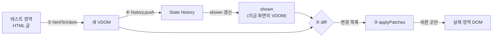

# sw-ai-week11-12
Mini React/Redis/RDBMS 구현 팀 레포지토리

## 팀 레포지토리 관리 방식
- 개인별 브랜치에서 작업 + README.md 작성
- 코드별로 대략적인 리뷰 후 브랜치 하나를 선정해서 main에다가 PR + merge
- 이 작업은 React에서 한번, Redis/RDBMS에서 한번으로 총 2번 이루어짐

## 팀 프로젝트 관리 방식
- 맨 왼쪽 탭은 전반적인 Kanban 보드로, 모든 팀원의 진행 상황이 표시됨
- 나머지 탭 3개는 개인별 스케줄 관리, 진행 상황은 Todo/In Progress/Done중 하나로 설정
  - 각자 입맛에 맞는 태그를 더 추가해서 넣어도 됩니다
- 개인별로 이슈를 프로젝트에 등록할 때 **Assignee를 자기 자신으로 꼭 설정**해주세요!

---

## 미니 리액트 Phase 1 — 종휘 (`feat-Jongeume`)

> [!NOTE]
> **한 줄 컨셉 : Virtual DOM 은 순수한 데이터, 실제 DOM 은 번호(path)로 찾는다.**
> 구조는 단순하게(객체 · 배열 · O(n) 순회), 대신 **정확성 우선** — 위치가 어긋나면 예외를 내고 되돌린다.

| 하고 싶은 것 | 방법 |
| --- | --- |
| 검증 페이지 열기 | `index.html` 더블클릭 (서버 필요 없음) |
| 단위 테스트 | `npm install` 한 번 → `npm test` |
| 설계 결정 · 엣지 케이스 전체 | [docs/phase1-design.md](docs/phase1-design.md) |
| Codex 교차 검증 기록 | [docs/codex-review-log.md](docs/codex-review-log.md) |

---

### 1. 한 바퀴 흐름 — Patch 버튼을 누르면



`app.js:36` `onPatch` 가 이 네 단계를 순서대로 부른다.

1. **읽기** — 테스트 영역의 HTML 글을 Virtual DOM 으로 만든다
2. **비교** — `shown`(지금 화면의 VDOM)과 새 VDOM 을 비교해 **변경 목록**을 만든다
3. **고치기** — 변경 목록대로 실제 영역에서 **바뀐 곳만** 고친다
4. **기록** — 새 VDOM 을 State History 에 넣고, `shown` 을 새 VDOM 으로 바꾼다

- 뒤로가기 · 앞으로가기(`app.js:59` `travel`)도 같다 : 기록의 VDOM 과 `shown` 을 비교 → 변경 목록 → 실제 영역 반영 → `shown` 을 그 VDOM 으로
- 페이지를 처음 열면 실제 영역을 VDOM 으로 읽고(`domToVdom`), 그 VDOM 대로 실제 영역을 한 번 다시 그려(`mount`) **둘의 모양을 1:1 로 맞춘다** (이유는 2.3)

---

### 2. 핵심 구조 — 무엇으로 적었나

#### 2.1 Virtual DOM 노드 `{ type, props, children }`

```js
// <p class="a">안녕</p>
{ type: 'p', props: { class: 'a' }, children: [
  { type: '#text', props: { nodeValue: '안녕' }, children: [] }
] }
```

- 실제 DOM 과 **같은 트리 모양** (부모 · 자식 · 순서)
- 글자 노드도 **같은 세 칸**이라, 비교 코드가 글자 · 요소를 한 방식으로 재귀한다
- 실제 DOM 노드를 **가리키지 않는 순수한 데이터**
	- DOM 없이 비교를 테스트할 수 있다
	- 기록에 넣을 때 깊은 복사만 하면 안전하다

#### 2.2 변경 목록 (patch) — 비교와 고치기 사이의 약속

```js
[ { type: 'TEXT',   path: [1, 0], value: '잘 가' },
  { type: 'REMOVE', path: [3] } ]
```

- 한 칸 = **무엇을 할지**(`type`) + **바꿀 위치**(`path`) (+ 필요한 재료)
- `type` 은 5종 : `CREATE` · `REMOVE` · `REPLACE` · `TEXT` · `PROPS`
	- 과제 중점 포인트 "최소 변경을 찾기 위한 5가지 핵심 케이스" 와 1:1
- `diff.js` 는 목록을 **만들기만**, `patch.js` 는 목록을 **쓰기만** 한다
	- 서로의 속을 몰라도 되고, 이 약속만 지키면 한쪽을 고쳐도 다른 쪽은 그대로다

#### 2.3 위치 `path` — 번호로 찾아가기

- `[1, 0]` = 루트의 두 번째 자식 → 그 노드의 첫 번째 자식 (번호는 0 부터)
- VDOM 과 실제 DOM 의 트리 모양이 같아서, **VDOM 에서 계산한 위치가 실제 DOM 에서도 같은 노드**다
- 대가 : 둘이 1:1 이어야 한다
	- 그래서 로드 때 `mount` 로 한 번 맞춘다 (실제 영역의 주석 · 들여쓰기 공백은 VDOM 에 없으므로)
	- 그래도 어긋나면 `findNode` 가 예외를 내고, 페이지가 잡아 이전 화면으로 되돌린다

#### 2.4 State History — 배열 + 현재 번호

- 처음 화면도 0 번에 저장 (11-09 팀 결정)
- 뒤로간 뒤 새로 Patch 하면 앞쪽 기록은 버린다 (브라우저 뒤로가기와 같은 규칙)
- 넣을 때 · 꺼낼 때 깊은 복사 → 밖에서 고쳐도 기록은 안 바뀐다
- 뒤로 · 앞으로 때 **`shown`(다음 비교의 기준)도 그 칸으로 옮긴다** — 공통 테스트 v2 의 P-15 가 검사하는 부분

---

### 3. 핵심 알고리즘 — 어떻게 비교하나

#### 3.1 Diff : 같은 자리끼리 나란히 내려가는 트리 비교 (`src/diff.js:15` `walk`)

위에서부터 보고, 걸리면 그 자리에서 끝낸다.

1. 이전 노드가 없다 → `CREATE`
2. 새 노드가 없다 → `REMOVE`
3. 태그가 다르다 → `REPLACE` (**그 아래는 더 비교하지 않는다**)
4. 둘 다 글자 → 내용이 다르면 `TEXT`
5. 같은 태그 → 속성 비교(`PROPS`) 후, 자식을 **같은 번호끼리** 재귀

- 자식 수가 다를 때 (`src/diff.js:45 ~ 53`)
	- 공통 개수까지 재귀
	- 새 쪽이 더 많으면 `CREATE` 를 **앞에서부터**
	- 옛 쪽이 더 많으면 `REMOVE` 를 **뒤에서부터** — 앞에서 지우면 뒤 번호가 당겨져 엉뚱한 노드를 지운다

| | 이 구현 (같은 자리끼리) | 최적 트리 비교 |
| --- | --- | --- |
| 시간 | **O(n)** | O(n³) 수준 |
| 변경 목록 | 최소가 아닐 수 있음 | 최소 |
| 고른 이유 | 실제 React 도 같은 가정(태그가 다르면 통째로, 자식은 순서대로)을 쓴다. 화면은 대부분 조금씩 바뀌어 충분하다 | — |

#### 3.2 Patch : 목록을 앞에서부터 차례로 (`src/patch.js:26`)

- 칸마다 `path` 를 따라 내려가(`findNode`) 그 노드만 고친다
- 새 노드는 `render` 가 `createElement` 로 만든다 — **`innerHTML` 을 쓰지 않는다**
	- 글자가 HTML 로 해석되지 않는다 (XSS 방지)
	- SVG 같은 이름공간을 지킨다

#### 3.3 왜 VDOM 을 거치나 (이 구조 전체의 이유)

| 얻는 것 | 내주는 것 |
| --- | --- |
| 실제 DOM 은 **바뀐 곳만** 건드린다 (화면 재계산이 줄어든다) | 트리 두 벌을 메모리에 둔다 |
| 입력 중이던 값 · 포커스가 날아가지 않는다 | 매번 O(n) 비교를 한다 |
| 개발자는 "최종 화면 모양" 만 적으면 된다 | 바뀐 곳을 정확히 알고 손으로 고치는 코드보다는 느리다 |

---

### 4. 모듈 구성

| 파일 | 책임 | 크기 |
| --- | --- | --- |
| `src/vdom.js` | DOM ↔ VDOM 변환, `render`, `setProp`, `toHtml`, `h()` | 280 줄 |
| `src/diff.js` | 두 VDOM → 변경 목록 | 100 줄 |
| `src/patch.js` | 변경 목록 → 실제 DOM, `mount` | 124 줄 |
| `src/history.js` | State History | 41 줄 |
| `app.js` · `index.html` · `style.css` | 검증 페이지 (Phase 1 전용) | — |

- 의존 방향은 한쪽 : `patch` · `history` → `vdom`, `diff` 는 아무것도 안 부른다 (VDOM 객체만 받음), `app` → 전부
- 모듈은 `window.MiniReact` 하나에 모인다 (`<script>` 태그, 빌드 · 서버 없음). Node 테스트에서는 `require` 로도 불린다

---

### 5. 검증

| 무엇 | 결과 |
| --- | --- |
| 단위 테스트 (`npm test`, jsdom) | 72 개 통과 (`npm test` 집계는 73 — `test/helpers.js` 가 하나로 세짐) |
| 팀 공통 테스트 v2 | 55 개 중 필수 50 통과 · 실패 0, 선택 5 도 통과 |
| Codex 교차 검증 (읽기 전용 5 회) | 엣지 케이스 21 개 발견 → 18 개 수정, 3 개는 범위 밖 ([기록](docs/codex-review-log.md)) |
| 가장 강한 증거 | 무작위 트리 500 쌍 : patch 결과를 다시 읽으면 새 VDOM 과 같다 |

---

### 6. 병합 기준으로 본 분석

#### 6.1 확장성

| 강점 | 약점 |
| --- | --- |
| Phase 2 에서 **diff · patch · render 를 그대로** 쓸 수 있다 (입력이 VDOM 이기만 하면 된다) | `key` 비교가 없다 → 목록 맨 앞 삽입 · 순서 바꾸기에서 변경 목록이 늘어난다 (결과는 맞음) |
| `h(type, props, ...children)` 로 VDOM 을 코드에서 바로 만들 수 있다 (컴포넌트가 쓸 자리) | 이벤트 함수 속성(`onClick` 등)은 `setProp` 에 준비만 돼 있고, 컴포넌트와 연결은 안 해 봤다 |
| 변경 목록이 약속 역할을 해서, `key` · `MOVE` 를 넣어도 고칠 곳이 `diff.js` 와 `applyPatches` 의 한 갈래로 모인다 | |

#### 6.2 유지보수성

| 강점 | 약점 |
| --- | --- |
| 파일 하나 = 책임 하나, 의존이 한 방향 | 엣지 케이스(이름공간 · 폼 상태 · `<template>`) 처리가 `vdom.js` · `patch.js` 곳곳에 흩어져 있다 |
| 함수마다 한 줄 주석, "왜" 는 `docs/phase1-design.md` 에 모음 | `path` 방식이라 실제 DOM 을 다른 코드가 몰래 바꾸면 위치가 어긋난다 (그때는 예외 → 되돌리기) |
| 단위 테스트 72 개 + 공통 테스트가 고친 뒤 회귀를 잡아 준다 | |

#### 6.3 설계 복잡도

| 낮은 곳 | 높은 곳 |
| --- | --- |
| 핵심 자료구조가 객체 · 배열뿐, 알고리즘은 O(n) 재귀 하나 | `vdom.js` 가 280 줄 — 핵심(변환 · render)보다 엣지 케이스 처리가 더 길다 |
| 비교 분기가 5 갈래로 고정 | 실제 DOM 과 VDOM 을 1:1 로 맞추는 규칙(공백 · 주석 버리기, 로드 때 `mount`)을 알아야 `path` 가 이해된다 |

#### 6.4 팀 이해도

| 쉬운 곳 | 설명이 필요한 곳 |
| --- | --- |
| 큰 흐름이 `onPatch` 네 줄로 보인다 | "왜 노드 참조 대신 번호(`path`)인가" — 2.3 |
| 변경 목록 5 종이 과제 중점 포인트 5 케이스와 같다 | "왜 REMOVE 는 뒤에서부터인가" — 3.1 |
| 엣지 케이스 함수는 처음엔 건너뛰어도 흐름 이해에 지장 없다 | `shown` 이 "지금 화면의 VDOM" 이라는 것 — 1, 2.4 |

---

### 7. Phase 2 와 연결하면

| | Phase 1 | Phase 2 |
| --- | --- | --- |
| 새 VDOM 을 만드는 곳 | 테스트 영역 HTML 읽기 (`htmlToVdom`) | 컴포넌트 함수가 `h()` 로 만든다 |
| 비교 · 반영 | `diff` · `applyPatches` | **그대로** |
| 이전 VDOM | `shown` | 지난번에 그린 VDOM (같은 자리) |
| State History · 테스트 영역 · 버튼 | `history.js` · `app.js` | 쓰지 않는다 |

---

### 8. 알려진 한계

- `key` 비교 없음 (6.1)
- 줄바꿈이 든 공백만 있는 글자는 버린다 → `</label>\n<button>` 사이 공백이 화면에서도 사라진다 (같은 줄에 쓰면 남는다)
- MathML 의 드문 경우 · `<plaintext>` 는 범위 밖
- 실제 영역에서 사용자가 직접 바꾼 입력값 · 체크는 VDOM 에 없다 (Phase 2 에서 state 로 다룰 부분)

---

### 9. 리뷰 때 열어 볼 곳

| 순서 | 파일 : 줄 | 볼 것 |
| --- | --- | --- |
| 1 | `app.js:36` `onPatch` | 읽기 → 비교 → 고치기 → 기록 |
| 2 | `src/diff.js:15` `walk` | 분기 5 갈래의 순서 |
| 3 | `src/diff.js:45 ~ 53` | 자식 비교, REMOVE 를 뒤에서부터 |
| 4 | `src/patch.js:8` · `:26` | `findNode` 로 찾아가 고치기 |
| 5 | `src/vdom.js:44` · `:64` | DOM → VDOM (주석 · 들여쓰기 공백 버리기) |
| 6 | `app.js:59` · `src/history.js:8` | 뒤로 · 앞으로와 `shown` |
