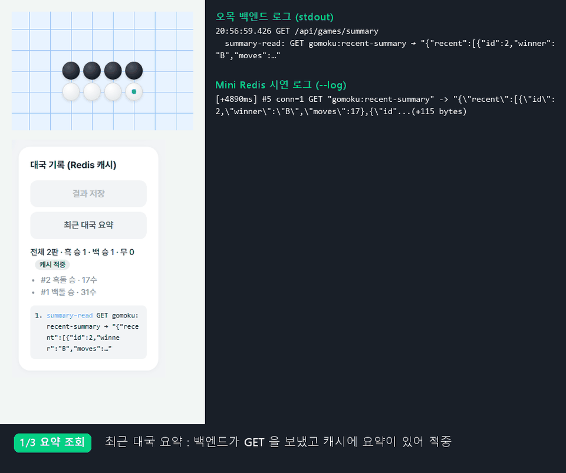

# Mini Redis

C11로 만든 인메모리 키-값 서버입니다. 외부 앱은 TCP 위의 RESP2 명령으로 값을 저장·조회·삭제하고 TTL을 지정합니다. 해시 테이블, 만료 처리, 이벤트 루프, 영속성(RDB 방식의 스냅샷, AOF)을 직접 구현했습니다.

이 문서는 4분 발표 순서로 구성했습니다. 빌드와 재현 명령은 맨 아래 [부록](#부록--빌드와-재현-명령)에 있습니다.

| 순서 | 시간 | 내용 |
| --- | ---: | --- |
| [1. 구조와 기능](#1-구조와-기능) | 40초 | TCP/RESP2 인터페이스, 지원 명령, 요청 처리 흐름 |
| [2. 중점 포인트별 처리 방식](#2-중점-포인트별-처리-방식) | 85초 | 동시성 실행 단위와 카운터 갱신 유실, TTL 조회·주기 회수, `DEL` 무효화 |
| [3. 장애 복구](#3-장애-복구) | 50초 | RDB 방식의 스냅샷과 AOF, 강제 종료 뒤 재시작 결과, 동기화 정책 |
| [4. 시연 장면](#4-시연-장면) | 30초 | 오목 앱의 요약 캐시와 무효화, 책임 경계 |
| [5. 검증 요약 및 한계](#5-검증-요약-및-한계) | 35초 | 테스트 결과, 보장 범위, 확인한 복구 범위 |

## 1. 구조와 기능

외부 앱은 `127.0.0.1:6379`에 TCP로 연결하고 RESP2 배열로 명령을 보냅니다. `redis-cli`나 Redis 클라이언트 라이브러리를 그대로 사용할 수 있습니다.

| 명령 | 응답 |
| --- | --- |
| `SET key value [EX 초 \| PX 밀리초]` | `OK`. 같은 키에 다시 쓰면 값과 TTL을 모두 바꿉니다. |
| `GET key` | 값. 키가 없거나 만료됐으면 `(nil)`입니다. |
| `DEL key [key ...]` | 실제로 지운 키 수 |
| `EXPIRE key 초`, `PEXPIRE key 밀리초` | TTL을 바꾸면 `1`, 키가 없으면 `0`. 0 이하는 즉시 삭제합니다. |
| `PTTL key` | 남은 밀리초. TTL이 없으면 `-1`, 키가 없으면 `-2`입니다. |
| `PING [message]` | `PONG` 또는 받은 메시지 |
| `SAVE` | 스냅샷 모드에서 지금 상태를 파일에 저장하고 `OK`를 반환합니다. |

키와 값은 바이트열과 길이로 다루므로 빈 값과 NUL이 포함된 값도 저장합니다. 인자는 최대 1 MiB, 명령당 인자는 최대 16개입니다.

```text
요청 수신        RESP 파싱          명령 실행             해시 테이블              응답
read_client  →  resp_parse   →  execute_command  →  store_set / store_get  →  queue_reply → write_client
(server.c)      (resp.c)        (commands.c)         (store.c)                (server.c)
```

- [`server.c`](src/server.c)의 `run_loop`가 `poll`(Windows는 `WSAPoll`) 하나로 서버 소켓과 모든 연결을 감시합니다.
- [`store.c`](src/store.c)는 FNV-1a 해시와 체이닝을 사용합니다. 부하율 75%에서 두 배 크기 테이블을 만들고 `rehash_step`으로 조금씩 옮깁니다.
- 저장소는 시계를 직접 읽지 않습니다. 명령마다 `net_now_ms`의 단조 시각을 받아 만료를 판정합니다.

## 2. 중점 포인트별 처리 방식

아래 로그는 `--log` 옵션의 실제 출력입니다.

- `EXEC`는 명령을 실행하고 응답을 출력 버퍼에 넣은 시점입니다.
- `SENT`는 그 응답을 소켓에 모두 쓴 시점입니다.
- `#번호`는 서버가 명령을 실행한 순번이고, `conn`은 접속 순서대로 붙인 연결 ID입니다.

### 2-1. 동시성 : 실행 단위는 명령 하나입니다

- 스레드는 하나입니다. `run_loop`가 연결마다 소켓 준비 상태를 확인하고, `process_input`이 연결당 명령을 한 번에 하나만 실행합니다.
- 공유 해시 테이블을 바꾸는 `execute_command`가 끝나야 다음 명령이 시작됩니다. 따라서 락이 없어도 명령 하나는 원자적입니다.
- 여러 명령에 걸친 작업은 원자적이지 않습니다. 두 연결이 `GET` 뒤 `SET`을 나눠 보내면 그 사이에 다른 연결의 명령이 실행됩니다.

별도 TCP 연결 A, B로 `A GET → B GET → A SET 1 → B SET 1` 순서를 만든 결과입니다(`python examples/demo.py lost-update`).

```text
[A] GET counter   -> "0"
[B] GET counter   -> "0"
[A] SET counter 1 -> OK
[B] SET counter 1 -> OK
[A] GET counter   -> "1"          두 클라이언트가 각각 +1 했지만 최종값은 "1"

[+     15ms] EXEC #2 conn=1 GET "counter" -> "0" | reply queued in output buffer (7 bytes)
[+     15ms] EXEC #3 conn=2 GET "counter" -> "0" | reply queued in output buffer (7 bytes)
[+     15ms] EXEC #4 conn=1 SET "counter" "1" -> OK | reply queued in output buffer (5 bytes)
[+     15ms] EXEC #5 conn=2 SET "counter" "1" -> OK | reply queued in output buffer (5 bytes)
```

- 순번 #2~#5는 하나씩 순서대로 실행됐습니다. 그래도 갱신 하나가 사라졌습니다.
- 개별 명령의 공유 상태 처리는 기존 통합 테스트가 검증합니다. 연결 12개가 동시에 같은 키에 `DEL`을 보내면 응답은 `1` 한 건, `0` 열한 건입니다.
- 읽고 더하고 쓰는 과정을 서버 안의 명령 하나로 옮기는 `INCR`이 이 문제를 해결하는 확장입니다. 이번 범위에서는 구현하지 않았습니다.

### 2-2. 데이터 만료 : 조회 시 회수와 주기 회수

| 경로 | 언제 | 코드 |
| --- | --- | --- |
| 조회 시 만료 | 명령이 키에 접근할 때 만료 시각이 지났으면 지우고 `(nil)`을 반환합니다. | `store.c`의 `find_live` |
| 주기 정리 | 100ms마다 만료 리스트의 커서부터 **최대 32개**를 검사해 지난 항목을 지웁니다. 커서는 다음 호출에서 이어서 돕니다. | `store.c`의 `store_maintain`, `server.c`의 `run_loop` |

조회 시 만료는 주기 정리를 끈 서버(`--expire-cycle-ms 0`)에서 확인해 두 경로가 섞이지 않게 했습니다(`python examples/demo.py expire`).

```text
조회 시 만료
[+      0ms] EXEC #1 conn=1 SET "session:lazy" "v" "PX" "100" -> OK
[+    297ms] EXPIRE on-access key="session:lazy" (found expired inside #2 conn=1, removed)
[+    297ms] EXEC #2 conn=1 GET "session:lazy" -> (nil)

주기 정리 (cache:ghost 는 아무도 조회하지 않음)
[+     16ms] EXEC #1 conn=1 SET "cache:ghost" "v" "PX" "100" -> OK
[+     16ms] EXEC #2 conn=1 SET "cache:alive" "v" "EX" "60" -> OK
[+    125ms] EXPIRE by-cycle  key="cache:ghost" (nobody read it, removed by active expiry)
[+    125ms] CYCLE checked 2 of 2 TTL keys from cursor (limit 32), removed 1
```

저장소 단위 테스트는 시각을 직접 넘겨 두 경로를 따로 검증합니다. TTL 키 40개 중 첫 호출이 32개만 검사하고, 다음 호출이 커서에서 이어 가는 것도 확인합니다.

### 2-3. 데이터 무효화 : TTL이 남은 키의 `DEL`

```text
[+     16ms] EXEC #1 conn=1 SET "cache:report" "v1" "EX" "30" -> OK
[+     16ms] EXEC #2 conn=1 PTTL "cache:report" -> (integer) 30000
[+     16ms] EXEC #3 conn=1 DEL "cache:report" -> (integer) 1
[+     16ms] EXEC #4 conn=1 GET "cache:report" -> (nil)
```

`DEL`은 TTL이 30초 남은 항목을 `remove_entry`로 즉시 제거하고, 지운 수 `1`을 반환합니다. 다음 `GET`은 `(nil)`을 반환합니다.

## 3. 장애 복구

| 방식 | 기록하는 것 | 재시작 시 | 강제 종료 시 잃는 범위 |
| --- | --- | --- | --- |
| RDB 방식의 스냅샷 (`--snapshot FILE`) | `SAVE` 시점의 키·값·만료 시각 전체 | 파일을 읽어 채웁니다. | 마지막 `SAVE` 이후의 모든 변경 |
| AOF (`--aof FILE`) | 상태를 바꾼 연산(`SET`, `DEL`, `PEXPIREAT`)을 실행 순서대로 | 처음부터 재생합니다. | 동기화 정책에 따라 다릅니다. |

- 만료 시각은 두 방식 모두 Unix ms 절대 시각으로 저장합니다. 서버가 꺼져 있던 시간도 TTL에서 빠지므로 TTL이 처음부터 다시 시작되지 않습니다.
- 스냅샷은 자체 형식입니다. `파일.tmp`에 끝까지 쓰고 fsync한 뒤에만 원래 이름으로 교체합니다. 쓰는 도중 종료되면 마지막 완성본이 그대로 남습니다. 체크섬이 맞지 않는 파일로는 시작하지 않습니다.
- AOF는 명령을 실행한 직후, 응답을 출력 버퍼에 넣기 전에 기록합니다. 마지막 레코드가 쓰다 만 상태이면 그 부분만 잘라 내고, 중간이 깨졌으면 시작하지 않습니다.

| `--appendfsync` | 동작 | 쓰기·동기화 실패 시 |
| --- | --- | --- |
| `always` | 레코드마다 write와 fsync가 끝난 뒤 응답합니다. | 응답하지 않고 서버를 종료합니다. 클라이언트는 연결 끊김으로 결과를 알 수 없음을 확인하고, 재시작 후 상태는 디스크 기준입니다. |
| `everysec` (기본) | write 뒤 바로 응답하고 fsync는 약 1초마다 합니다. | write 실패는 `always`와 같습니다. 주기 fsync가 실패하면 서버를 종료합니다. |
| `no` | fsync를 운영체제에 맡깁니다. | write 실패는 `always`와 같습니다. |

`v1 저장 → 기준 시점 → v2 갱신 → 강제 종료 → 2초 뒤 재시작 → GET` 결과입니다(`python examples/demo.py recovery-snapshot`, `recovery-aof`).

- 강제 종료 조건 : `process.kill()`(Windows `TerminateProcess`)로 정상 종료 처리 없이 끝냈습니다.
- 동기화 정책 : AOF는 `--appendfsync always`로 실행했습니다.

| 확인 | 스냅샷 | AOF (always) |
| --- | --- | --- |
| `GET user:1` | `"v1"` (`SAVE` 이후의 v2는 잃음) | `"v2"` |
| `SET temp` 뒤 `DEL temp` 한 키 | `(nil)` | `(nil)` |
| `PX 1500`으로 저장한 `short` (꺼져 있던 2초 동안 만료) | `(nil)` | `(nil)` |
| `PX 10000`으로 저장한 `long`의 `PTTL` | `7972` | `7937` |

```text
재시작 전 (AOF)
[+      0ms] AOF  #1 append SET "user:1" (33 bytes, appendfsync=always, fsync done before reply)
[+      0ms] EXEC #1 conn=1 SET "user:1" "v1" -> OK | reply queued in output buffer (5 bytes)
[+     16ms] AOF  #3 append DEL "temp" (23 bytes, appendfsync=always, fsync done before reply)
[+     16ms] AOF  #6 append SET "user:1" (33 bytes, appendfsync=always, fsync done before reply)

재시작 후 (AOF)
[+      0ms] LOAD aof demo-output\appendonly.aof: 6 records applied, 1 skipped as expired during downtime, 0 bytes of incomplete tail truncated, appendfsync=always
[+     31ms] EXEC #1 conn=1 GET "user:1" -> "v2" | reply queued in output buffer (8 bytes)

AOF 파일 내용 (레코드 하나를 한 줄로, CRLF 생략)
*3 $3 SET $6 user:1 $2 v1
*2 $3 DEL $4 temp
*5 $3 SET $5 short $1 s $4 PXAT $13 1794829972985
*3 $3 SET $6 user:1 $2 v2
```

## 4. 시연 장면

기존 오목 앱([Jongeume/mini-react](https://github.com/Jongeume/mini-react))에 대국 결과 저장과 최근 대국 요약 조회를 붙였습니다.

```text
오목 화면  →  HTTP/JSON  →  오목 백엔드(Node)  →  TCP/RESP2  →  Mini Redis
                            원본 대국 기록(JSON 파일)           요약 캐시 gomoku:recent-summary
```



| 장면 | 백엔드가 보낸 명령 → 실제 응답 |
| --- | --- |
| 1. 요약 조회 | `GET gomoku:recent-summary` → 요약 JSON (캐시 적중) |
| 2. 새 결과 저장 | 원본 저장 성공 뒤 `DEL gomoku:recent-summary` → `(integer) 1` |
| 3. 요약 다시 조회 | `GET` → `(nil)`, 원본으로 새 요약을 만들어 `SET … EX 30` → `OK`. 전체 2판이 3판으로 바뀝니다. |

```text
백엔드 로그 (GIF를 녹화한 실행)
20:57:00.324 POST /api/games 원본 저장 성공 id=3
20:57:00.326 POST /api/games reason=invalidate-after-save cmd="DEL gomoku:recent-summary" reply=(integer) 1
20:57:00.649 GET /api/games/summary reason=summary-read cmd="GET gomoku:recent-summary" reply=(nil)
20:57:00.650 GET /api/games/summary reason=cache-fill cmd="SET gomoku:recent-summary {"recent":[{"id":3,"winner":"B… EX 30" reply=OK
```

책임 경계는 다음과 같습니다.

- 앱(오목 백엔드)이 판단합니다. 원본 기록을 관리하고, 원본 저장이 성공했을 때만 캐시를 무효화합니다. 무엇을 캐시하고 언제 지울지는 앱이 정합니다.
- Mini Redis는 받은 명령을 실행합니다. 데이터의 의미는 알지 못하며, 명령 하나의 원자성과 TTL 만료를 보장합니다.

전체 로그는 [`docs/backend.log`](docs/backend.log), [`docs/mini-redis.log`](docs/mini-redis.log)에 있습니다.

## 5. 검증 요약 및 한계

| 테스트 | 명령 | 결과 |
| --- | --- | --- |
| 저장소 단위 (기존 4 + 추가 3) | `mingw32-make test` | 7개 시나리오 통과 |
| RESP 파싱 단위 (기존) | `mingw32-make test` | 3개 시나리오 통과 |
| 영속성 단위 (추가) | `mingw32-make test` | 6개 시나리오 통과 |
| 통합 (기존) | `python tests/test_integration.py -v` | 7건 통과 |
| 발표 장면 통합 (추가) | `python tests/test_scenarios.py -v` | 13건 통과 (연속 3회 실행) |
| 오목 백엔드·화면 (mini-react) | `npm test` | 663건 통과 (기존 644 + 추가 19) |

추가 테스트가 확인하는 항목입니다.

- 카운터 갱신 유실의 실행 순번과 연결 ID
- 조회 시 만료와 주기 정리의 구분, 주기 정리의 32개 검사 한도
- TTL이 남은 키의 `DEL` 무효화
- 스냅샷·AOF 강제 종료 복구, 삭제한 키가 되살아나지 않는지, 중단 중 만료
- AOF 불완전한 마지막 레코드, AOF 쓰기 실패(장애 주입), 스냅샷 쓰기 도중 종료(장애 주입)

보장 범위와 한계입니다.

- 원자성은 명령 한 건까지입니다. `GET` 뒤 `SET`처럼 여러 명령에 걸친 작업은 앱이 책임집니다.
- 만료된 키는 조회하면 항상 `(nil)`입니다. 조회하지 않은 만료 키가 메모리에서 회수되는 시점은 TTL 키 수에 따라 늦어질 수 있습니다.
- 스냅샷은 마지막 `SAVE` 이후의 변경을 잃습니다. 마지막 `SAVE` 뒤에 지운 키는 재시작 후 다시 나타납니다(`test_snapshot_loses_delete_after_last_save`).
- 복구 실험은 프로세스 강제 종료만 확인했습니다. 운영체제나 전원 장애에서 `everysec`, `no` 정책의 손실 범위는 측정하지 않았습니다.
- `SAVE`는 단일 스레드에서 실행되므로 저장하는 동안 다른 명령이 멈춥니다. 자동 저장 주기와 AOF 재작성(rewrite)은 구현하지 않았습니다.
- `INCR`, `DECR`, `SET NX`, 오목 로비 동시 입장은 이번 범위에서 제외했습니다.
- 인증, TLS, 전체 메모리 상한은 제공하지 않습니다.

### `/v1/report` 예제 성능 (기존 예제)

| 조건 | 값 |
| --- | --- |
| 측정 | `examples/benchmark.ps1 -Requests 30`, 모드마다 30회 번갈아 요청, PowerShell `Invoke-WebRequest` |
| 환경 | Windows 10, 같은 PC의 루프백, Mini Redis 기본 옵션(로그·영속성 꺼짐), `report-api` 기본 옵션 |
| 원본 조회 | 예제 코드의 고정 50ms 지연 포함 |
| 캐시 미사용 중앙값 | 77.28 ms |
| 캐시 적중 중앙값 | 21.45 ms |

HTTP 왕복과 PowerShell 요청 비용이 포함된 값입니다. 오목 앱의 성능은 측정하지 않았습니다.

## 부록 : 빌드와 재현 명령

Windows PowerShell에서 MinGW-w64의 `gcc`, `mingw32-make`와 Python 3을 사용합니다. POSIX에서는 `make`와 `./mini-redis`를 사용합니다.

```powershell
mingw32-make                      # mini-redis.exe, report-api.exe
mingw32-make test                 # 저장소 · RESP · 영속성 단위 테스트
python tests/test_integration.py -v
python tests/test_scenarios.py -v
python examples/demo.py all       # 발표 장면 재현. 로그는 demo-output/ 에 저장됩니다.
```

| 서버 옵션 | 뜻 |
| --- | --- |
| `--bind IPv4`, `--port PORT` | 수신 주소. 기본 `127.0.0.1:6379`, `0`이면 임의 포트입니다. |
| `--log FILE` 또는 `--log -` | 시연 로그를 파일 또는 표준 오류로 기록합니다. 기본은 꺼짐입니다. |
| `--expire-cycle-ms MS` | 주기 정리 간격. 기본 100, `0`이면 주기 정리를 끕니다. |
| `--snapshot FILE` | RDB 방식의 스냅샷 모드. `SAVE`로 저장하고 시작할 때 복원합니다. |
| `--aof FILE`, `--appendfsync always\|everysec\|no` | AOF 모드. `--snapshot`과 함께 쓸 수 없습니다. |
| `--debug-aof-fail-at N`, `--debug-snapshot-crash-after N` | 시험용 장애 주입. N번째 AOF 기록을 실패시키거나, 스냅샷 항목 N개를 쓴 직후 종료합니다. |

오목 시연은 [Jongeume/mini-react](https://github.com/Jongeume/mini-react)의 `feat/gomoku-redis-backend` 브랜치에서 실행합니다.

```powershell
.\mini-redis.exe                                   # 이 저장소
node backend/gomoku-api.js --redis-port 6379       # mini-react 저장소, http://127.0.0.1:8090/
npm test                                           # mini-react 저장소, 백엔드 테스트는 ../mini-redis/mini-redis.exe 사용
node docs/demo/record-redis.mjs; python docs/demo/make_redis_gif.py   # GIF 다시 만들기
```

참고 자료 : [Redis 실행 모델](https://redis.io/docs/latest/operate/oss_and_stack/management/optimization/latency/), [RESP 사양](https://redis.io/docs/latest/develop/reference/protocol-spec/), [Redis 만료 처리](https://redis.io/docs/latest/commands/expire/), [Redis 영속성](https://redis.io/docs/latest/operate/oss_and_stack/management/persistence/)
