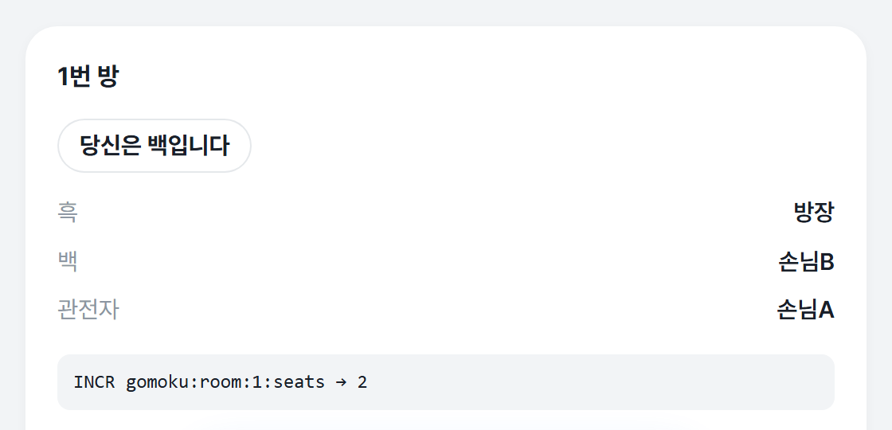
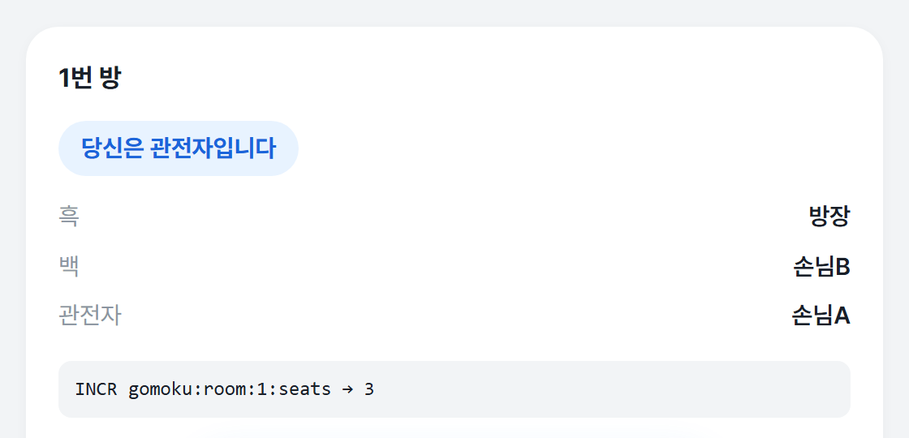
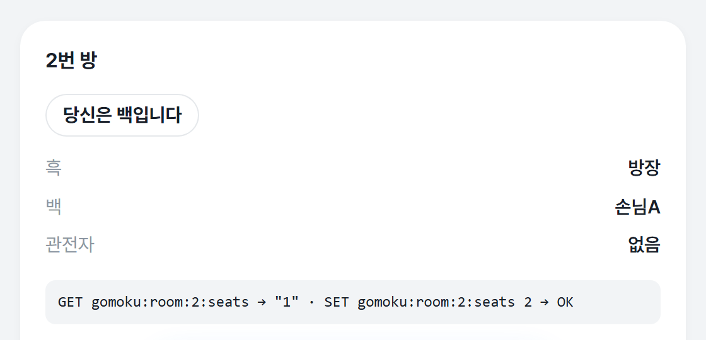
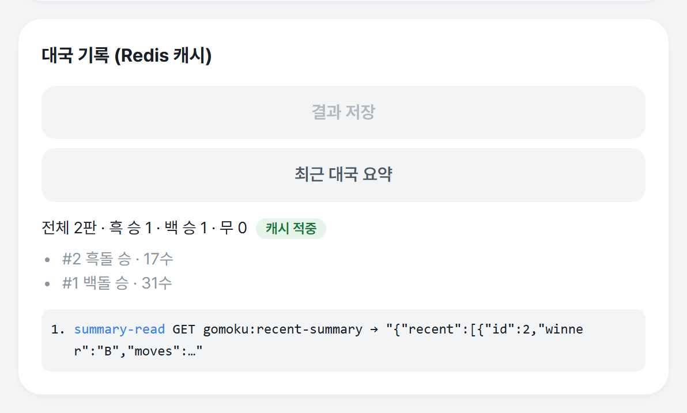
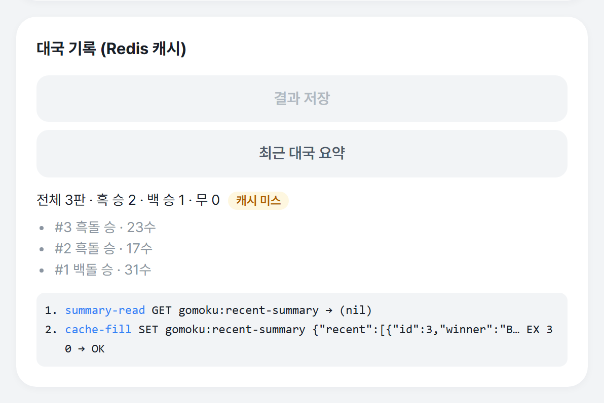

<div align="center">


<br>

**"해시 테이블로 키-값 서버를 직접 만들고, 고려한 상황마다 무엇을 얻고 무엇을 내주는지 따져서 골랐습니다"**

<p>
  
  
  
  
</p>

<sub>크래프톤 정글 · Mini Redis 구현 과제</sub><br>
<sub>서버는 C11 표준 라이브러리와 운영체제 소켓만 사용합니다. SipHash 참조 구현 한 파일을 가져왔습니다.</sub>

[실행](#-실행-방법) · [요구사항](#-과제-요구사항과-충족한-곳) · [구조](#-구조) · [외부 API](#-외부-api) · [해시 테이블](#%EF%B8%8F-해시-테이블) · [설계 결정](#%EF%B8%8F-설계-결정) · [시연](#-시연) · [검증](#-검증) · [한계](#-한계) · [문서](#-문서)

</div>

<br>

## 🚀 실행 방법

Mini Redis 서버를 켜 두고, 다른 애플리케이션이 TCP로 연결해 키-값 저장소로 쓰는 순서입니다.

### 1. 빌드

```powershell
mingw32-make          # Windows, MinGW-w64의 gcc. mini-redis.exe가 생깁니다
```

POSIX에서는 `make`로 빌드하고 `./mini-redis`로 실행합니다.

### 2. 서버 켜기

```powershell
.\mini-redis.exe                                # 127.0.0.1:6379에서 연결을 받습니다
.\mini-redis.exe --port 7000 --aof data.aof     # 포트를 바꾸고, 재시작해도 데이터가 남게 합니다
```

`Mini Redis listening on 127.0.0.1:6379`가 출력되면 연결을 받을 준비가 된 것입니다.

| 서버 옵션 | 뜻 |
|---|---|
| `--bind IPv4`, `--port PORT` | 수신 주소. 기본 `127.0.0.1:6379`, `0`이면 임의 포트 |
| `--aof FILE`, `--appendfsync always\|everysec\|no` | 쓰기 명령을 파일에 기록하고 시작할 때 재생합니다 |
| `--snapshot FILE` | `SAVE` 명령으로 전체를 저장하고 시작할 때 복원합니다. `--aof`와 함께 쓸 수 없습니다 |
| `--expire-cycle-ms MS` | 만료된 키를 정리하는 주기. 기본 100, `0`이면 끔 |
| `--log FILE` 또는 `--log -` | 받은 명령과 응답을 파일 또는 표준 오류로 기록. 기본은 꺼짐 |

### 3. 애플리케이션에서 연결하기

RESP2를 쓰는 Redis 클라이언트 라이브러리로 연결합니다. 아래는 파이썬 `redis-py` 8.1.0으로 실행해 확인한 예시입니다.

```python
import redis

r = redis.Redis(host="127.0.0.1", port=6379, protocol=2, decode_responses=True)

r.set("session:42", "kim", ex=30)            # 캐시 저장. 30초 뒤 만료됩니다
print(r.get("session:42"))                   # kim
print(r.pttl("session:42"))                  # 남은 밀리초. 예: 30000
print(r.execute_command("INCR", "visits"))   # 1. 동시에 보내도 번호가 겹치지 않습니다
print(r.delete("session:42"))                # 1. 원본이 바뀌면 캐시를 지웁니다
print(r.get("session:42"))                   # None
```

Node.js는 `redis`(node-redis) 6.3.1에서 아래 옵션으로 확인했습니다.

```js
import { createClient } from 'redis';

const client = createClient({
  url: 'redis://127.0.0.1:6379',
  RESP: 2,
  disableClientInfo: true,
  maintNotifications: 'disabled',
});
await client.connect();
await client.set('session:42', 'kim', { EX: 30 });
console.log(await client.get('session:42'));   // kim
console.log(await client.incr('visits'));      // 1
```

| 연결할 때 알아 둘 것 | 이유 |
|---|---|
| 클라이언트를 RESP2로 설정합니다 | `HELLO`, `CLIENT`처럼 구현하지 않은 명령에는 `ERR unknown command`로 답합니다 |
| `redis-py`의 `incr()` 대신 `execute_command("INCR", key)`를 씁니다 | `incr()`은 `INCRBY`를 보내는데 `INCRBY`는 구현하지 않았습니다 |
| `ioredis` 6.0.0은 기본 설정으로 연결하지 못했습니다 | 연결할 때 `HELLO 3`을 보냅니다 |
| 같은 PC의 앱에서 씁니다 | 인증과 TLS가 없어 기본 수신 주소가 `127.0.0.1`입니다 |

쓸 수 있는 명령 전체는 [외부 API](#-외부-api)에 있습니다.

<br>

## 🎯 과제 요구사항과 충족한 곳

| 구분 | 요구사항 | 충족한 방법 | 위치 |
|:---:|---|---|---|
| 필수 | 해시 테이블 기반 키-값 저장소 | 버킷 배열과 연결 리스트(체이닝)를 직접 구현 | [해시 테이블](#%EF%B8%8F-해시-테이블) |
| 필수 | 외부에서 사용할 수 있는 API | TCP 위의 RESP2 명령. 기존 Redis 클라이언트 라이브러리로 연결 | [외부 API](#-외부-api) |
| 중점 | 동시성 문제가 생기지 않는 구조 | 단일 스레드 이벤트 루프, 복합 작업은 `INCR` | [결정 1](#1-동시성) |
| 중점 | 만료된 값을 요청받았을 때의 처리 | 조회 시 만료와 주기 정리 | [결정 2](#2-데이터-만료) |
| 중점 | 저장된 데이터의 무효화 | `DEL`로 즉시 삭제, TTL은 안전망 | [결정 3](#3-데이터-무효화) |
| 선택 | 서버가 다운돼도 데이터 유지 | RDB 방식의 스냅샷과 AOF | [결정 4](#4-장애-복구-선택-항목) |
| 품질 | 저장 · 조회 · 삭제 단위 테스트 | 저장소 단위 테스트 10개 | [검증](#-검증) |
| 품질 | API 응답을 Mini Redis에 저장해 활용 | 리포트 API, 오목 테스트 페이지의 요약 캐시 | [시연](#-시연) |
| 품질 | 엣지 케이스 | 없는 키, 같은 키 다시 저장, 만료된 키 | [검증](#엣지-케이스) |
| 품질 | 사용 전후 성능 비교 | 처리량, 지연 시간 분포, 적중률 | [검증](#성능-비교) |

<br>

## 🧱 구조

요청 한 건은 네 계층을 순서대로 지나갑니다. 디스크 계층은 명령 계층이 넘긴 변경 내용을 기록합니다.

```text
외부 앱 ── TCP / RESP2 ──▶ 네트워크 ──▶ 프로토콜 ──▶ 명령 ──▶ 저장소
                           server.c     resp.c      commands.c  store.c
                           net.c                        │       siphash.c
                                                        ▼
                                                      디스크
                                                      persist.c
```

| 계층 | 파일 | 역할 |
|---|---|---|
| 네트워크 | [`server.c`](src/server.c), [`net.c`](src/net.c) | `poll` 루프, 연결별 입출력 버퍼 |
| 프로토콜 | [`resp.c`](src/resp.c) | 바이트 버퍼를 인자 배열로 파싱 |
| 명령 | [`commands.c`](src/commands.c) | 명령 이름으로 분기해 저장소 함수를 호출 |
| 저장소 | [`store.c`](src/store.c), [`siphash.c`](src/siphash.c) | 해시 테이블, 만료 리스트 |
| 디스크 | [`persist.c`](src/persist.c) | 스냅샷 저장 · 복원, AOF 기록 · 재생 |

<br>

## 🔌 외부 API

> **질문** 외부 앱이 Mini Redis를 쉽게 쓰려면 어떤 형태의 API가 좋은가?

| 선택지 | 얻는 것 | 내주는 것 |
|---|---|---|
| **TCP 위의 RESP2** (선택) | 언어별 Redis 클라이언트 라이브러리를 RESP2 설정으로 사용합니다. 길이를 앞에 적는 형식이라 NUL이 든 값도 전달합니다 | 파서와 연결 관리를 직접 구현해야 합니다 |
| HTTP와 JSON | 브라우저와 `curl`로 바로 호출합니다 | 요청마다 머리말 비용이 붙고, 바이너리 값은 인코딩이 필요합니다 |
| 라이브러리 함수 호출 | 네트워크 비용이 없습니다 | 같은 프로세스, 같은 언어에서만 쓸 수 있습니다 |

| 명령 | 응답 |
|---|---|
| `SET key value [EX 초 \| PX 밀리초]` | `OK`. 같은 키에 다시 쓰면 값과 TTL을 모두 바꿉니다 |
| `GET key` | 값. 키가 없거나 만료됐으면 `(nil)` |
| `DEL key [key ...]` | 실제로 지운 키 수 |
| `INCR key` | 1 증가한 값. 키가 없으면 `1`, 정수가 아니면 오류. TTL은 유지합니다 |
| `EXPIRE key 초`, `PEXPIRE key 밀리초` | TTL을 바꾸면 `1`, 키가 없으면 `0`. 0 이하는 즉시 삭제 |
| `PTTL key` | 남은 밀리초. TTL이 없으면 `-1`, 키가 없으면 `-2` |
| `PING [message]`, `SAVE` | `PONG` 또는 받은 메시지, 스냅샷 저장 뒤 `OK` |

```text
요청 수신        RESP 파싱          명령 실행             해시 테이블              응답
read_client  →  resp_parse   →  execute_command  →  store_set / store_get  →  queue_reply → write_client
(server.c)      (resp.c)        (commands.c)         (store.c)                (server.c)
```

<br>

## 🗂️ 해시 테이블

### 설계 원리

키를 해시 함수에 넣어 64비트 숫자를 얻고, 버킷 개수로 나눈 나머지를 버킷 번호로 씁니다. 키가 몇 개든 버킷 하나만 보면 되므로 평균 O(1)에 찾습니다.

```text
키 → SipHash-2-4(시작할 때 뽑은 비밀 키 128비트) → 64비트 해시 → hash % capacity → 버킷 번호

buckets[0] → NULL
buckets[1] → Entry → Entry → NULL        같은 버킷의 항목은 연결 리스트로 잇습니다 (체이닝)
buckets[2] → Entry → NULL

Entry = { hash, 키 길이, 값 길이, 만료 시각, 체인의 다음 항목, 만료 리스트의 앞뒤 항목, 키와 값 바이트 }
```

### 주요 함수의 동작

| 함수 | 하는 일 | 순서 |
|---|---|---|
| `store_set` | 저장 | 항목을 만들어 키와 값을 복사 → 같은 키가 있으면 그 자리의 항목을 교체 → 없으면 버킷 체인 맨 앞에 삽입 → 부하율 75%에 닿으면 두 배 크기 테이블 생성 |
| `store_get` | 조회 | `find_live`로 항목을 찾음 → 값의 위치와 길이를 반환 (복사하지 않음) |
| `store_delete` | 삭제 | `find_live`로 항목을 찾음 → 앞 항목의 링크를 다음 항목으로 바꿔 체인에서 제거 → 만료 리스트에서도 제거 |
| `find_live` | 살아 있는 항목 찾기 | rehash 두 단계 진행 → 버킷 체인에서 키 비교 → 만료 시각이 지났으면 지우고 없음으로 처리 |
| `find_in_table` | 키 비교 | 해시 → 길이 → 바이트 순서로 비교. 비용이 작은 비교에서 다르면 뒤는 보지 않습니다 |
| `rehash_step` | 테이블 확장 | 옛 테이블의 항목을 정해진 수만큼만 새 테이블로 이동. 다 옮기면 새 테이블이 현재 테이블이 됩니다 |

### 구현하며 고른 것

| 고려한 상황 | 고른 방식 | 얻는 것 | 내주는 것 |
|---|---|---|---|
| 서로 다른 키가 같은 버킷에 온다 | 체이닝 (개방 주소법 대신) | 삭제가 링크 하나 바꾸기로 끝납니다. 부하율이 높아져도 동작합니다 | 항목마다 포인터 메모리가 들고, 체인을 따라갈 때 메모리가 흩어져 있습니다 |
| 항목이 늘면 체인이 길어진다 | 부하율 75%에서 두 배로 확장 | 체인 길이를 짧게 유지합니다 | 확장 중에는 테이블 두 개를 유지합니다 |
| 한 번에 옮기면 그동안 서버가 멈춘다 | 명령마다 조금씩 옮기는 점진 rehash | 명령 하나의 지연이 일정합니다 | 확장 중에는 두 테이블을 모두 찾아야 하고 코드가 복잡해집니다 |
| 공개된 해시 상수로 키를 한 버킷에 몰 수 있다 | FNV-1a에서 키 있는 SipHash-2-4로 교체 | 비밀 키를 모르면 같은 버킷으로 몰 수 없습니다. 몰리던 키 1000개의 가장 긴 체인이 **1000에서 4**로 줄었습니다 | 짧은 키에서 FNV-1a보다 느립니다 |

해시 함수를 바꾼 과정은 [ADR 0001](docs/adr/0001-siphash.md)에 있습니다.

<br>

## ⚖️ 설계 결정

### 1. 동시성

> **질문** 여러 연결이 같은 데이터를 동시에 바꾸려 할 때 데이터가 어긋나지 않으려면 어떤 구조여야 하는가?

| 선택지 | 얻는 것 | 내주는 것 |
|---|---|---|
| **단일 스레드 이벤트 루프** (선택) | 락이 없습니다. 명령 하나가 끝나야 다음 명령이 시작되므로 명령 하나는 원자적입니다 | CPU 코어를 하나만 씁니다. 오래 걸리는 명령 하나가 모든 연결을 멈춥니다 |
| 스레드 여러 개와 전체 락 | 연결마다 코드 흐름이 단순합니다 | 락을 기다리느라 실제로는 한 번에 하나만 실행됩니다 |
| 스레드 여러 개와 버킷별 락 | 여러 코어를 씁니다 | rehash와 만료 리스트가 여러 버킷에 걸쳐 있어 락 순서가 복잡하고 교착 위험이 있습니다 |

단일 스레드에서도 남는 문제가 있습니다. 클라이언트가 `GET` 뒤에 `SET`을 따로 보내면 그 사이에 다른 연결의 명령이 실행됩니다.

```text
[+     15ms] EXEC #2 conn=1 GET "counter" -> "0"
[+     15ms] EXEC #3 conn=2 GET "counter" -> "0"
[+     15ms] EXEC #4 conn=1 SET "counter" "1" -> OK
[+     15ms] EXEC #5 conn=2 SET "counter" "1" -> OK      두 연결이 각각 +1 했지만 최종값은 "1"
```

> **질문** 읽고 고쳐 쓰는 복합 작업을 어떻게 원자적으로 만들 것인가?

| 선택지 | 얻는 것 | 내주는 것 |
|---|---|---|
| 앱이 `GET` 뒤 `SET` | 서버를 바꾸지 않습니다 | 두 명령 사이에 다른 명령이 끼어들어 갱신이 사라집니다 |
| **`INCR` 명령 추가** (선택) | 읽고 더하고 쓰기가 명령 하나라서 원자적입니다 | 미리 정한 연산만 할 수 있습니다 |
| 트랜잭션이나 스크립트 | 임의의 명령 조합을 묶습니다 | 구현 범위가 큽니다. 이번에는 만들지 않았습니다 |

```text
[+     31ms] EXEC #1 conn=1 INCR "room:1:seats" -> (integer) 1
[+     31ms] EXEC #2 conn=2 INCR "room:1:seats" -> (integer) 2      두 연결이 서로 다른 번호를 받습니다
```

`--log` 옵션의 실제 출력입니다. `#번호`는 서버가 명령을 실행한 순번이고 `conn`은 연결 ID입니다.

### 2. 데이터 만료

> **질문** 보관 기간이 지난 값을 요청받으면 어떻게 답하고, 아무도 요청하지 않는 만료 값은 언제 지울 것인가?

| 선택지 | 얻는 것 | 내주는 것 |
|---|---|---|
| 조회할 때만 만료 | 구현이 단순하고 응답은 항상 정확합니다 | 조회되지 않는 만료 키가 메모리에 계속 남습니다 |
| 주기마다 전부 검사 | 만료 키를 빠짐없이 회수합니다 | 키 수에 비례해 그동안 모든 명령이 멈춥니다 |
| 만료 시각 순으로 정렬한 구조 | 가장 먼저 만료될 키를 바로 압니다 | 구조가 하나 더 필요하고 `SET`마다 정렬 비용이 듭니다 |
| **조회 시 만료와 32개 한도의 주기 정리** (선택) | 응답은 항상 정확하고, 한 번의 정리 시간에 상한이 있습니다 | 조회되지 않는 키의 회수 시점이 늦어질 수 있습니다 |

```text
만료 시각이 있는 항목만 잇는 원형 이중 연결 리스트

  → Entry ⇄ Entry ⇄ Entry ⇄ … ⇄ Entry →  (끝은 처음으로 이어집니다)
              ↑
        expire_cursor : 다음 주기 정리가 검사를 시작할 항목
```

| 경로 | 언제 | 코드 |
|---|---|---|
| 조회 시 만료 | 명령이 키에 접근할 때 만료 시각이 지났으면 지우고 `(nil)`을 반환 | `find_live` |
| 주기 정리 | 100ms마다 커서부터 **최대 32개**를 검사해 지난 항목을 삭제. 다음 호출은 커서에서 이어 갑니다 | `store_maintain` |

```text
[+     16ms] EXEC #1 conn=1 SET "cache:ghost" "v" "PX" "100" -> OK
[+    125ms] EXPIRE by-cycle  key="cache:ghost" (nobody read it, removed by active expiry)
[+    125ms] CYCLE checked 2 of 2 TTL keys from cursor (limit 32), removed 1
```

### 3. 데이터 무효화

> **질문** 원본이 바뀌어 저장된 값이 낡았을 때 사용자가 어떻게 무효화할 것인가?

| 선택지 | 얻는 것 | 내주는 것 |
|---|---|---|
| TTL에만 맡김 | 앱이 할 일이 없습니다 | TTL이 끝날 때까지 낡은 값을 돌려줍니다 |
| **`DEL`로 즉시 삭제, TTL은 안전망** (선택) | 원본이 바뀐 직후부터 새 값을 돌려줍니다 | 앱이 언제 지워야 하는지 알고 있어야 합니다 |

```text
[+     16ms] EXEC #2 conn=1 PTTL "cache:report" -> (integer) 30000
[+     16ms] EXEC #3 conn=1 DEL "cache:report" -> (integer) 1
[+     16ms] EXEC #4 conn=1 GET "cache:report" -> (nil)
```

`DEL`은 TTL이 30초 남은 항목을 버킷 체인과 만료 리스트에서 즉시 제거합니다. `EXPIRE`에 0 이하를 주어도 즉시 삭제합니다.

### 4. 장애 복구 (선택 항목)

> **질문** 프로세스가 죽으면 메모리의 내용이 사라진다. 무엇을 디스크에 남길 것인가?

| 방식 | 기록하는 것 | 얻는 것 | 내주는 것 |
|---|---|---|---|
| RDB 방식의 스냅샷 (`--snapshot`) | `SAVE` 시점의 키 · 값 · 만료 시각 전체 | 파일이 작고 복원이 빠릅니다 | 마지막 `SAVE` 이후의 변경을 모두 잃습니다. 저장하는 동안 명령이 멈춥니다 |
| AOF (`--aof`) | 상태를 바꾼 연산을 실행 순서대로 | 잃는 범위가 작습니다. `appendfsync always`이면 응답한 변경은 디스크에 있습니다 | 쓰기마다 디스크 비용이 듭니다. 파일이 계속 커집니다 |

두 방식을 모두 만들고 같은 조건으로 비교했습니다. `v1 저장 → 기준 시점(스냅샷은 여기서 SAVE) → v2 갱신 → 강제 종료 → 2초 뒤 재시작` 결과입니다.

| 확인 | 스냅샷 | AOF (`appendfsync always`) |
|---|---|---|
| `GET user:1` | `"v1"` (`SAVE` 이후의 v2는 잃음) | `"v2"` |
| `SET` 뒤 `DEL` 한 키 | `(nil)` | `(nil)` |
| 꺼져 있던 2초 동안 만료된 키 | `(nil)` | `(nil)` |
| `PX 10000`으로 저장한 키의 `PTTL` | `7972` | `7937` |

- 스냅샷은 임시 파일에 끝까지 쓰고 fsync한 뒤에만 원래 이름으로 교체합니다. 쓰는 도중 종료되면 마지막 완성본이 남습니다.
- AOF는 명령을 실행한 직후, 응답을 보내기 전에 기록합니다.
- 만료 시각은 Unix ms 절대 시각으로 저장합니다. 서버가 꺼져 있던 시간도 TTL에서 빠집니다.

동기화 정책별 동작과 재시작 전후 로그는 [docs/persistence.md](docs/persistence.md)에 있습니다.

<br>

## 🎬 시연

테스트 페이지는 미니 리액트 과제에서 만든 오목 앱([Jongeume/mini-react](https://github.com/Jongeume/mini-react))입니다. 오목 백엔드가 Mini Redis에 TCP로 연결해 명령을 보냅니다.

```text
오목 화면  →  HTTP/JSON  →  오목 백엔드(Node)  →  TCP/RESP2  →  Mini Redis
```

### 1. 모드 선택과 로비

| 모드 선택 | 온라인 대전 로비 |
|:---:|:---:|
|  |  |

> **쓰인 기능** 방 번호 발급 `INCR gomoku:room:next-id`

### 2. 두 클라이언트가 같은 방에 동시에 입장

브라우저 탭 두 개에서 같은 순간에 "입장"을 눌렀습니다.

| | 한 클라이언트 | 다른 클라이언트 |
|:---:|:---:|:---:|
| **`INCR`** |  |  |
| **`GET` 뒤 `SET`** (비교용) |  |  |

> **쓰인 기능** 좌석 순번 `INCR gomoku:room:{방}:seats` (1은 흑, 2는 백, 3 이상은 관전자)

- `INCR`은 2번과 3번을 주어 한 명은 백, 한 명은 관전자가 됩니다.
- `GET` 뒤 `SET`은 두 클라이언트가 모두 `"1"`을 읽고 `2`를 써서 백이 두 명이 됩니다. 오목 백엔드의 `--seat-mode getset` 옵션으로 재현한 비교용 동작입니다.

### 3. API 응답 캐시와 무효화

| 요약 조회 (캐시 적중) | 새 결과 저장 뒤 다시 조회 (캐시 미스) |
|:---:|:---:|
|  |  |

> **쓰인 기능** 조회 `GET`, TTL 지정 저장 `SET … EX 30`, 무효화 `DEL`

- 백엔드는 요약 API의 응답을 Mini Redis에 30초 동안 저장하고 다시 씁니다.
- 대국 결과를 저장하면 원본 저장이 성공한 뒤 `DEL`로 요약 캐시를 지웁니다. 다음 조회는 `(nil)`을 받고 새 요약을 저장합니다.
- 무엇을 캐시하고 언제 지울지는 앱이 정합니다. Mini Redis는 받은 명령을 실행합니다.

전체 로그는 [`docs/backend.log`](docs/backend.log), [`docs/mini-redis.log`](docs/mini-redis.log)에 있습니다.

테스트 페이지는 [Jongeume/mini-react](https://github.com/Jongeume/mini-react) 저장소에서 실행합니다.

```powershell
.\mini-redis.exe                                   # 이 저장소
node backend/gomoku-api.js --redis-port 6379       # mini-react 저장소, http://127.0.0.1:8090/
node docs/demo/join-race.mjs                       # mini-react 저장소, 두 명을 동시에 입장시킵니다
node docs/demo/shots.mjs                           # mini-react 저장소, 시연 스크린샷을 다시 찍습니다
```

<br>

## ✅ 검증

| 테스트 | 명령 | 결과 |
|---|---|---|
| 저장소 단위 | `mingw32-make test` | 10개 시나리오 통과 |
| SipHash 단위 | `mingw32-make test` | 공식 테스트 벡터 64개 일치 |
| RESP 파싱 단위 | `mingw32-make test` | 3개 시나리오 통과 |
| 영속성 단위 | `mingw32-make test` | 6개 시나리오 통과 |
| 통합 (실제 서버에 TCP로 명령 전송) | `python tests/test_integration.py -v` | 12건 통과 |
| 발표 장면 통합 | `python tests/test_scenarios.py -v` | 15건 통과 |
| 오목 백엔드와 화면 (mini-react) | `npm test` | 693건 통과 |

### 엣지 케이스

| 상황 | 동작 | 테스트 |
|---|---|---|
| 없는 키 조회 | `(nil)` | `test_binary_and_collision`, `test_binary_crud_and_multiple_delete` |
| 같은 키 다시 저장 | 값과 TTL을 모두 새 값으로 교체 | `test_binary_and_collision`, `test_expiration` |
| 만료된 키 조회 | 그 자리에서 지우고 `(nil)` | `test_expiration`, `test_expired_key_is_removed_on_access` |
| 이미 지운 키를 다시 삭제 | 지운 수 `0` | `test_binary_and_collision` |
| 빈 키, 빈 값, NUL이 든 값 | 그대로 저장하고 조회 | `test_binary_and_collision` |
| 연결 12개가 같은 키를 동시에 `DEL` | `1` 한 건, `0` 열한 건 | `test_concurrent_clients_and_same_key_deletion` |
| 연결 12개가 같은 키를 동시에 `INCR` | 1부터 12까지 하나씩 | `test_concurrent_incr_gives_each_client_a_distinct_number` |
| 정수가 아닌 값에 `INCR` | 오류, 값은 그대로 | `test_incr_rejects_non_integer_and_overflow_without_changing_value` |
| 명령이 조각나서 도착 | 다른 연결을 막지 않고 이어서 파싱 | `test_partial_frames_do_not_block_other_clients_and_pipeline_is_ordered` |
| AOF 마지막 레코드가 쓰다 만 상태 | 그 부분만 잘라 내고 시작 | `test_aof_incomplete_last_record_is_truncated` |

### 성능 비교

같은 API(`GET /v1/report`)를 Mini Redis 캐시를 쓸 때와 쓰지 않을 때로 나눠 200회씩 요청했습니다. 원본 작업은 50ms 고정 지연으로 흉내 냈습니다.

| 모드 | 처리량 (req/s) | avg | p50 | p95 | p99 | max | 적중률 |
|---|---:|---:|---:|---:|---:|---:|---:|
| 캐시 사용 | 316.2 | 3.143 | 0.940 | 15.811 | 24.412 | 54.730 | 99.5% (hit 199, miss 1) |
| 캐시 미사용 | 15.4 | 64.775 | 62.485 | 78.298 | 78.914 | 79.380 | 해당 없음 |

지연 시간 단위는 ms입니다. 3회 실행에서 캐시 미사용은 15.2에서 15.4 req/s로 일정했고, 캐시 사용은 102.8에서 316.2 req/s로 편차가 컸습니다. 세 번 모두 캐시 사용이 빨랐습니다.

Mini Redis 자체의 명령별 지연입니다(명령마다 10000회, 연결 1개, 값 64바이트).

| 명령 | 처리량 (req/s) | avg | p50 | p95 | p99 | max |
|---|---:|---:|---:|---:|---:|---:|
| `SET` | 22552 | 0.041 | 0.036 | 0.066 | 0.124 | 0.747 |
| `GET` (적중) | 21543 | 0.043 | 0.037 | 0.084 | 0.141 | 0.832 |
| `INCR` | 19181 | 0.048 | 0.039 | 0.106 | 0.154 | 0.754 |
| `DEL` | 18100 | 0.051 | 0.041 | 0.093 | 0.138 | 0.917 |

측정 조건, 연결 8개 결과, 편차는 [docs/benchmark.md](docs/benchmark.md)에 있습니다. 같은 PC의 루프백에서 파이썬 클라이언트로 측정한 값이라 서버의 한계 처리량으로 읽으면 안 됩니다.

### 다시 실행하기

```powershell
mingw32-make test                 # 저장소 · SipHash · RESP · 영속성 단위 테스트
python tests/test_integration.py -v
python tests/test_scenarios.py -v
python examples/demo.py all       # 설계 결정 절의 로그 장면 재현. 로그는 demo-output/ 에 저장됩니다
python examples/benchmark.py      # 성능 측정
```

장애 복구 테스트는 서버의 시험용 옵션 `--debug-aof-fail-at N`, `--debug-snapshot-crash-after N`으로 장애를 주입합니다.

<br>

## 🚧 한계

| 한계 | 이유 |
|---|---|
| 원자성은 명령 한 건까지 | 여러 명령을 묶는 트랜잭션을 만들지 않았습니다. 복합 작업은 `INCR`만 제공합니다 |
| 조회되지 않는 만료 키의 회수 지연 | 주기 정리가 한 번에 32개만 검사합니다 |
| 스냅샷은 마지막 `SAVE` 이후를 잃음 | 자동 저장 주기를 만들지 않았습니다 |
| AOF 파일이 계속 커짐 | 재작성(rewrite)을 만들지 않았습니다 |
| 복구는 프로세스 강제 종료만 확인 | 운영체제나 전원 장애는 측정하지 않았습니다 |
| 인증, TLS, 메모리 상한 없음 | 로컬 루프백에서 쓰는 것을 전제로 했습니다 |

전체 목록은 [docs/verification.md](docs/verification.md)에 있습니다.

<br>

## 📚 문서

| 문서 | 내용 |
|---|---|
| [docs/adr/0001-siphash.md](docs/adr/0001-siphash.md) | 해시 함수를 FNV-1a에서 SipHash-2-4로 바꾼 결정 |
| [docs/persistence.md](docs/persistence.md) | 동기화 정책, 재시작 전후 로그, AOF 파일 내용 |
| [docs/benchmark.md](docs/benchmark.md) | 성능 측정 조건과 전체 결과 |
| [docs/verification.md](docs/verification.md) | 테스트가 확인하는 항목 전체, 한계 전체 |

참고 자료 : [Redis 실행 모델](https://redis.io/docs/latest/operate/oss_and_stack/management/optimization/latency/), [RESP 사양](https://redis.io/docs/latest/develop/reference/protocol-spec/), [Redis 만료 처리](https://redis.io/docs/latest/commands/expire/), [Redis 영속성](https://redis.io/docs/latest/operate/oss_and_stack/management/persistence/), [SipHash 참조 구현](https://github.com/veorq/SipHash)
