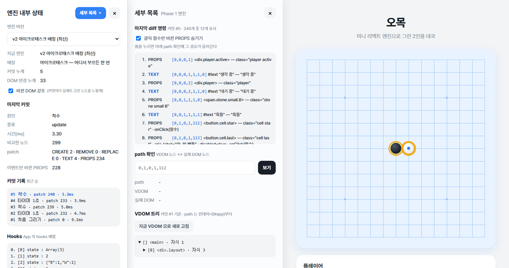
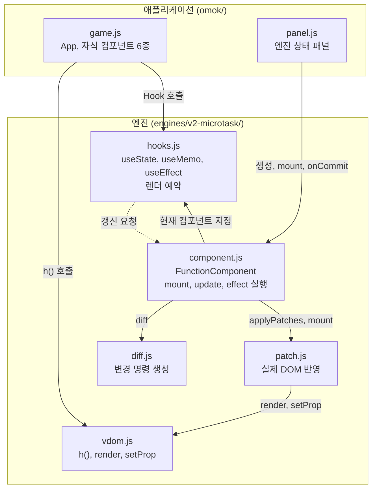
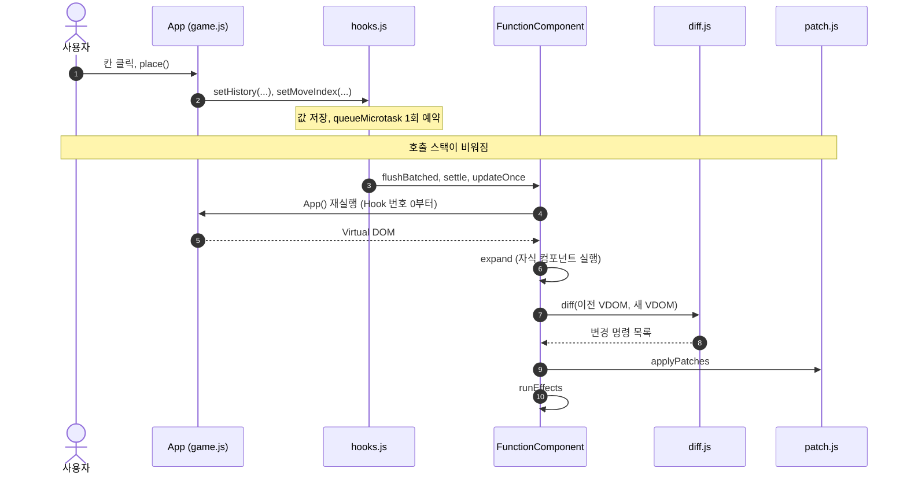
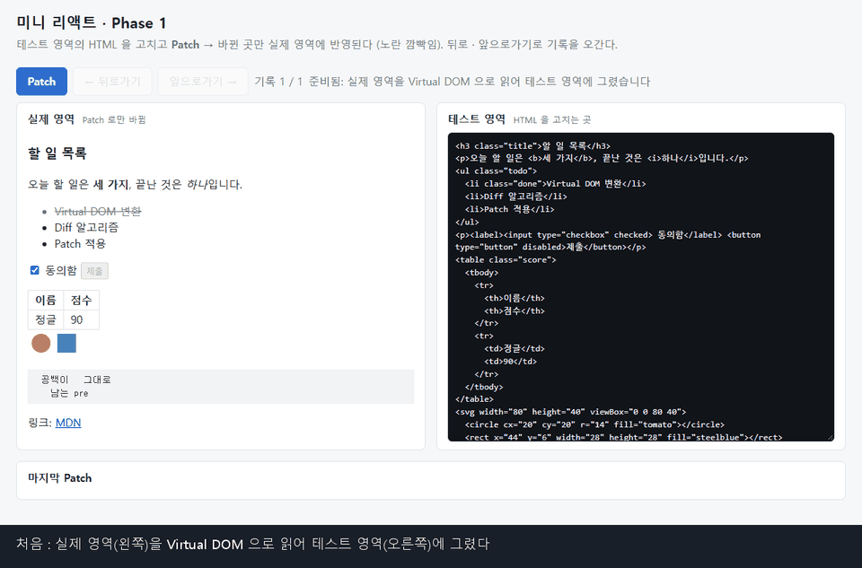
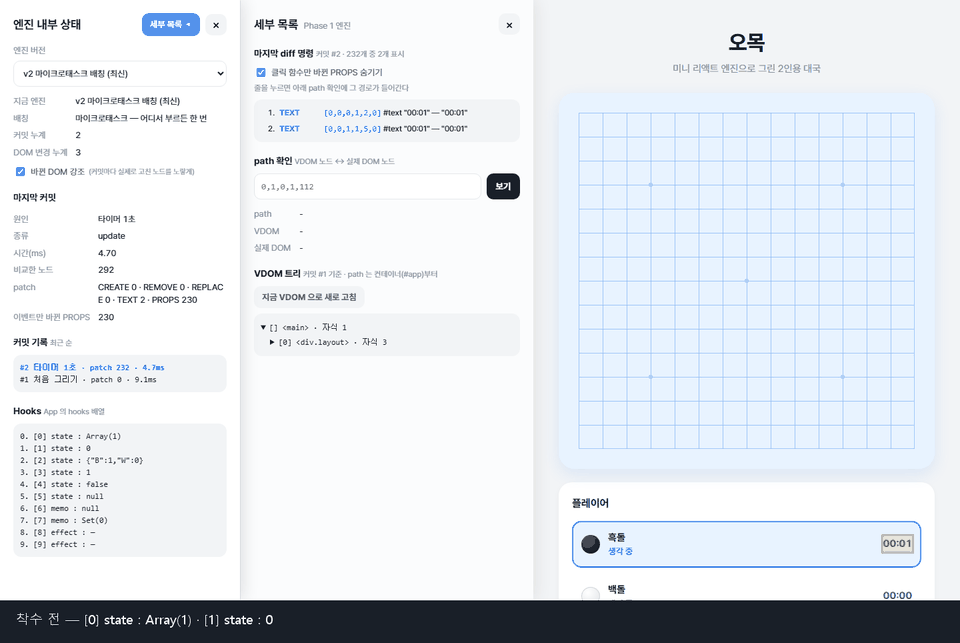
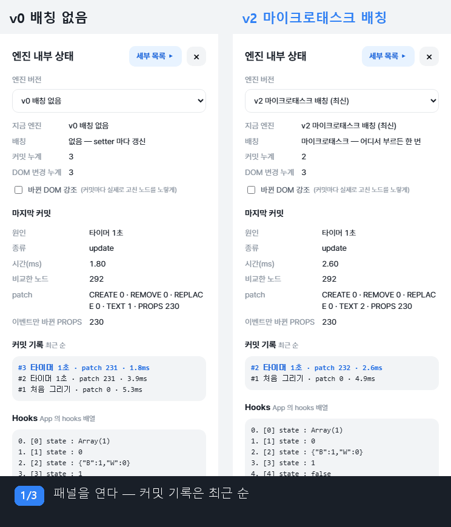

<p align="center">
  
</p>

# Mini React

---

[](#제약-조건)
[](#제약-조건)
[](#테스트)
[](#실행)
[](https://raw.githack.com/mg-2023/sw-ai-week11-12/feat-Jongeume/index.html)

Mini React는 Virtual DOM, Diff, Patch, 함수형 컴포넌트와 Hooks를 외부 라이브러리 없이 구현한 Vanilla JavaScript 렌더링 엔진입니다. 오목 데모 애플리케이션으로 동작을 검증하며, 같은 애플리케이션을 세 가지 엔진 버전으로 실행하여 배칭 방식의 차이를 비교할 수 있습니다.

- **선언적 렌더링:** 컴포넌트는 현재 상태에 맞는 화면을 `h()`로 기술합니다. 엔진은 이전 Virtual DOM과 비교하여 변경된 노드만 실제 DOM에 반영합니다.
- **Hook 기반 상태:** 컴포넌트 함수는 렌더할 때마다 새로 실행되며, 상태는 엔진이 관리하는 `hooks` 배열에 Hook 호출 순서대로 보존됩니다.
- **마이크로태스크 배칭:** 하나의 작업에서 발생한 여러 상태 변경은 호출 위치와 관계없이 한 번의 렌더로 반영됩니다.

## 목차

1. [개요](#1-개요)
2. [아키텍처](#2-아키텍처)
3. [실행 흐름과 설계 결정](#3-실행-흐름과-설계-결정)
4. [시연과 검증](#4-시연과-검증)
5. [제한 사항과 향후 계획](#5-제한-사항과-향후-계획)
6. [시작하기](#6-시작하기)

---

## 1. 개요

### 목표

React의 핵심 원리인 Virtual DOM, Diff, Patch, State, Hooks를 직접 구현하고, 실제로 동작하는 웹 페이지로 검증합니다.

### 구현 범위

| 영역 | 내용 | 진입점 |
| --- | --- | --- |
| Phase 1 | Virtual DOM, Diff(변경 명령 5종), Patch, State History(뒤로 가기, 앞으로 가기) | `phase1.html` |
| Phase 2 | `FunctionComponent` 클래스, `useState`, `useMemo`, `useEffect` | `index.html` (오목) |
| 배칭 | v0 배칭 없음, v1 이벤트 경계 배칭, v2 마이크로태스크 배칭(기본값) | `?engine=` 쿼리 |
| 검증 | 단위 테스트 202개 통과, 실제 브라우저에서 엔진별 렌더 횟수 측정 | `npm test` |

### 제약 조건

- 외부 라이브러리와 빌드 도구를 사용하지 않습니다. 개발 의존성은 테스트용 `jsdom` 하나입니다.
- 상태와 Hook은 루트 컴포넌트에서만 사용합니다. 자식 컴포넌트는 props만 받는 순수 함수입니다.

---

## 2. 아키텍처

### 모듈 구성



### 모듈별 책임

| 모듈 | 책임 | 주요 함수 |
| --- | --- | --- |
| `vdom.js` | 화면을 `{ type, props, children }` 객체로 표현하고, 객체를 실제 노드로 생성합니다. | `h`, `render`, `setProp` |
| `diff.js` | 이전 Virtual DOM과 새 Virtual DOM을 같은 위치끼리 비교하여 변경 명령 목록을 생성합니다. DOM에 접근하지 않습니다. | `diff`, `walk` |
| `patch.js` | 변경 명령의 `path`를 따라 대상 노드를 찾아 해당 노드만 수정합니다. | `applyPatches`, `findNode` |
| `hooks.js` | Hook 호출 순서를 슬롯 번호로 사용하여 상태를 저장하고, setter 호출 시 렌더를 예약합니다. | `nextSlot`, `makeSetter`, `schedule` |
| `component.js` | 컴포넌트 실행, 트리 확장, Diff, Patch, effect 실행으로 이어지는 갱신 주기를 수행합니다. | `updateOnce`, `run`, `expand`, `runEffects` |

### 변경 명령

`diff`는 아래 다섯 종류의 명령만 생성하고, `patch`는 명령만 해석합니다. 두 모듈은 이 명령 형식으로만 연결됩니다.

| 명령 | 생성 조건 | DOM 반영 |
| --- | --- | --- |
| `CREATE` | 해당 위치에 이전 노드가 없음 | 부모 노드에 새 노드 삽입 |
| `REMOVE` | 해당 위치에 새 노드가 없음 | 노드 제거 (뒤쪽 인덱스부터) |
| `REPLACE` | 태그가 다름 | 노드를 새로 생성하여 교체 |
| `TEXT` | 텍스트 내용이 다름 | `nodeValue` 변경 |
| `PROPS` | 속성이 다름 | 속성 추가, 변경, 제거 |

### 엔진 버전

세 버전은 `vdom.js`, `diff.js`, `patch.js`를 공유하며, 배칭 방식을 결정하는 `hooks.js`와 `component.js`만 다릅니다.

| 버전 | 경로 | 렌더 시점 |
| --- | --- | --- |
| v0 | `engines/v0/` | setter 호출마다 즉시 렌더 |
| v1 | `engines/v1-batch/` | 엔진이 등록한 이벤트 핸들러가 반환될 때 한 번 렌더 |
| v2 | `engines/v2-microtask/` | 현재 실행 중인 코드가 끝난 직후(마이크로태스크) 한 번 렌더 |

---

## 3. 실행 흐름과 설계 결정

### 착수 시 실행 흐름



| 단계 | 구현 위치 (`engines/v2-microtask/`) |
| --- | --- |
| 상태 저장과 렌더 예약 | `hooks.js`: `makeSetter`, `schedule` |
| 예약 처리 | `hooks.js`: `flushFromMicrotask`, `flushScheduled` |
| 갱신 주기 | `component.js`: `flushBatched`, `settle`, `flushPending`, `updateOnce` |
| 컴포넌트 실행과 트리 확장 | `component.js`: `run`, `expand` |
| 비교, 반영, effect | `diff.js`: `diff`, `patch.js`: `applyPatches`, `component.js`: `runEffects` |

### 설계 결정: 렌더 시점을 마이크로태스크로 지정

| 항목 | 내용 |
| --- | --- |
| 문제 | 착수 한 번에 setter가 2회 호출됩니다. setter마다 렌더하면 렌더가 2회 발생하고, 그 사이에 기록과 현재 수가 일치하지 않는 중간 상태가 렌더됩니다. |
| 결정 | setter는 값만 저장하고, 렌더는 `queueMicrotask`로 한 번만 예약합니다. 예약이 실행되기 전까지 발생한 변경을 한 번에 렌더합니다. |
| 근거 | v1은 엔진이 등록한 이벤트 핸들러 안의 변경만 묶을 수 있으며, 타이머나 `await` 이후의 변경은 `batch(fn)`로 직접 감싸야 합니다. 마이크로태스크 방식은 호출 위치와 관계없이 변경을 묶습니다. |
| 비용 | setter 직후에는 DOM이 아직 갱신되지 않으므로, 즉시 읽어야 하는 경우 `flushSync(fn)`를 사용합니다. 예약된 렌더에서 발생한 예외는 호출한 코드로 전달되지 않으므로, 값을 되돌린 뒤 `reportError`로 보고합니다. |

### 엔진별 렌더 횟수

동일한 오목 화면에서 엔진만 바꾸어 측정한 커밋 횟수입니다. 측정 순서는 두 수 착수, 전체 초기화, 타이머 1초, 첫 저장입니다. (실제 브라우저, 2026-11-11)

| 동작 | setter 호출 수 | v0 | v1 | v2 |
| --- | :---: | :---: | :---: | :---: |
| 착수 | 2 | 2 | 1 | 1 |
| 전체 초기화 | 5 | 4 | 1 | 1 |
| 타이머 1초 (이벤트 외부) | 2 | 2 | 2 | 1 |
| 첫 저장 (`await` 전 1, 후 2) | 3 | 3 | 3 | 2 |

- 값이 변하지 않는 setter는 렌더하지 않습니다(`Object.is` 비교). 전체 초기화의 v0 결과가 4인 이유는 `savedAt`이 이미 `null`이기 때문입니다.
- 저장의 v2 결과가 2인 이유는 `await` 전후가 서로 다른 작업이기 때문입니다. 저장 중 상태를 한 번 표시해야 합니다.

---

## 4. 시연과 검증

모든 시연은 현재 엔진 코드를 실제 브라우저에서 실행하여 녹화했습니다. `docs/demo/record.mjs`가 헤드리스 Edge에서 실제 버튼을 조작하며, 자막의 수치와 노드 이름은 녹화 시점에 페이지에서 읽은 값입니다. 노란색 강조는 해당 커밋에서 실제로 변경된 DOM 노드를 나타냅니다.

### 시연 1. Diff와 Patch



| 항목 | 내용 |
| --- | --- |
| 문제 | 텍스트 하나를 수정할 때 영역 전체를 다시 그리면 노드가 새로 생성되고 입력 상태와 포커스가 유실됩니다. |
| 설계 | 이전 Virtual DOM과 새 Virtual DOM을 같은 위치끼리 비교하여 변경 명령을 만들고(`diff`), `path`로 찾은 노드만 수정합니다(`applyPatches`). |
| 결과 | "세 가지"를 "네 가지"로 수정하면 `TEXT` 명령 1건, DOM 변경 1건이 발생하며 `<b>` 요소와 텍스트 노드는 동일한 객체로 유지됩니다. 이어서 class 추가와 `<li>` 추가는 `PROPS`, `CREATE` 2건으로 반영됩니다. |
| 선택 근거 | 최소 편집 거리를 구하는 O(n³) 비교 대신 노드 수에 비례하는 비교를 사용합니다. React도 같은 가정을 사용합니다. |
| 검증하는 설계 | [변경 명령](#변경-명령): `diff`는 명령을 생성하고 `patch`는 명령만 반영합니다. |

### 시연 2. Hooks와 화면 갱신



| 항목 | 내용 |
| --- | --- |
| 문제 | 함수 컴포넌트는 렌더마다 처음부터 다시 실행되므로, 착수 기록을 보존할 위치가 필요합니다. |
| 설계 | Hook 호출 순서를 슬롯 번호로 사용하여 `hooks` 배열에 상태를 저장합니다. setter가 값을 변경하면 `App()`을 다시 실행하여 새 Virtual DOM을 만들고 Diff와 Patch를 수행합니다. |
| 결과 | 착수할 때마다 `hooks[0]`(판 기록)이 `Array(1)`, `Array(2)`, `Array(3)`으로, `hooks[1]`(현재 수)이 0, 1, 2로 변경되고 렌더는 1회 발생합니다. 새 돌 `<span class="stone B">`는 `CREATE`로 생성되며, 차례와 기보처럼 변경된 노드만 강조됩니다. |
| 선택 근거 | 루트에서만 상태를 관리하는 과제 제약에서 가장 단순한 저장 구조입니다. 225칸 Virtual DOM을 매번 다시 생성하는 비용이 있습니다([제한 사항](#제한-사항)). |
| 검증하는 설계 | [착수 시 실행 흐름](#착수-시-실행-흐름): Virtual DOM은 루트부터 다시 만들고, DOM은 변경 명령만 반영합니다. |

### 시연 3. 배칭



| 항목 | 내용 |
| --- | --- |
| 문제 | 착수 한 번에 setter가 2회 호출됩니다. setter마다 렌더하면 렌더가 2회 발생하고 중간 상태가 생깁니다. v0 엔진에서는 이 중간 상태로 인해 렌더 오류가 발생한 적이 있습니다. |
| 설계 | setter는 값만 저장하고, 렌더는 `queueMicrotask`로 한 번만 예약합니다(v2). |
| 결과 | 착수 1회에 v0는 커밋 2회, v2는 1회입니다. 엔진 이벤트 외부에서 실행되는 타이머 1초에서도 v0는 2회, v2는 1회입니다. |
| 선택 근거 | v1의 이벤트 경계 방식은 타이머와 `await` 이후의 변경을 묶지 못합니다. 작업의 끝을 호출 스택이 비는 시점으로 정의하면 호출 위치와 관계없이 변경을 묶을 수 있습니다. |
| 검증하는 설계 | [설계 결정: 렌더 시점을 마이크로태스크로 지정](#설계-결정-렌더-시점을-마이크로태스크로-지정) |

### 온라인 데모

`feat-Jongeume` 브랜치를 raw.githack.com으로 제공합니다. 처음 접속하면 안내 화면이 표시되며, "Open the page"를 선택하면 데모가 열립니다.

| 시연 | 링크 | 조작 |
| --- | --- | --- |
| 1. Diff와 Patch | [phase1.html](https://raw.githack.com/mg-2023/sw-ai-week11-12/feat-Jongeume/phase1.html) | 테스트 영역 수정 후 Patch |
| 2. Hooks | [오목 (v2)](https://raw.githack.com/mg-2023/sw-ai-week11-12/feat-Jongeume/index.html) | 엔진 패널에서 "바뀐 DOM 강조"와 "세부 목록" 선택 |
| 3. 배칭 | [v0](https://raw.githack.com/mg-2023/sw-ai-week11-12/feat-Jongeume/index.html?engine=v0), [v1](https://raw.githack.com/mg-2023/sw-ai-week11-12/feat-Jongeume/index.html?engine=v1-batch), [v2](https://raw.githack.com/mg-2023/sw-ai-week11-12/feat-Jongeume/index.html?engine=v2-microtask) | 엔진 패널의 커밋 기록 비교 |

시연 GIF는 `node docs/demo/record.mjs` 실행 후 `python docs/demo/make_gif.py`로 다시 생성할 수 있습니다.

### 테스트

| 항목 | 결과 | 비고 |
| --- | --- | --- |
| 단위 테스트 (`npm test`) | 202개 통과, 실패 0 | Node 내장 테스트 러너와 jsdom 사용. 러너 집계 203은 `test/helpers.js`를 포함한 값입니다. |
| v2 엔진 전용 | 10개 | `test/v2-microtask.test.js` |
| v1 엔진 기준 | 192개 | vdom, diff, patch, hooks, effect, 배칭, 오목 페이지 |
| 무작위 트리 500쌍 | Patch 결과를 다시 읽으면 새 Virtual DOM과 일치 | `test/patch.test.js` |
| 실제 브라우저 | 세 엔진 모두 착수, 초기화, 타이머, 저장 동작 확인, 콘솔 오류 0 | [엔진별 렌더 횟수](#엔진별-렌더-횟수) |

### 예외 상황 처리

| 상황 | 동작 | 테스트 엔진 |
| --- | --- | :---: |
| 조건문으로 Hook 개수나 종류가 변경됨 | 예외 발생 | v1 |
| 자식 컴포넌트에서 `useState` 호출 | 예외 발생 | v1 |
| 렌더 중 `setState` 호출 | 예외 발생 | v1 |
| 렌더 중 예외 발생 | 변경한 값을 되돌리고 이전 화면 유지 | v1, v2 |
| 값이 변하지 않는 setter만 호출 | 렌더하지 않음 | v1, v2 |
| 함수형 setter `n => n + 1` 3회 호출 | 결과 +3, 렌더 1회 | v1, v2 |
| effect에서 setter를 반복 호출 | 후속 갱신 50회 초과 시 `update loop` 예외, 마지막 변경 묶음 복원 | v1 |
| 렌더 예약 후 `destroy` 호출 | 렌더하지 않음 | v2 |
| 텍스트에 `` 같은 태그 문자열 포함 | 텍스트 노드로만 생성하며 HTML로 해석하지 않음 (`innerHTML` 미사용) | v1 |

---

## 5. 제한 사항과 향후 계획

### 제한 사항

| 항목 | 내용 |
| --- | --- |
| 전체 트리 재생성 | Virtual DOM은 항상 루트부터 다시 생성합니다. 빈 판에서 첫 착수 시 비교 노드는 291개입니다. |
| 이벤트 핸들러 재생성 | 렌더마다 클릭 핸들러가 새로 생성됩니다. 같은 착수의 `PROPS` 명령 233건 중 227건이 이벤트 핸들러만 변경된 경우입니다. |
| `key` 미지원 | 목록을 위치 기준으로만 비교하므로 앞쪽 삽입이나 순서 변경 시 변경 명령이 증가합니다. 결과는 정확합니다. |
| `useRef` 미지원 | 오목 타이머는 모듈 수준 객체로 최신 값을 참조합니다. |
| Hook 순서 검사 | 같은 종류의 Hook끼리 순서만 바뀌는 경우는 감지하지 않습니다. 개수와 종류의 변경은 감지합니다. |
| v2 테스트 범위 | v2 전용 테스트는 10개이며, 나머지 단위 테스트는 v1 엔진을 기준으로 합니다. |

### 향후 계획

아래 항목은 아직 구현되지 않았습니다.

1. 안정적인 이벤트 핸들러 참조로 불필요한 `PROPS` 명령 감소
2. `useRef` 추가
3. `key` 기반 목록 비교
4. 단위 테스트를 v2 엔진 기준으로 전환

### 결론

- 컴포넌트 함수가 매번 새로 실행되어도 상태가 유지되는 원리를 컴포넌트 객체의 배열과 Hook 호출 순서로 구현하여 확인했습니다.
- 배칭의 핵심은 변경을 모으는 방법보다 작업이 끝나는 시점을 정의하는 데 있으며, 이 정의에 따라 v1과 v2의 결과가 달라졌습니다.
- 동일한 애플리케이션을 엔진만 바꾸어 실행할 수 있도록 구성하여 설계 차이를 수치로 비교했습니다.

---

## 6. 시작하기

### 실행

| 목적 | 방법 |
| --- | --- |
| 오목 데모 | `index.html`을 브라우저에서 엽니다. 서버가 필요하지 않습니다. |
| 엔진 버전 변경 | 엔진 패널에서 선택하거나 URL에 `?engine=v0`, `?engine=v1-batch`, `?engine=v2-microtask`를 추가합니다. |
| Phase 1 검증 페이지 | `phase1.html`을 엽니다. |
| 단위 테스트 | `npm install` 후 `npm test`를 실행합니다. |

### 디렉터리 구조

```
index.html          오목 데모
omok/               game.js(애플리케이션), panel.js(엔진 상태 패널), loader.js(엔진 선택), style.css
phase1.html         Phase 1 검증 페이지
phase1/             app.js, history.js(State History), style.css
engines/
  v0/               배칭 없음
  v1-batch/         이벤트 경계 배칭, 단위 테스트 기준 엔진
  v2-microtask/     마이크로태스크 배칭, 데모 기본 엔진
test/               단위 테스트 (node --test, jsdom)
docs/               설계 문서, 발표 가이드, 시연 녹화 스크립트
```

### 관련 문서

| 문서 | 내용 |
| --- | --- |
| [docs/README_DETAIL.md](docs/README_DETAIL.md) | Phase 1, Phase 2 상세 설명 (자료구조, Diff 알고리즘, 컴포넌트 계층, React 비교) |
| [docs/phase1-design.md](docs/phase1-design.md) | Phase 1 설계 결정과 예외 상황 |
| [docs/superpowers/specs/](docs/superpowers/specs/) | 배칭 v1, v2 설계 문서 |
| [docs/README_FACT_CHECK.md](docs/README_FACT_CHECK.md) | README 내용과 코드 대조 결과 |
| [docs/PRESENTATION_GUIDE.md](docs/PRESENTATION_GUIDE.md) | 4분 발표 가이드 |

### 팀 저장소 운영 방식

- 각자 개인 브랜치에서 작업하고 README.md를 작성합니다.
- 코드 리뷰 후 브랜치 하나를 선정하여 `main`에 PR을 생성하고 병합합니다. 이 과정은 React와 Redis/RDBMS 과제에서 각각 한 번씩, 총 두 번 진행합니다.
- 프로젝트 보드의 첫 번째 탭은 전체 Kanban 보드이며, 나머지 세 탭은 개인별 일정(Todo, In Progress, Done)입니다.
- 이슈를 프로젝트에 등록할 때는 Assignee를 본인으로 지정합니다.
