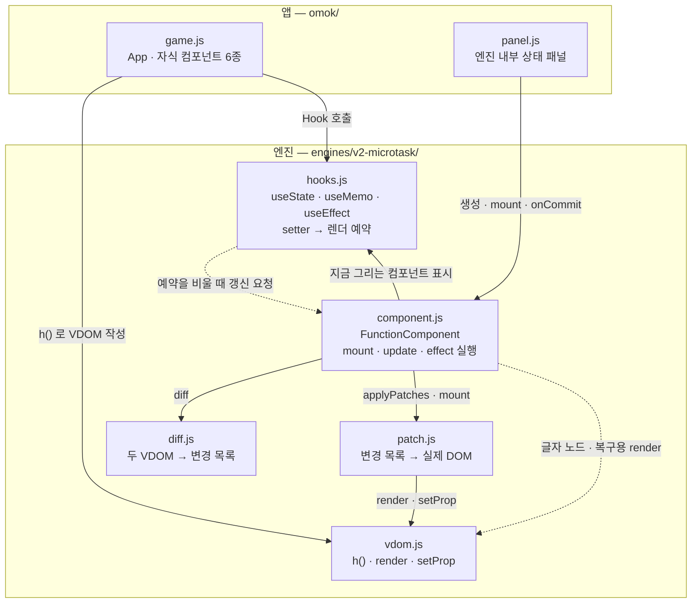
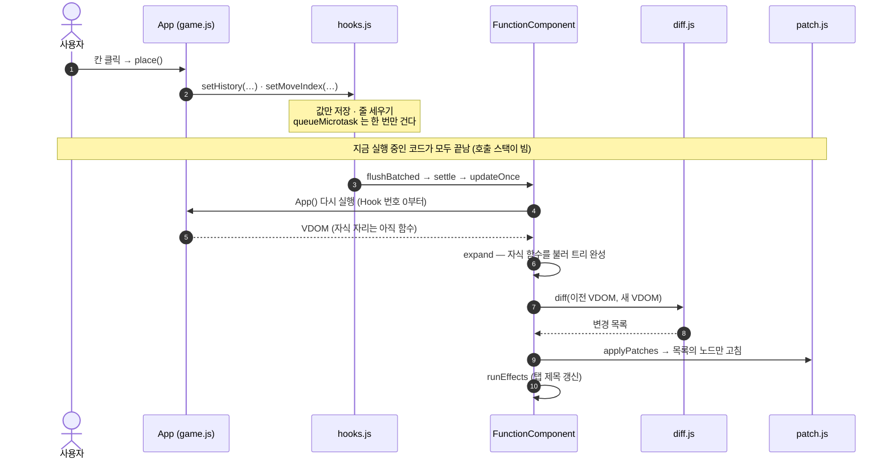

# Mini React — 오목으로 검증한 Vanilla JS 리액트 엔진

> [!NOTE]
> **함수는 매번 새로 실행되고, 상태는 엔진의 `hooks` 배열에 남는다.**
> 상태가 바뀌면 루트부터 새 Virtual DOM 을 만들고, Diff 로 찾은 **바뀐 곳만** 실제 DOM 에 고친다.
> 같은 작업 안에서 생긴 여러 상태 변경은 **한 번의 렌더로 묶는다** (마이크로태스크 배칭).

---

## 1. 프로젝트 소개

**목표** — React 의 핵심 원리(Virtual DOM · Diff · Patch · State · Hooks)를 라이브러리 없이 직접 만들고, 실제로 동작하는 웹 페이지로 증명한다.

| 구현 범위 | 내용 |
| --- | --- |
| Phase 1 | Virtual DOM · Diff(5가지 변경) · Patch · State History(뒤로 · 앞으로) — `phase1.html` |
| Phase 2 | `FunctionComponent` 클래스 · `useState` · `useMemo` · `useEffect` — 데모 **오목** `index.html` |
| 배칭 | 엔진 3단계로 발전 : v0 배칭 없음 → v1 이벤트 경계 → **v2 마이크로태스크 (데모 기본)** |
| 검증 | 단위 테스트 202개 통과 · 실제 브라우저에서 엔진별 렌더 횟수 측정 |

- 외부 라이브러리 · 빌드 도구 없음 (테스트용 `jsdom` 만 개발 의존성)
- 과제 제약 : **상태와 Hook 은 루트 컴포넌트에만**, 자식은 props 만 받는 순수 함수

---

## 2. 아키텍처

### 모듈 관계



### 모듈별 책임

| 모듈 | 한 줄 책임 | 핵심 함수 |
| --- | --- | --- |
| `vdom.js` | 화면을 `{ type, props, children }` 객체로 적고, 객체 → 실제 노드로 만든다 | `h` · `render` · `setProp` |
| `diff.js` | 이전 · 새 VDOM 을 **같은 자리끼리** 비교해 변경 목록을 만든다 (DOM 을 모름) | `diff` · `walk` |
| `patch.js` | 변경 목록의 위치(`path`)를 따라가 **그 노드만** 고친다 | `applyPatches` · `findNode` |
| `hooks.js` | Hook 을 부른 **순서 = 칸 번호**로 상태를 저장하고, setter 가 렌더를 예약한다 | `nextSlot` · `makeSetter` · `schedule` |
| `component.js` | 함수 실행 → 펼치기 → diff → patch → effect 한 바퀴를 돌린다 | `updateOnce` · `run` · `expand` · `runEffects` |

- **변경 목록 5종** : `CREATE` · `REMOVE` · `REPLACE` · `TEXT` · `PROPS`
- `diff` 는 목록을 **만들기만**, `patch` 는 **쓰기만** — 둘은 변경 목록이라는 약속으로만 이어진다
- v0 · v1 · v2 세 엔진의 `vdom` · `diff` · `patch` 는 **같은 파일**이다. 다른 곳은 `hooks` · `component` 뿐 (배칭 방식)

---

## 3. 핵심 실행 흐름 및 설계 결정

### 돌 하나를 두면 — 클릭에서 DOM 반영까지



| 단계 | 코드 (`engines/v2-microtask/`) |
| --- | --- |
| setter : 저장 · 예약 | `hooks.js` `makeSetter` → `schedule` |
| 예약 비우기 | `hooks.js` `flushFromMicrotask` → `flushScheduled` |
| 한 바퀴 갱신 | `component.js` `flushBatched` → `settle` → `flushPending` → `updateOnce` |
| 함수 실행 · 펼치기 | `component.js` `run` · `expand` |
| 비교 · 반영 · effect | `diff.js` `diff` → `patch.js` `applyPatches` → `component.js` `runEffects` |

### 설계 결정 — "작업이 끝나는 때" 를 마이크로태스크로 정했다

| | 내용 |
| --- | --- |
| **문제** | 착수 한 번에 setter 가 2개 불린다. setter 마다 렌더하면 렌더가 2번이고, 그 사이 **중간 상태**(기록과 현재 수가 안 맞는 화면)를 한 번 그린다 |
| **선택** | setter 는 값만 저장하고, 렌더는 `queueMicrotask` 로 **한 번만 예약**한다. 예약이 실행되기 전에 모인 변경을 1번에 렌더 |
| **이유** | v1(엔진이 붙인 이벤트 핸들러만 자동으로 묶기)은 **타이머 · `await` 뒤**의 setter 를 자동으로 묶지 못했다 (직접 `batch(fn)` 로 감싸야 함). 마이크로태스크는 부르는 곳과 상관없이 묶인다 |
| **트레이드오프** | setter 직후엔 DOM 이 아직 옛 모습 → 바로 읽어야 하면 `flushSync(fn)` · 예약된 렌더의 예외는 부른 쪽이 못 받음 → 값을 되돌리고 `reportError` 로 보고 |

**같은 오목, 엔진만 바꿔 측정한 렌더(커밋) 횟수** — 실제 브라우저, 11-11 측정
(순서 : 새로 연 판에 두 수 → 전체 초기화 → 타이머 1초 → 첫 저장)

| 동작 | 부르는 setter | v0 배칭 없음 | v1 이벤트 경계 | v2 마이크로태스크 |
| --- | :---: | :---: | :---: | :---: |
| 착수 | 2 | 2 | **1** | **1** |
| 전체 초기화 | 5 | 4 | **1** | **1** |
| 타이머 1초 (이벤트 밖) | 2 | 2 | 2 | **1** |
| 첫 저장 : 시작 + `await` 뒤 | 1 + 2 | 3 | 3 | **2** |

- 값이 그대로인 setter 는 렌더하지 않는다 (`Object.is` 비교). 그래서 v0 의 숫자는 판 상태에 따라 달라진다
	- 전체 초기화가 4 : 저장한 적이 없어 `savedAt` 이 이미 `null`
	- 같은 수를 다시 저장하면 `savedAt` 이 그대로라 v0 · v1 도 2
- 저장이 v2 에서도 2인 이유 : `await` 앞과 뒤는 다른 작업이다 — "저장 중" 화면을 한 번 보여 줘야 한다

---

## 4. 기능 시연 및 검증

> 세 GIF 모두 **지금 엔진 코드를 그대로 실행해 녹화**했다 — `docs/demo/record.mjs` 가 Edge(화면 없음)에서 진짜 버튼을 누르고, 자막의 숫자 · 노드 이름은 찍는 순간 페이지에서 읽은 값이다. 노란 표시 = 그 커밋에서 **실제로 고친 DOM 노드**.

### 시연 1 — Diff · Patch : 글자 하나를 바꾸면 그 글자 노드만 고친다

<table><tr>
<td width="58%"></td>
<td>

**문제** — 테스트 영역 글자 하나를 고쳤을 뿐인데 실제 영역을 통째로 다시 그리면 노드가 새로 생기고, 입력 · 포커스 상태가 날아간다

**채택한 설계** — 이전 · 새 VDOM 을 **같은 자리끼리** 비교(`diff`) → 변경 명령 목록 → `path` 로 그 노드만 고침(`applyPatches`)

**시연에서 보이는 것** — "세 가지 → 네 가지" : `TEXT` 1건 · 실제 DOM 변경 1건, `<b>` 와 글자 노드는 **같은 객체 그대로**. 이어서 class 추가 + `<li>` 추가 : `PROPS` · `CREATE` 2건

**선택 이유** — 최소 편집을 찾는 O(n³) 대신 노드 수에 비례하는 비교. 화면은 대개 조금씩 바뀌어 충분하다 (React 도 같은 가정)

**증명하는 설계** → 2절 "diff 는 만들기만, patch 는 쓰기만"

</td></tr></table>

### 시연 2 — Hooks : 상태는 엔진 배열에 남고, 바뀐 DOM 만 고친다

<table><tr>
<td width="58%"></td>
<td>

**문제** — 함수 컴포넌트는 매번 처음부터 다시 실행된다. 착수한 판은 어디에 남나

**채택한 설계** — Hook 을 **부른 순서 = 칸 번호**로 `hooks` 배열에 저장. setter 가 값을 바꾸면 `App()` 을 다시 실행해 새 VDOM → diff → patch

**시연에서 보이는 것** — 착수마다 `hooks[0]` 판 기록 `Array(1→2→3)` · `hooks[1]` 현재 수 `0→1→2`, 렌더 1번, 새 돌 `CREATE <span.stone.B>` 와 차례 · 기보처럼 **바뀐 노드만 노랗게**

**선택 이유** — 과제 제약(상태는 루트에만) 아래 가장 단순한 저장소. 대가 : 225칸 VDOM 을 매번 다시 만든다 (5절 한계)

**증명하는 설계** → 3절 흐름 "VDOM 은 루트부터, DOM 은 patch 만"

</td></tr></table>

### 시연 3 — 배칭 : 같은 오목, 엔진만 바꿔 커밋 수를 센다

<table><tr>
<td width="46%"></td>
<td>

**문제** — 착수 한 번에 setter 2개. setter 마다 렌더하면 2번 그리고, 그 사이 **중간 상태**가 생긴다 (v0 에서 실제로 터진 적 있음)

**채택한 설계** — setter 는 값만 저장, 렌더는 `queueMicrotask` 로 **한 번만** 예약 (v2)

**시연에서 보이는 것** — 착수 1번 : v0 커밋 **2** · v2 **1**. 1초 타이머(엔진 이벤트 밖) : v0 **2** · v2 **1**

**선택 이유** — v1(이벤트 경계)은 타이머 · `await` 뒤를 묶지 못했다. "작업의 끝" 을 호출 스택이 빌 때로 정하면 부르는 곳과 상관없이 묶인다

**증명하는 설계** → 3절 설계 결정 "작업이 끝나는 때를 마이크로태스크로"

</td></tr></table>

**직접 해 보기** (브라우저에서 바로 열림 — `feat-Jongeume` 브랜치를 raw.githack.com 으로 미리보기)

| 시연 | 링크 |
| --- | --- |
| 1 · Diff · Patch | [phase1.html](https://raw.githack.com/mg-2023/sw-ai-week11-12/feat-Jongeume/phase1.html) — 테스트 영역을 고치고 **Patch** |
| 2 · Hooks | [오목 (v2)](https://raw.githack.com/mg-2023/sw-ai-week11-12/feat-Jongeume/index.html) — 왼쪽 위 **엔진** → **바뀐 DOM 강조** 체크 · **세부 목록** |
| 3 · 배칭 | [오목 v0](https://raw.githack.com/mg-2023/sw-ai-week11-12/feat-Jongeume/index.html?engine=v0) · [v1](https://raw.githack.com/mg-2023/sw-ai-week11-12/feat-Jongeume/index.html?engine=v1-batch) · [v2](https://raw.githack.com/mg-2023/sw-ai-week11-12/feat-Jongeume/index.html?engine=v2-microtask) — 엔진 패널의 커밋 기록 비교 |

- 저장소를 받아 `phase1.html` · `index.html` 을 그냥 열어도 된다 (서버 필요 없음)
- GIF 다시 찍기 : `node docs/demo/record.mjs` → `python docs/demo/make_gif.py`

<details>
<summary><b>데모에서 더 볼 수 있는 것</b></summary>

| 동작 | 보이는 것 |
| --- | --- |
| 다섯 줄 완성 | 승리 칸 표시 · 판 잠김 (`useMemo` 로 승리 줄 계산) |
| 무르기 · 기보 클릭 | 지난 수로 이동, 이동 뒤 새로 두면 뒤 기록은 잘림 |
| 세부 목록의 path 확인 | 변경 명령의 `path` 가 가리키는 VDOM 노드 ↔ 실제 DOM 노드 |

</details>

### 검증 근거

| 무엇 | 결과 | 근거 |
| --- | --- | --- |
| 단위 테스트 `npm test` | **202개 통과 · 실패 0** | 11-11 직접 실행 (Node 내장 테스트 러너 + jsdom). 러너 집계는 203 — 도우미 파일 `test/helpers.js` 가 1개로 세짐 |
| 그중 v2 엔진 전용 | 10개 | `test/v2-microtask.test.js` |
| 나머지 192개 | v1 엔진 기준 (vdom · diff · patch · hooks · effect · 배칭 · 오목 페이지) | 각 테스트 파일의 `require` 경로 |
| 무작위 트리 500쌍 | patch 결과를 다시 읽으면 새 VDOM 과 같다 | `test/patch.test.js` |
| 실제 브라우저 | 엔진 3개 모두 착수 · 초기화 · 타이머 · 저장 동작, **콘솔 오류 0** | 3절 측정 표 |

**엣지 케이스 — 테스트로 고정한 것**

| 상황 | 기대 동작 | 테스트 엔진 |
| --- | --- | :---: |
| 조건문 때문에 Hook 개수 · 종류가 바뀜 | 예외로 알린다 | v1 |
| 자식 컴포넌트에서 `useState` | 예외 (상태는 루트에만) | v1 |
| 렌더 중 `setState` | 예외 | v1 |
| 렌더 중 예외 | 바꾼 값을 되돌리고 이전 화면 유지 | v1 · v2 |
| 값이 그대로인 setter 만 부름 | 렌더 0번 | v1 · v2 |
| 함수형 setter `n => n + 1` 세 번 | `+3`, 렌더 1번 | v1 · v2 |
| effect 가 끝없이 setter | 이어진 갱신 50번 뒤 `update loop` 예외, 마지막 묶음 값만 되돌림 | v1 |
| 렌더 예약 뒤 `destroy` | 렌더하지 않음 | v2 |
| 글자에 `` 같은 태그 문자 | 글자 노드 하나로만 그림, HTML 로 해석하지 않음 (`innerHTML` 미사용) | v1 |

---

## 5. 한계 및 개선 방향

### 현재 한계

| 한계 | 수치 · 근거 |
| --- | --- |
| **VDOM 은 늘 루트부터 전부 다시 만든다** (실제 DOM 은 patch 만) | 빈 판 첫 착수에 비교한 노드 **291개** (225칸 바둑판 포함) |
| **매 렌더 새 클릭 함수** — 안정된 핸들러(`useCallback` 류) 없음 | 같은 착수의 PROPS patch 233개 중 **227개가 이벤트 함수만 바뀐 것** |
| `key` 없음 — 목록을 위치(번호)로만 비교 | 앞에 끼우기 · 뒤집기에서 변경 목록이 많아진다 (결과는 맞음) |
| `useRef` 없음 | 오목 타이머는 파일 수준 `live` 객체로 흉내 |
| 같은 종류 Hook 끼리 순서만 바뀌면 못 잡음 | 값이 뒤섞인다 (개수 · 종류 변화는 잡음) |
| 데모 기본 엔진 v2 의 전용 테스트는 10개 | 나머지 단위 테스트는 v1 엔진 기준 |

### 개선 예정 (v3 후보 — 아직 구현 안 함)

1. 안정된 핸들러 → 이벤트 함수만 바뀐 PROPS 줄이기
2. `useRef` → 렌더 없이 남는 값
3. `key` 기반 목록 비교
4. 단위 테스트를 v2 기준으로 옮기기

### 얻은 것

- "함수는 매번 새로 실행되는데 상태는 어떻게 남나?" → **컴포넌트 객체의 배열 + 부른 순서**라는 답을 직접 구현으로 확인했다
- 배칭은 "모은다" 보다 **"작업이 언제 끝났다고 볼 것인가"** 를 정하는 문제였다 — 그 기준에 따라 v1 과 v2 의 결과가 갈렸다
- 같은 앱을 엔진만 바꿔 열 수 있게 만들어, 설계 차이를 **숫자로** 비교했다

---

<details>
<summary><b>실행 방법</b></summary>

| 하고 싶은 것 | 방법 |
| --- | --- |
| 오목 데모 | `index.html` 을 브라우저로 열기 (서버 필요 없음) |
| 엔진 버전 바꾸기 | 패널의 엔진 고르기, 또는 주소 뒤 `?engine=v0` · `v1-batch` · `v2-microtask` |
| Phase 1 검증 페이지 | `phase1.html` |
| 단위 테스트 | `npm install` 한 번 → `npm test` |

</details>

<details>
<summary><b>폴더 구조</b></summary>

```
index.html          오목 (메인 데모)
omok/               game.js 앱 · panel.js 엔진 패널 · loader.js 엔진 고르기 · style.css
phase1.html         Phase 1 검증 페이지
phase1/             app.js · history.js (State History) · style.css
engines/
  v0/               배칭 없음 — setter 마다 렌더
  v1-batch/         이벤트 경계 배칭 — 단위 테스트 기준 엔진
  v2-microtask/     마이크로태스크 배칭 — 데모 기본
test/               단위 테스트 (node --test + jsdom)
docs/               설계 문서 · 발표 가이드 · 사실 확인
```

</details>

<details>
<summary><b>더 읽을 곳</b></summary>

- [docs/README_DETAIL.md](docs/README_DETAIL.md) — Phase 1 · 2 상세 정리 (자료구조 · Diff 알고리즘 · 컴포넌트 계층도 · 실제 React 비교)
- [docs/phase1-design.md](docs/phase1-design.md) — Phase 1 설계 결정 · 엣지 케이스
- [docs/superpowers/specs/](docs/superpowers/specs/) — 배칭 v1 · v2 설계 문서
- [docs/README_FACT_CHECK.md](docs/README_FACT_CHECK.md) — 이 README 의 주장과 코드 대조 결과
- [docs/PRESENTATION_GUIDE.md](docs/PRESENTATION_GUIDE.md) — 4분 발표 가이드

</details>

<details>
<summary><b>팀 레포지토리 관리 방식</b></summary>

- 개인별 브랜치에서 작업 + README.md 작성
- 코드별로 대략적인 리뷰 후 브랜치 하나를 선정해서 main에다가 PR + merge
- 이 작업은 React에서 한번, Redis/RDBMS에서 한번으로 총 2번 이루어짐
- 맨 왼쪽 탭은 전반적인 Kanban 보드, 나머지 탭 3개는 개인별 스케줄 (Todo/In Progress/Done)
- 개인별로 이슈를 프로젝트에 등록할 때 **Assignee를 자기 자신으로 꼭 설정**

</details>
