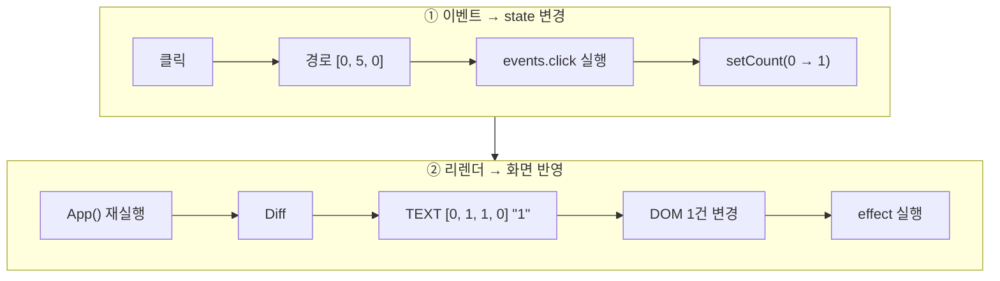

# sw-ai-week11-12
Mini React/Redis/RDBMS 구현 팀 레포지토리

## 팀 레포지토리 관리 방식
- 개인별 브랜치에서 작업 + README.md 작성
- 코드별로 대략적인 리뷰 후 브랜치 하나를 선정해서 main에다가 PR + merge
- 이 작업은 React에서 한번, Redis/RDBMS에서 한번으로 총 2번 이루어짐

## 팀 프로젝트 관리 방식
- 맨 왼쪽 탭은 전반적인 Kanban 보드로, 모든 팀원의 진행 상황이 표시됨
- 나머지 탭 3개는 개인별 스케줄 관리, 진행 상황은 Todo/In Progress/Done중 하나로 설정
  - 각자 입맛에 맞는 태그를 더 추가해서 넣어도 됩니다
- 개인별로 이슈를 프로젝트에 등록할 때 **Assignee를 자기 자신으로 꼭 설정**해주세요!

---

# React 1 + 2 Flow
## 0. 실행 시 주의사항
반드시 **이 디렉토리 안에서** 파이썬으로 로컬 서버를 열어야 동작합니다!
```python
python -m http.server 8000
```
그리고 다음 링크로 들어가서 시연을 해주세요
```
http://localhost:8000/virtual-dom-diff-verifier.html
```

## 1. 주요 기능 (5줄 요약)
- **HTML 편집 → Patch**: 테스트 영역의 HTML로 새 VDOM을 만들고 이전 VDOM과 Diff해서, 달라진 부분만 실제 영역에 반영한 뒤 결과가 목표 VDOM과 같은지 검증
- **컴포넌트 모드**: `h()`로 작성한 함수 컴포넌트(`App`)를 실제 영역에 마운트하면, 카드 맨 아래에 카운터 버튼들(`+1`, `증가 폭`, `자동 증가`, `제목 강조`)이 생김
- **훅 (useState / useMemo / useEffect)**: 훅 배열 + 커서로 관리. setter가 호출되면 즉시 리렌더 → Diff → Patch가 일어나고, `useMemo` / `useEffect`는 deps가 바뀐 렌더에서만 다시 실행됨
- **이벤트 위임**: `#real-root`에 click 리스너 하나만 두고, 클릭된 노드의 경로로 최신 VDOM에서 핸들러를 찾아 실행 (핸들러를 DOM에 붙이지 않음)
  - 이벤트 위임 작업은 `src/events.js`의 `delegate` 함수에서 한다
- **State History**: Patch / 렌더 기록을 저장하고, HTML 편집 모드에서는 뒤로 / 앞으로 / 항목 클릭으로 이동 가능, 컴포넌트 모드에서는 보기 전용
  
## 2. deps에 따른 useMemo / useEffect 동작
| 훅 | deps | 다시 실행되는 때 | 확인 방법 |
|---|---|---|---|
| `useMemo` (소수 개수) | `[count]` | count가 바뀐 렌더 | `제목 강조` / `증가 폭`만 누르면 콘솔에 `[useMemo]` 로그가 찍히지 않음 |
| `useEffect` (제목 복원) | `[]` | 마운트 때 한 번, cleanup은 언마운트 때 | HTML 편집 모드로 돌아가면 탭 제목이 원래대로 |
| `useEffect` (탭 제목) | `[count]` | count가 바뀐 렌더 | 탭 제목이 `카운터: N` |
| `useEffect` (자동 증가) | `[autoPlay, step]` | 자동 증가를 켜고 끌 때, 켠 채로 증가 폭을 바꿀 때 | 콘솔의 `타이머 시작` / `타이머 해제` 로그 |

이 표에 나오지 않은 state인 `highlight`가 있는데, 이건 "Virtual DOM 연습"이라는 제목 구간을 밝게 강조할 것인가만 표시하는 state이므로 이게 바뀌었다고 해서 count 이하의 소수의 개수를 다시 계산하지 않는다. (로그에서도 확인이 가능하다)

다시 말해, `highlight` state는 `count` state와 아무런 상관이 없다.

## 3. 카운터 +1 버튼을 눌렀을 때의 흐름


### 클릭 이벤트 + state 변경
1. **클릭 감지**: `#real-root`에 하나만 등록된 click 리스너가 이벤트를 받는다
2. **경로 계산**: 클릭된 DOM 노드에서 `#real-root`까지 올라가며 `childNodes` 인덱스를 모은다. `+1` 버튼이면 `[0, 5, 0]`
3. **핸들러 찾기**: 최신 VDOM을 그 경로대로 내려가 해당 VNode의 `events.click`을 찾는다. 없으면 부모 쪽으로 올라가며 찾는다
4. **핸들러 실행**: `() => setCount(c => c + step)`이 실행된다
5. **state 변경**: 훅 배열의 값이 0에서 1로 바뀐다. 값이 같으면(`Object.is`) 여기서 끝난다

### 리렌더 + 화면 반영
6. **리렌더**: 훅 커서를 0으로 되돌리고 `App()`을 다시 실행한다. `useMemo`는 deps `[count]`가 바뀌었으므로 소수 개수를 다시 계산하고, deps가 바뀐 `useEffect`는 대기열에 들어간다. 자식 컴포넌트까지 펼쳐 `#root`로 감싼 새 VDOM을 만든다
7. **Diff**: `patchToVdom(실제 영역, 이전 VDOM, 새 VDOM)`을 호출하면 `TEXT [0, 1, 1, 0] "1"` 패치가 나온다 (소수 개수가 바뀌면 `TEXT [0, 2, 1, 0]`도 함께)
8. **Patch와 검증**: `<b>` 안 텍스트 노드의 값만 바꾸고, 결과 DOM이 새 VDOM과 같은지 확인한다
9.  **커밋**: 새 VDOM을 "이전 VDOM"으로 저장하고 `onCommit`으로 `app.js`에 넘긴다. `app.js`는 숫자 부분을 깜빡이고, State History에 `렌더 N`을 저장하고, 로그를 출력한다
10. **effect 실행**: 대기열의 effect를 호출 순서대로 실행한다(이전 cleanup → effect). 여기서는 탭 제목이 `카운터: 1`로 바뀐다

핸들러는 DOM이 아니라 VDOM에 있으므로, 렌더마다 함수가 새로 만들어져도 패치가 생기지 않는다

## 4. 어떻게 이 방식이 나오게 되었는가
기본적으로 버튼에다가 이벤트를 다는 방법은 onClick을 사용하는 방법이 있다.
```html
<button class="btn primary" onclick="onPlus"></button>
```

그런데 Phase 1 구현 도중 보안상의 이유로 onClick과 같은 이벤트성 태그는 VDOM 변환에서 빠져서, 버튼마다 이벤트를 다는 방법은 불가능해진 상태가 되었다. (DOM으로 이벤트를 관리하는 방법이 안 된다는 말이다)

그래서 클릭 리스너를 **루트 컴포넌트 하나에만** 달아놓았다. 그래놓고 클릭했을 때 어느 컴포넌트를 클릭했는지와 이벤트 함수를 VDOM에만 저장해서 이벤트 핸들링을 VDOM에서만 하게 했다.

클릭 이벤트가 있는 버튼의 경우 VDOM 요소가 이렇게 생겼다.
```json
{ "type": "button", "props": { "class": "btn primary" }, "events": { "click": "[function]" }, "children": ["증가 폭: 1"] }
```

그 중에서 `"events": { "click": "[function]" }`를 살펴보자. 원래 `onclick="onPlus"`와 같이 되어 있었는데 이걸 JSON 객체로 만들어놓고 직렬화하는 과정에서 **함수 객체를 직렬화하지 못해** `[function]`과 같은 형식으로 보이게끔 만들어 놓은 것이고, 실제로는 `onPlus`이라는 함수가 들어있다.

`onPlus` 함수는 `count`라는 state를 step만큼 증가시키는 함수이므로, 이 함수가 호출됨으로 인해서 윗 문단의 4번부터 10번까지 일렬로 실행되고, 최종적으로 다시 렌더링된 결과 숫자가 바뀌는 것이다.
