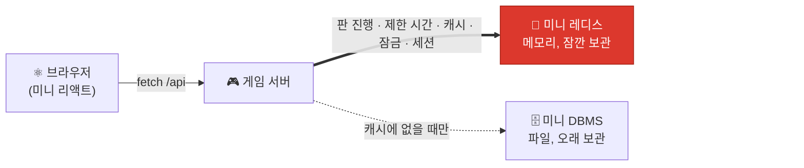
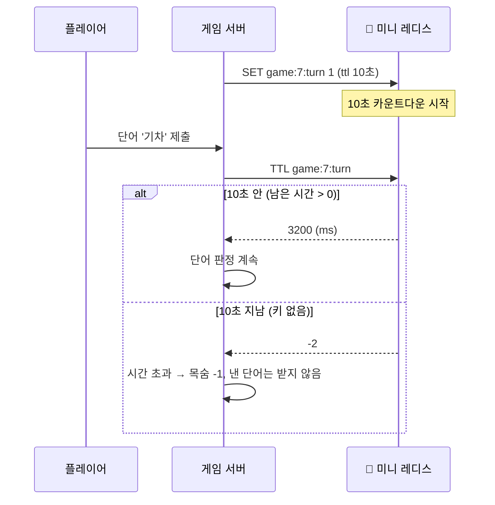
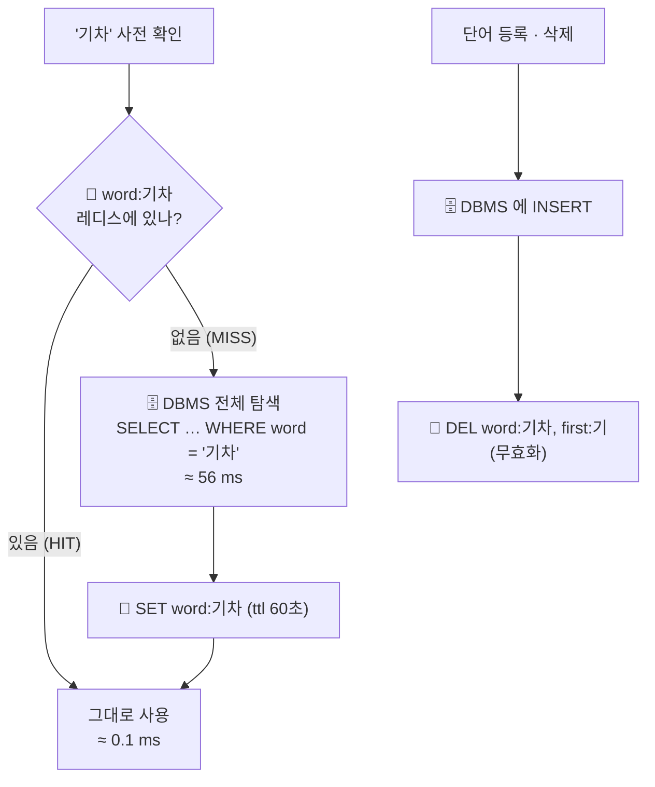
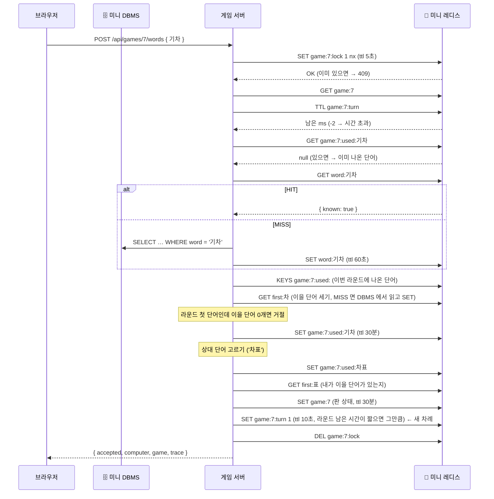
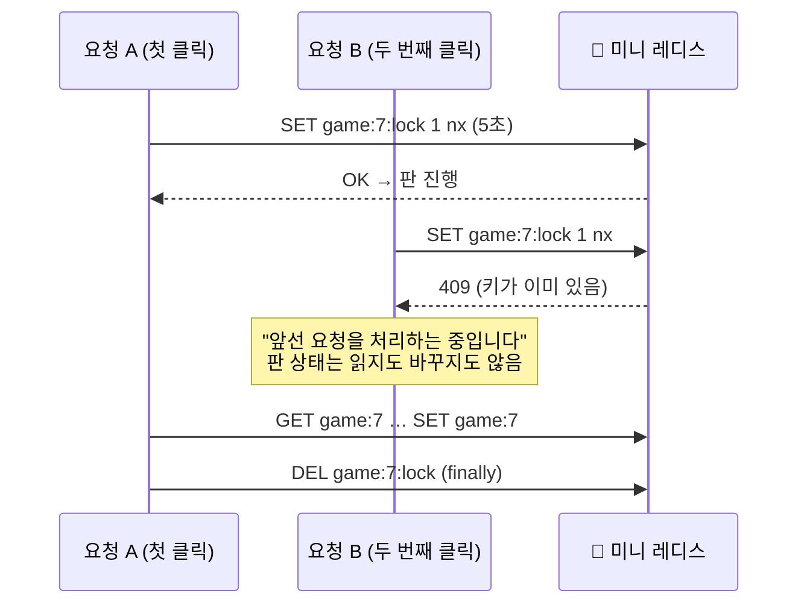
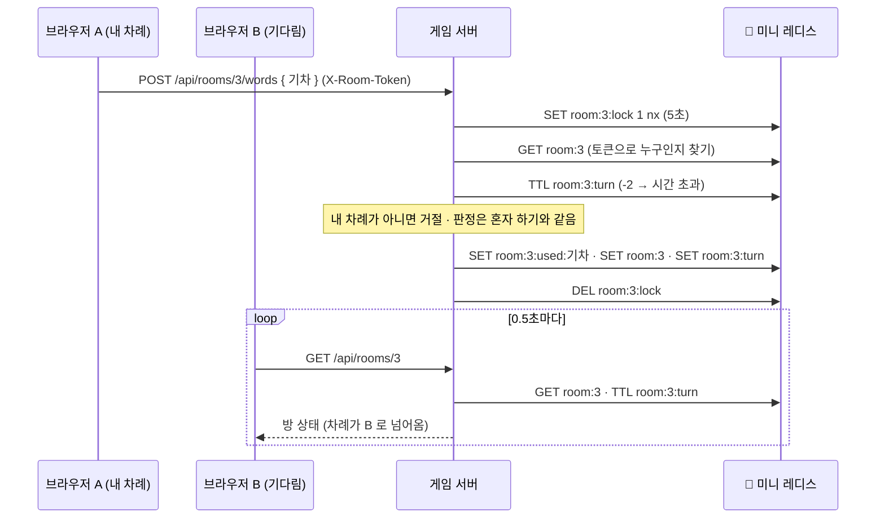

# 🧠 끝말잇기로 보는 미니 레디스

**끝말잇기의 규칙을 Redis 의 기능으로 돌립니다**


> [!NOTE]
> ## 🎯 레디스 기능 = 게임 규칙

| 미니 레디스 기능              | 끝말잇기에서 하는 일                                                                   | 키                                      |
| ---------------------- | ----------------------------------------------------------------------------- | -------------------------------------- |
| ⏱️ **TTL (만료)**        | 한 차례 **10초 제한 시간**과 라운드 시간을 키 하나의 만료로. 키가 사라지면 시간 초과 → 목숨 -1                  | `game:<번호>:turn`, `room:<번호>:turn`     |
| ⚡ **캐시 (Cache-Aside)** | 사전 확인을 DBMS 대신 레디스에서 → **20만 단어 벤치에서 약 3.5배** (실제 사전은 약 34만 단어)               | `word:<단어>`, `first:<글자>`              |
| 🧹 **무효화**             | 단어를 등록·삭제하면 그 캐시를 바로 지워 **다음 차례부터 반영** (순차 요청 기준, [4장 한계](#4-캐시와-무효화--사전-확인)) | `del`, `delByPrefix`                   |
| 🔒 **nx (없을 때만 저장)**   | 같은 판에 동시에 낸 단어는 **하나만 처리** (잠금). 같은 와이파이에서 2~4명이 하는 방도 같은 방식                  | `game:<번호>:lock`, `room:<번호>:lock`     |
| ➕ **incr**             | 판 · 방 번호를 겹치지 않게 발급, 로그인 실패 횟수 세기                                             | `game:seq`, `room:seq`, `login:fail:*` |
| 🔑 **세션 TTL**          | 제작자 로그인(단어 추가용 계정) **30분 뒤 자동 로그아웃**                                                     | `session:<토큰>`                         |
| 💾 **AOF (영속성)**       | 서버가 꺼졌다 켜져도 **기록된 키를 복구** (최근 약 1초 기록은 잃을 수 있음)                               | `data/redis.aof`                       |


| ⏱️ 제한 시간 | ⚡ 단어 확인 | 🔒 동시 제출 8번 | 💾 강제 종료 후 |
|:---:|:---:|:---:|:---:|
| 서버의 키 만료로 판정 | 56 ms → **16 ms** (20만 단어 벤치) | → **1번만 처리** | **기록된 값 복구** (테스트) |



게임 서버는 미니 레디스를 **HTTP API 로만** 씁니다. 실제 Redis 의 RESP 프로토콜이 아니라, Redis 와 같은 키-값 사용 패턴을 이 프로젝트의 HTTP + JSON API 로 구현한 것입니다.
미니 DBMS 는 단어 사전과 판 기록의 원본이고, 미니 리액트는 화면입니다 (부록).

**왜 자바스크립트(Node.js)인가.** 실제 Redis 는 C 로 만들고, 명령을 스레드 하나의 이벤트 루프에서 하나씩 처리해 잠금 없이 원자성을 지킵니다. Node.js 는 자바스크립트를 원래 스레드 하나에서 실행하므로, 저장소 명령을 `await` 없는 동기 함수로만 쓰면 같은 성질이 따라옵니다 (6장). 그래서 이벤트 루프 · HTTP · JSON 은 언어에 맡기고, 해시 테이블 · 만료 · 원자적 명령 · 영속성 · 캐시 설계에 집중했습니다. 외부 패키지는 0개입니다.

<details>
<summary><b>더 알아보기 — 레디스를 처음 보는 분께 (기본 개념)</b></summary>

- **키-값 저장소(Key-Value Store)**: 이름표(키, 문자열) 하나에 값 하나를 붙여 둡니다. `game:7` → `{ 목숨: 3, 점수: 120 }` 처럼요. 표(테이블)나 SQL 은 없고, "이 키의 값을 줘 / 이 키에 이 값을 넣어"만 합니다.
- **메모리에 둔다**: 파일에서 읽지 않으니 빠릅니다. 대신 프로세스가 꺼지면 사라집니다 (그래서 8장의 AOF 가 따로 필요합니다).
- **서버로 따로 돈다**: 게임 서버와 다른 프로그램이고, 게임 서버는 네트워크로 명령을 보냅니다. 게임 서버가 여러 개여도 같은 데이터를 함께 볼 수 있습니다.
- **TTL(Time To Live, 보관 기간)**: 키에 기간을 붙이면 지난 뒤 없는 키가 됩니다. 남은 시간을 물으면 ms 로, 만료가 없는 키는 -1, 없는 키는 -2 로 답합니다 (3장).
- **원자적 명령**: 두 요청이 거의 동시에 같은 값을 "읽고 → 계산하고 → 쓰면" 결과가 꼬입니다 (판 번호 7 을 둘이 읽고 둘 다 8 을 쓰면 번호가 겹침). 레디스는 명령을 한 번에 하나씩 실행하므로, `incr`(더하기) · `set … nx`(없을 때만 저장 = 잠금)처럼 **명령 하나**로 만들어 두면 끼어들 틈이 없습니다 (6장).
- **캐시(Cache) · 무효화(Invalidation)**: 느린 원본(파일 기반 DBMS)의 결과를 레디스에 잠깐 복사해 두고(캐시 어사이드, Cache-Aside), 원본이 바뀌면 그 복사본을 지웁니다. 지우는 것을 잊어도 사라지게 늘 TTL 을 같이 겁니다 (4장).
- **영속성 · AOF(Append Only File)**: 데이터를 바꾼 명령을 파일 끝에 한 줄씩 적고, 다시 켤 때 처음부터 다시 실행합니다. 디스크에 내려가게 하는 `fsync` 를 1초마다 불러서, 강제 종료 때 최근 약 1초는 잃을 수 있습니다 (8장).
- **나누는 기준**: 오래 둘 원본(단어 사전, 끝난 판 기록)은 미니 DBMS(파일), 잠깐 쓰는 상태(진행 중인 판 · 방, 차례 시간, 나온 단어, 잠금, 캐시, 로그인 세션)는 미니 레디스(메모리).

</details>

<details>
<summary><b>더 알아보기 — 왜 자바스크립트인가 (C 로 만든 미니 레디스와 비교)</b></summary>

미니 레디스를 C 로 만드는 경우가 많은데, 실제 Redis 가 C 로 쓰였기 때문입니다. 이 프로젝트는 거의 전부 자바스크립트입니다 (나머지는 HTML · CSS, 데이터인 JSON · 단어 목록).

| 이 프로젝트에 필요한 것 | Node.js 에서 | C 로 만든다면 |
|---|---|---|
| 명령이 한 번에 하나씩 (원자성) | JS 실행 스레드가 하나 → 동기 함수 = 끼어들 틈 없음 | `poll` · `epoll` 이벤트 루프를 직접 짜거나, 스레드 + 잠금 |
| 연결 수백 개를 동시에 받기 | `node:http` + 이벤트 루프 (비동기 I/O) | 소켓 · 논블로킹 · 연결별 버퍼를 직접 관리 |
| HTTP API (외부 프로그램이 쓰기 쉬운 API) | `node:http` 내장 | HTTP 해석기를 직접 짜거나 라이브러리 |
| 값 = 아무 JSON, AOF 한 줄 = JSON 한 줄 | `JSON.parse` · `JSON.stringify` 내장 | JSON 해석 · 직렬화를 직접 |
| 파일 끝에 쓰기 · `fsync` | `fs.writeSync` · `fs.fsyncSync` | `write` · `fsync` 시스템 호출 (같음) |
| 비밀번호 해시 · 토큰 | `node:crypto` 의 `scrypt` · `randomBytes` | OpenSSL 같은 라이브러리 |
| 여러 스레드 (미니 DBMS 의 스레드 풀) | `worker_threads` + `SharedArrayBuffer` + `Atomics` | `pthread` + 뮤텍스 |
| 화면 | 브라우저는 자바스크립트만 돈다 → 미니 리액트도 JS | 화면은 어차피 JS |
| 테스트 | `node:test` 내장 | 테스트 도구를 따로 |

- C 로 만드는 미니 레디스는 소켓 · 이벤트 루프 · 메모리까지 직접 다루는 **시스템 프로그래밍 연습**에 무게가 있고, 이 프로젝트는 **레디스 기능을 실제 서비스(게임) 규칙에 붙여 보는 것**에 무게가 있습니다.
- 한 언어라서: 브라우저 · 게임 서버 · 미니 레디스 · 미니 DBMS 를 한 사람이 한 번에 따라 읽을 수 있고, 규칙 함수(`game/rules.js`)를 게임 서버와 단어 분석 스크립트(`words/analyze.js`)가 같이 씁니다. 레디스에 넣는 값도 자바스크립트 객체 그대로(JSON)입니다.

| 대신 잃는 것 | 이 코드에서 드러나는 곳 |
|---|---|
| 메모리를 직접 다루지 못함. 노드 하나가 JS 객체라 C 구조체보다 크고, 쓰레기 수집(GC) 때 잠깐 멈출 수 있음 | 해시 테이블 노드 `{ key, value, next }` |
| 숫자가 기본으로 64비트 실수 | 32비트 해시를 맞추려고 `Math.imul` 과 `>>> 0` 을 씀 (2장) |
| 문자열이 UTF-16 | 해시를 `charCodeAt`(UTF-16 단위)으로 계산해서, UTF-8 바이트로 계산하는 C 구현과 **한글 키의 해시값이 다르다** (영문 키는 같다) |
| 속도 | 실제 Redis 와 비교하지는 않았다. 9장의 수치는 "캐시를 쓴 경우와 안 쓴 경우"의 차이 |
| 리사이즈 중 멈춤 | 스레드가 하나라, 한 번에 옮기는 리사이즈 동안 다른 명령이 모두 기다린다 (11장) |

<sub>출처 (2026-11-18 확인): [Redis — What is Redis?](https://redis.io/tutorials/what-is-redis/) (명령 처리는 스레드 하나의 이벤트 루프, Redis 는 C 로 작성)</sub>

</details>

---

<br>

## 0. 실행

Node.js 만 있으면 됩니다. 설치할 패키지가 없습니다. 반드시 **이 디렉토리(`word-chain/`) 안에서** 실행해야 합니다.

```bash
npm start
```

그리고 다음 링크로 들어가서 시연을 해주세요.

```
http://127.0.0.1:3000
```

| 서버 | 주소 | 하는 일 |
|---|---|---|
| 게임 서버 | `http://127.0.0.1:3000` | 화면 파일과 게임 API |
| **미니 레디스** | `http://127.0.0.1:6380` | 키-값 저장소 (기록 파일 `data/redis.aof`) |
| 미니 DBMS | `http://127.0.0.1:4000` | SQL 실행 (테이블 파일 `data/db/`) |

> 💡 **시연 포인트**: 화면 오른쪽 **"방금 일어난 일"** 패널에 요청마다 값을 어디서 가져왔는지(🧠 레디스 캐시 / 🗄️ DBMS 전체 탐색 / 🗄️ DBMS 인덱스)와 걸린 시간이 나옵니다. 같은 글자로 두 번 이어 보면 두 번째는 레디스에서 나오는 것을 볼 수 있습니다.

같은 와이파이의 다른 기기와 같이 하려면 `npm start` 대신 `npm run room` 으로 켜고, 출력된 주소를 알려 준 뒤 **"같이 하기"** 탭에서 방을 만듭니다 (부록 B).

<details>
<summary><b>명령 모음 · 제작자 계정 · 포트 바꾸기</b></summary>

| 명령 | 하는 일 |
|---|---|
| `npm start` | 단어 파일 → DBMS 로 넣고, 서버 세 개를 켠다 |
| `npm run room` | `npm start` 와 같지만 게임 서버를 같은 와이파이에 연다 ("같이 하기" 탭으로 2~4명이 한 방에서). 다른 기기에 알려 줄 주소를 출력 |
| `npm run admin` | 제작자 계정 만들기 (화면에서 단어를 등록·삭제할 때 필요) |
| `npm run words` / `npm run words:reset` | 단어 파일의 새 단어만 넣기 / 테이블을 비우고 다시 채우기 (서버를 끄고 실행) |
| `npm test` / `npm run test:redis` / `npm run test:dbms` | 테스트 (10장) |
| `npm run bench` | 캐시 유무 성능 비교 (9장) |

- 제작자 계정은 아이디와 비밀번호를 물어보고 `admin.json` 에 저장합니다 (비밀번호는 해시로 저장, 저장소에는 올라가지 않음). 게임은 로그인 없이 합니다.
- 포트 바꾸기: `PORT=3100 REDIS_PORT=6381 DB_PORT=4001 node server.js`
- 시험용 사전으로 켜기: `node server.js --data <데이터 폴더> --words <단어 파일 폴더>`

</details>

<details>
<summary><b>더 알아보기 — 구조 · 폴더 · 켜지는 순서</b></summary>

- 세 서버를 `server.js` 하나가 한 프로세스 안에서 켭니다. 그래도 게임 서버는 레디스 · DBMS 를 **HTTP 로만** 부릅니다 (외부 프로그램이 쓰는 방식 그대로).
- 기본 주소는 `127.0.0.1` (이 PC 안에서만). `npm run room` 은 게임 서버만 `0.0.0.0` 으로 열어 같은 와이파이의 다른 기기가 들어오게 합니다.

```
word-chain/
├── server.js            세 서버를 켜는 진입점 (npm start)
├── room.js              HOST=0.0.0.0 으로 server.js 를 켜고 접속 주소를 출력 (npm run room)
├── redis/src/           미니 레디스
│   ├── hash-table.js    해시 테이블 (2장)
│   ├── store.js         명령 · 만료 · 무효화 · 기록 알림 (2 · 3장)
│   ├── api.js           HTTP API 서버 (1장)
│   ├── client.js        HTTP 클라이언트 (연결 풀)
│   ├── cache.js         Cache-Aside (4장)
│   └── aof.js           명령 기록 파일 · 복구 · 줄이기 (8장)
├── game/
│   ├── rules.js         규칙 (순수 함수, 부록 B)
│   ├── service.js       혼자 하기 (판 진행 · 사전 · 등급 표 · 순위)
│   ├── rooms.js         같이 하기 (방, 6장)
│   ├── auth.js          제작자 로그인 (7장)
│   ├── server.js        게임 HTTP 서버 (화면 파일 + /api, 부록 D)
│   ├── db.js            미니 DBMS 클라이언트 (부록 A)
│   ├── import-words.js  단어 파일 → DBMS (부록 E)
│   ├── set-admin.js     제작자 계정 만들기 (npm run admin)
│   └── schema.json      테이블 정의
├── web/                 index.html · app.js · api.js · style.css (부록 C)
├── mini-react/          화면 라이브러리
├── dbms/                미니 DBMS
├── words/               words.txt · finishers.txt · remove.txt · extra.txt
└── data/                실행 중 생기는 파일 (redis.aof, db/, words.sql)
```

**켜지는 순서** (`server.js`)

1. **단어 넣기**: `words/*.txt` 에서 DBMS 에 아직 없는 단어만 골라 INSERT 문 파일(`data/words.sql`)을 만들고 DBMS 의 CLI 로 실행 (부록 E)
2. **미니 DBMS 서버** (`maxRows: 100_000`)
3. **미니 레디스**: `data/redis.aof` 를 읽어 복구 → 주기 삭제 타이머 시작 → HTTP 서버
4. **게임 서버**: 레디스 · DBMS 클라이언트 → 서비스 생성 → 단어 캐시 비우기(`word:` · `first:`, 단어 파일이 바뀌었을 수 있음) → 등급 표 미리 세기(비동기, 부록 B) → 로그인(`admin.json`) → 방 서비스 → HTTP 서버
5. `SIGINT` · `SIGTERM` 을 받으면 타이머를 멈추고, 클라이언트 · 서버를 닫고, AOF 를 마지막으로 `fsync` 한 뒤 끝낸다

</details>

<br>

## 1. 레디스 키 지도

한 판이 돌아가는 동안 미니 레디스에 들어가는 키 전부입니다. 키 이름을 `종류:번호:…` 로 지어 두어서, 접두사로 묶어 한꺼번에 지울 수 있습니다.

| 키 | 값 | 만료 | 쓰이는 기능 |
|---|---|---|---|
| `game:<번호>` | 진행 중인 판의 상태 (목숨, 점수, 낸 단어) | 30분 (끝난 판은 10분) | 저장 · 조회 |
| `game:<번호>:turn` | 지금 차례 표시 (내 차례 · 상대가 생각하는 중) | 내 차례 **10초** (라운드 남은 시간이 더 짧으면 그만큼) · 상대 차례 0.1~1초 | 만료. 사라져 있으면 내 차례는 시간 초과, 상대 차례는 상대가 단어를 냄 |
| `game:<번호>:used:<단어>` | 이번 라운드에 나온 단어 (새 라운드에 지움) | 30분 | 조회 (있으면 "이미 나온 단어") |
| `game:<번호>:lock` | 처리 중 표시 | 5초 | `nx` (없을 때만 저장) |
| `word:<단어>` | 사전에 있는지 `{ known, finisher }` | 60초 | 캐시 |
| `first:<글자>` | 그 글자로 시작하는 단어 목록 | 60초 | 캐시 |
| `ranking` | 점수가 높은 판 10개 | 5초 | 캐시 |
| `game:seq`, `stats:games` | 판 번호, 끝난 판 수 | 없음 | `incr` |
| `session:<토큰>` | 제작자 로그인 상태 | **30분** | 만료 → 자동 로그아웃 |
| `login:fail:<접속 주소>` | 로그인 실패 횟수 | 1분 | `incr` + 만료 |
| `room:<번호>` | 같이 하는 방의 상태 (사람, 설정, 차례, 낸 단어) | 30분 (끝난 방은 10분) | 저장 · 조회 |
| `room:<번호>:turn` · `:used:<단어>` · `:lock` | 방에서 지금 차례인 사람의 시간 · 이번 라운드에 나온 단어 · 처리 중 표시 | 차례 시간 · 30분 · 5초 | 만료 · 조회 · `nx` |
| `room:seq` | 방 번호 | 없음 | `incr` |

<details>
<summary><b>더 알아보기 — 미니 레디스 HTTP API 와 클라이언트 (재구현용)</b></summary>

게임 서버는 위 키들을 아래 HTTP API 로 다룹니다 (`redis/src/api.js`). 본문은 JSON, ttl 단위는 ms.

| 요청 | 본문 | 응답 |
|---|---|---|
| `GET /keys/:key` | | `200 { key, value, ttl }` · 없으면 `404` |
| `PUT /keys/:key` | `{ value, ttl?, nx?, xx? }` | `200 { ok: true }` · nx/xx 조건에 막히면 `409 { ok: false, error }` |
| `DELETE /keys/:key` | | `200 { deleted: 0 또는 1 }` |
| `POST /keys/:key/incr` | `{ by? }` | `200 { value }` |
| `POST /keys/:key/expire` | `{ ttl }` | `200 { ok: true }` · 없는 키 `404` |
| `DELETE /keys/:key/expire` | | `200 { ok: true 또는 false }` |
| `GET /keys?prefix=` | | `200 { keys: [...] }` |
| `DELETE /keys?prefix=` | | `200 { deleted: n }` |
| `POST /flush` | | `200 { deleted: n }` |
| `GET /info` | | `200 { keys, keysWithTtl, hits, misses, expired, table }` |

- 키는 경로에 `encodeURIComponent` 로 넣고 서버가 `decodeURIComponent` 로 되돌린다 (잘못된 인코딩 400). 한글 · 공백 · `/` · `?` · `%` 가 든 키도 된다
- `GET` · `DELETE` 는 본문을 읽지 않는다. 나머지는 끝까지 읽어 JSON **객체**인지 확인 (빈 본문 `{}`, 객체가 아니면 400, 1MB 넘으면 413)
- 본문을 다 읽은 뒤 명령을 **함수 호출 한 번**으로 실행한다 (6장)
- 오류는 `{ error }`. 400 인자 오류 · 404 없는 키 / 없는 경로 · 405 지원하지 않는 메서드 · 413 본문 초과 · 500 그 밖
- `listen` 은 `backlog: 4096` 으로 듣는다 (연결이 몰려도 운영체제가 거절하지 않게)

**클라이언트** (`redis/src/client.js`) `createClient(baseUrl, { maxSockets = 32 })` → 메서드 이름 · 반환값이 저장소(2장)와 같은 객체 (모두 Promise)

- `http.Agent({ keepAlive: true, maxSockets: 32 })`: 연결을 최대 32개까지 다시 쓰고, 더 몰리면 줄을 세운다
- `get` → 404 면 `null` · `set` → 409 면 `false` · `ttl` 은 `GET /keys/:key` 로 물어 404 면 `-2` · `expire` → 404 면 `false`
- 그 밖의 4xx · 5xx 는 `RedisError(status, message)` 를 던진다. 서버가 꺼져 있으면 연결 오류를 그대로 던진다 (4장의 캐시는 이것을 삼킨다)

</details>

<br>

> [!NOTE]
> ## 2. 해시 테이블 — 모든 키가 들어가는 곳

`Map` / `Object` 를 쓰지 않고 **버킷 배열 + 연결 리스트**로 직접 만들었습니다 (`redis/src/hash-table.js`).

```
buckets (capacity = 16)
 [0] → { key: 'game:7', … } → null
 [1] ~ [4] null
 [5] → { key: 'word:기차', … } → { key: 'game:7:turn', … } → null     ← 충돌: 연결 리스트로 잇는다
 …
```

1. **해시 계산**: 키를 FNV-1a 로 32비트 정수로 바꾼다. 같은 문자열은 항상 같은 숫자
2. **버킷 번호**: `해시 & (capacity - 1)`. capacity 가 2의 거듭제곱이라 나머지 연산과 같다
3. **충돌**: 같은 버킷의 노드를 `next` 로 잇고(분리 연결법), 찾을 때는 키를 직접 비교
4. **리사이즈**: 노드 수가 `capacity × 0.75` 를 넘으면 2배로 늘려 모든 노드를 다시 배치 → 연결 리스트가 짧게 유지돼 평균 O(1)

**`Map` / `Object` 와 무엇이 다른가.** `Map` 도 V8 안쪽은 해시 테이블입니다. 차이는 해시 · 충돌 · 크기 조절을 **엔진이 숨기느냐, 코드로 드러내느냐**입니다.

| | 안쪽 구조 | 해시 · 충돌 · 크기 조절 | 상태 보기 |
|---|---|---|---|
| `Map`<br>(V8) | 버킷 배열 + 넣은 순서대로 쌓는 항목 배열. 버킷은 첫 항목의 번호만 들고, 같은 버킷 항목끼리는 `chain` 으로 잇는다 | 엔진(C++) 안에 있어 JS 에서 보거나 바꿀 수 없다 | 버킷 수 · 체인 길이를 볼 수 없다 |
| `Object`<br>(V8) | 보통은 숨은 클래스(Hidden Class)가 속성마다 자리를 정해 두고 그 칸에서 읽는다. 속성을 자주 넣고 지우면 사전 모드(Dictionary Mode, 해시 테이블)로 바뀐다 | 엔진 안에 있다 | 볼 수 없다 |
| 이 프로젝트<br>`HashTable` | 버킷 배열 + 노드 `{ key, value, next }` 연결 리스트 | FNV-1a, `next` 체인, 0.75 → 2배 · 0.125 → 절반을 JS 코드로 직접 정한다 | `stats()` 가 capacity · 적재율 · 쓰는 버킷 수 · 가장 긴 체인을 돌려준다 (`GET /api/status`) |

겉으로 보이는 차이도 있습니다. `Map` 은 넣은 순서로 돌고 키에 아무 값이나 씁니다. `Object` 는 키가 문자열 · 심볼이고 프로토타입이 가진 키와 겹칠 수 있으며, 도는 순서 규칙이 복잡합니다. 이 `HashTable` 은 키가 문자열이고 버킷 번호 순서로 돕니다.

<sub>출처 (2026-11-18 확인): [V8 ordered-hash-table.h](https://chromium.googlesource.com/v8/v8/+/main/src/objects/ordered-hash-table.h) · [V8 블로그: Fast properties](https://v8.dev/blog/fast-properties) · [MDN: Map 과 Object 비교](https://developer.mozilla.org/en-US/docs/Web/JavaScript/Reference/Global_Objects/Map)</sub>

저장소(`store.js`)는 이 해시 테이블을 **두 개** 씁니다. `data`(키 → 값)와 `expires`(키 → 만료 시각). 3절의 만료 처리는 `expires` 를 봅니다.
자세한 설계는 [redis/README.md](redis/README.md) 에 있습니다.

<details>
<summary><b>더 알아보기 — 해시 테이블</b></summary>

- **위 그림의 번호**: `game:7` → `game:7:turn` → `word:기차` 순서로 넣었을 때 실제 `hashString` 값으로 계산한 위치입니다. `game:7`(1180080784)은 `& 15` 가 0, `game:7:turn`(2300311477)과 `word:기차`(4115560709)는 둘 다 5라서 같은 버킷에 들어갑니다. 새 노드는 버킷 맨 앞에 끼웁니다.
- **`& (capacity - 1)` 이 나머지와 같은 이유**: capacity 가 16 이면 `16 - 1 = 15 = 0b1111` 이라, AND 하면 하위 4비트, 곧 `hash % 16` 만 남습니다.
- **FNV-1a 는 충돌이 적다고 보장하지 않습니다**: 암호용이 아닌 해시라 키에 따라 한 버킷에 몰릴 수 있습니다. 그래서 충돌은 체인으로 받고, 적재율 0.75 를 넘으면 2배로 늘려 체인을 짧게 둡니다.
- **줄이기**: 키를 많이 지워 적재율이 0.125 아래로 내려가면 절반으로 줄입니다. 16 아래로는 줄이지 않습니다.

</details>

<details>
<summary><b>재구현용 — 해시 테이블 함수 명세 (<code>hash-table.js</code>)</b></summary>

```js
function hashString(key) {                  // FNV-1a, 32비트
  let hash = 0x811c9dc5;                     // 시작값 (FNV offset basis)
  for (let i = 0; i < key.length; i++) {
    hash ^= key.charCodeAt(i);               // 글자 코드(UTF-16 단위)로 XOR
    hash = Math.imul(hash, 0x01000193);      // 16777619 를 곱한다 (32비트 정수 곱셈)
  }
  return hash >>> 0;                         // 부호 없는 32비트 정수로
}
// 버킷 번호 = hashString(key) & (capacity - 1)
```

| 상수 | 값 |
|---|---|
| 처음 · 최소 capacity | 16 (생성자에 준 값은 16 이상의 2의 거듭제곱으로 올림) |
| 늘리는 기준 | 넣은 뒤 `size > capacity × 0.75` → capacity × 2 |
| 줄이는 기준 | 지운 뒤 `capacity > 16` 이고 `size < capacity × 0.125` → capacity ÷ 2 |

| 함수 | 동작 | 반환 |
|---|---|---|
| `set(key, value)` | 같은 키 노드가 있으면 값만 바꾼다. 없으면 새 노드를 리스트 **맨 앞**에 끼우고 size+1, 늘리는 기준 확인 | 새 키였으면 `true` |
| `get(key)` | 버킷의 리스트를 따라가며 `node.key === key` 인 노드 | 값, 없으면 `undefined` |
| `has(key)` | | `true` / `false` |
| `delete(key)` | 앞 노드의 `next` 를 다음 노드로 (머리면 버킷이 다음 노드를 가리키게), size-1, 줄이는 기준 확인 | 지웠으면 `true` |
| `clear()` | capacity 16 의 빈 배열로 | |
| `resize(n)` | 새 배열을 만들고 모든 노드의 버킷 번호를 다시 계산해 옮긴다 (rehash). 옮길 때도 맨 앞에 끼운다 | |
| `entries()` · `keys()` | 0번 버킷부터 차례로 | 제너레이터 · 배열 |
| `scan(cursor, count)` | `cursor` 번 버킷부터 버킷 단위로 읽으며 모은 개수가 `count` 이상이 될 때까지. **버킷 하나는 끝까지** 읽는다. `cursor` 가 capacity 이상이면 0 부터 | `{ cursor: 다음 버킷 (끝까지 돌았으면 0), entries }` |
| `stats()` | | `{ capacity, size, loadFactor, usedBuckets, longestChain }` |

확인 값: 빈 테이블에 13개를 넣으면 capacity 가 32 가 된다 (13 > 16 × 0.75).

</details>

<details>
<summary><b>재구현용 — 저장소 명령 전부 (<code>store.js</code>)</b></summary>

`createStore({ now = Date.now, onWrite = null })`. `now` 는 테스트에서 시간을 움직이려고 바꿔 끼우는 함수, `onWrite(record)` 는 데이터를 바꾼 명령의 기록을 받는 함수(8장의 AOF 가 씀)입니다.

**입력 검사** (어기면 `CommandError` → HTTP 400): 키는 비어 있지 않은 문자열 · 512자 이하, ttl 은 0 보다 큰 유한한 숫자(ms), `set` 의 값은 `undefined` · `null` 이 아닌 JSON 값.

**살아 있는 키** `alive(key)`: 모든 명령은 키를 보기 전에 만료 시각을 확인해, 지났으면 두 테이블에서 지우고(`expired + 1`) "없음"으로 봅니다 (3장의 지연 삭제).

| 명령 | 동작 | 반환 | AOF 기록 |
|---|---|---|---|
| `set(key, value, { ttl, nx, xx })` | `nx`: 살아 있는 키가 있으면 저장 안 함. `xx`: 없으면 저장 안 함. 저장할 때 **ttl 이 없으면 걸려 있던 만료를 지운다** | 저장했으면 `true` | `{op:'set', key, value, expireAt}` (만료 없으면 `null`) |
| `get(key)` | 살아 있으면 값 (`hits + 1`), 없으면 `misses + 1` | 값 또는 `null` | |
| `del(...keys)` | 살아 있는 키만 지운다 | 지운 개수 | 키마다 `{op:'del', key}` |
| `exists(key)` | | `true` / `false` | |
| `expire(key, ttl)` | 지금부터 ttl 뒤 만료 | 키가 없으면 `false` | `{op:'expire', key, expireAt}` |
| `persist(key)` | 만료를 없앤다 | 만료가 걸려 있었으면 `true` | `{op:'persist', key}` |
| `ttl(key)` | | 남은 ms, 만료 없음 `-1`, 키 없음 `-2` | |
| `incr(key, by = 1)` | 없는 키는 0 에서 시작. 정수가 아닌 값 · `by` 는 오류. **만료 시각은 그대로 둔다** | 더한 뒤의 값 | `{op:'set', key, value: 결과, expireAt: 기존 값}` |
| `keys(prefix = '')` | `prefix` 로 시작하고 살아 있는 키 | 배열 (버킷 번호 순) | |
| `delByPrefix(prefix)` | `keys(prefix)` 를 하나씩 `del` (prefix 는 비면 안 됨) | 지운 개수 | 키마다 `del` |
| `flushAll()` | 두 테이블을 비운다 | 지우기 전 키 수 | `{op:'flush'}` |
| `sweepExpired(20, 10)` | 주기 삭제 (3장) | 지운 개수 | |
| `info()` | | `{ keys, keysWithTtl, hits, misses, expired, table }` | |
| `apply(record)` · `snapshot()` | 기록 다시 실행 · 살아 있는 키를 `set` 기록 목록으로 (8장) | | |

기록 탭의 "조회 성공 / 실패"는 `hits` / `misses` 입니다. 실패는 "`GET` 했는데 키가 없었던 횟수"라서, 아직 안 나온 단어인지 `GET game:<번호>:used:<단어>` 로 확인하는 정상적인 경우도 실패로 셉니다.

</details>

<br>

> [!NOTE]
> ## 3. TTL — 10초 제한 시간

**제한 시간은 화면의 시계가 아니라 레디스의 키 만료로 판정합니다.**



만료된 키는 두 가지 방법으로 지워집니다.

| | 언제 | 무엇을 보고 어떻게 지우나 | 끝말잇기에서 |
|---|---|---|---|
| **지연 삭제**<br>Lazy Expiration | 그 키를 쓰는 명령이 올 때<br>`get` `set` `del` `exists` `expire` `persist` `ttl` `incr` `keys` | 그 키 하나의 만료 시각을 본다. `만료 시각 ≤ 지금` 이면 지우고 "없음"으로 답한다 (`get` → null, `ttl` → -2) | 단어를 낼 때 `TTL game:7:turn` → -2 → 시간 초과 |
| **주기 삭제**<br>Active Expiration | 요청과 상관없이 **0.1초마다**<br>(서버를 켤 때 `startSweeper` 가 타이머를 건다) | `expires` 테이블을 지난번에 멈춘 버킷부터 키 20개 이상(버킷 하나는 끝까지) 훑어 같은 기준으로 지운다. **1/4 넘게** 만료였으면 바로 다음 20개 (한 번에 최대 10번), 아니면 다음 0.1초까지 쉰다 | 떠난 판의 `game:7`(30분) · `turn`(10초), 다시 찾지 않은 `word:` 캐시(60초) |

- 지연 삭제만 있으면 아무도 다시 찾지 않는 키(도중에 창을 닫고 떠난 판의 `turn` 등)가 서버를 다시 켤 때까지 메모리에 남고, 주기 삭제만 있으면 청소 전까지 만료된 값이 보입니다. 둘을 같이 써서 **만료된 값은 절대 돌려주지 않으면서** 메모리도 회수합니다.
- 화면의 시계는 보여 주기용입니다. 0 이 되면 `GET /api/games/:id` 로 물어보고, 서버는 `turn` 키가 사라져 있으면 그때 목숨을 뺍니다. 화면을 조작해도 시간을 늘릴 수 없습니다.
- **라운드 시간도 같은 키 하나로 잽니다.** 차례 키의 TTL 을 `min(10초, 라운드 남은 시간)` 으로 겁니다. 단어를 받으면 이번 차례에 쓴 시간(건 TTL − 남은 TTL)을 라운드 시간에서 빼고, 라운드 시간 때문에 키가 먼저 사라졌으면 `round-time` 으로 목숨을 뺍니다 (`game/service.js` 의 `turnLimit` · `spend`). 화면의 차례 막대는 매 차례 10초로 다시 차고, 라운드 막대는 따로 줄어듭니다. **상대가 생각하는 시간(남은 라운드 시간에 따라 0.1~1초)도 같은 차례 키로 잽니다.** 상대 차례가 되면 차례 키에 생각 시간을 TTL 로 걸고, 키가 사라진 뒤 처음 오는 요청에서 상대가 단어를 냅니다 (시간 초과와 같은 방식). 생각한 시간도 라운드 시간에서 빠지고, 생각하는 동안 라운드 시간이 다 되면 상대가 `round-time` 으로 목숨을 잃습니다 (부록 B).

<details>
<summary><b>더 알아보기 — 시간 초과가 반영되는 순간</b></summary>

- 키가 만료돼도 서버가 먼저 무언가를 하지는 않습니다. 화면의 0.1초 타이머가 마감 + 0.15초가 지나면 `GET /api/games/:id` 를 보내고(`web/app.js`), 서버는 그 요청을 처리할 때 `TTL` 이 `-2` 이면 목숨을 뺍니다. 단어를 낼 때도 같은 확인을 합니다.
- 판정은 서버가 요청을 처리하는 순간의 키 상태로 합니다. 9.9초에 보낸 단어라도 서버에서 처리될 때 10초가 지났으면 시간 초과입니다.
- `TTL` 의 `-1` 은 "키는 있는데 만료가 없음"(`game:seq` 등), `-2` 는 "키가 없음"(만료돼 지워진 경우 포함)입니다. 실제 Redis 와 같은 규칙입니다 ([Redis TTL](https://redis.io/docs/latest/commands/ttl/), 2026-11-18 확인).

</details>

<details>
<summary><b>재구현용 — 주기 삭제 순서 (<code>sweepExpired</code>)</b></summary>

```
sweepExpired(sample = 20, rounds = 10):
  removed = 0
  최대 rounds 번 반복:
    { cursor, entries } = expires.scan(sweepCursor, sample)   ← 지난번에 멈춘 버킷부터
    sweepCursor = cursor
    expired = entries 중 만료 시각이 지난 키를 지운 수
    removed += expired
    entries 가 비었거나 expired × 4 ≤ entries 수이면 멈춘다   ← 1/4 넘게 만료였을 때만 한 번 더
  return removed
```

`startSweeper(store, 100)` 이 `setInterval` 로 100ms 마다 부르고, `unref()` 로 이 타이머 때문에 프로세스가 안 끝나는 일이 없게 합니다.

</details>

<br>

> [!NOTE]
> ## 4. 캐시와 무효화 — 사전 확인

미니 DBMS 는 `word` 열에 인덱스가 없어서, 단어 하나를 확인할 때마다 **34만 줄을 처음부터** 훑어야 합니다. 그래서 결과를 미니 레디스에 60초 동안 둡니다 (`redis/src/cache.js` 의 `getOrLoad`).



**캐시를 보는 때** (읽기 → 없으면 DBMS → 60초 저장)

| 게임에서 | 키 | 조건 |
|---|---|---|
| 단어를 낼 때 사전 확인 (혼자 하기 · 같이 하기 같은 캐시) | `word:<단어>` | 형식 · 시작 글자 · 이미 나온 단어를 통과한 단어만 |
| 단어를 받아들인 뒤, 상대가 받아친 뒤 이을 단어 세기 (등급 · 상대 후보) | `first:<끝 글자>` | 두음법칙이면 글자 두 개 |
| 판을 열 때 · 목숨을 잃고 새 라운드를 열 때 시작 단어 확인 | `word:`, `first:` | 무작위 번호로 뽑은 단어마다 |
| 사전 화면에서 글자로 찾기 (`GET /api/words`) | `first:<글자>` | |
| 기록 탭의 순위 | `ranking` | 5초 보관 |

**무효화가 없으면 생기는 문제.** "없는 단어"라는 결과도 캐시합니다. 그래서 무효화가 없으면 방금 등록한 단어가 60초 동안 "등록되지 않은 단어"로 거절됩니다. 그래서 원본을 바꿀 때마다 그 키를 바로 지웁니다.

| 무효화하는 때 | 지우는 키 | 방법 |
|---|---|---|
| 단어 등록 · 삭제 | `word:<단어>`, `first:<첫 글자>` | 키 하나씩 `del` |
| 새 라운드 · 판 종료 | `game:<번호>:used:` 로 시작하는 키 전부 | 접두사로 묶어서 `delByPrefix` |
| 판 종료 | `ranking` | `del` |
| 서버를 켤 때 | `word:`, `first:` 로 시작하는 키 전부 | `delByPrefix` (단어 파일이 바뀌었을 수 있음) |
| 그 밖에 | 모든 캐시 | ttl 이 지나면 저절로. 지우는 것을 잊어도 언젠가 사라진다 |

`cache.js` 가 추가로 처리하는 두 가지

- **동시에 놓친 요청 합치기**: 캐시에 없는 같은 키를 여러 요청이 동시에 찾으면, 먼저 시작한 DBMS 조회 하나를 나머지가 함께 기다립니다. 원본은 1번만 읽습니다.
- **레디스가 죽었을 때**: 캐시 오류는 무시하고 DBMS 에서 읽습니다. 사전 확인은 느려질 뿐 계속됩니다. 다만 판 상태 · 제한 시간 · 잠금도 레디스에 있어서, 레디스 서버가 멈추면 판 시작과 단어 내기는 실패합니다.

> ⚠️ **무효화의 한계 (동시 요청)**: 캐시 미스로 DBMS 를 읽는 도중에 같은 단어가 등록·삭제되면, 무효화(`del`)가 먼저 끝난 뒤 진행 중이던 조회가 **옛 결과를 캐시에 다시 쓸 수 있습니다** (`cache.js` 는 로더가 끝난 뒤 저장하고, 무효화는 별도로 지웁니다). 그래서 "다음 차례부터 반영"은 요청이 순서대로 올 때 기준이고, 이렇게 겹친 경우에는 ttl(60초)이 지나야 바로잡힙니다. 막으려면 캐시 세대 번호 등으로 오래된 로더의 저장을 막아야 합니다.

<details>
<summary><b>더 알아보기 — 캐시가 어긋나는 순서</b></summary>

| 순서 | 조회 A ('기차' 확인) | 등록 B ('기차' 등록) |
|:---:|---|---|
| ① | `word:기차` MISS → DBMS 를 읽기 시작 | |
| ② | (읽는 중) | DBMS 에 INSERT → `DEL word:기차` |
| ③ | 등록 전에 읽은 "없음" 을 `SET word:기차` (60초) | |

- 이때 옛 값은 무효화한 때가 아니라 ③에서 다시 쓴 때부터 60초 동안 남습니다.
- 같은 키를 동시에 놓친 요청을 합치는 `loading` Map 은 프로세스 안에만 있습니다. 게임 서버가 여러 대라면 서버마다 한 번씩 원본을 읽습니다.

</details>

<details>
<summary><b>재구현용 — <code>getOrLoad</code> 순서와 사전 찾기 함수</b></summary>

`createCache(redis, { ttl = 60_000 })` → `{ stats, getOrLoad, invalidate }`. `redis` 는 클라이언트든 저장소든 `get` · `set` · `del` 만 있으면 됩니다.

```
getOrLoad(key, loader):
  cached = safely(redis.get(key), 실패하면 null)
  cached 가 null 이 아니면 → hits + 1, { value: cached, hit: true }
  misses + 1
  loading 에 key 가 없으면:                     ← 같은 키를 동시에 놓친 요청은 하나의 loader 를 함께 기다린다
    job = loader() → 값이 null/undefined 가 아니면 safely(redis.set(key, 값, { ttl })) → 값
          끝나면 loading 에서 key 를 지운다
    loading.set(key, job)
  return { value: await loading.get(key), hit: false }

invalidate(key) = safely(redis.del(key), 실패하면 0)
safely(run, fallback) = run 이 던지면 errors + 1 하고 fallback     ← 레디스가 죽어도 원본으로 동작
```

**게임의 사전 찾기** (`game/service.js`)

```
findWord(word):                     ← 원본 조회 (캐시를 거치지 않음)
  SELECT id, finisher, removed FROM words WHERE word = '…'
  latest = id 가 가장 큰 줄
  known = latest 가 있고 removed ≠ 1,  finisher = known 이고 latest.finisher = 1

lookup(word) = getOrLoad('word:' + word, findWord)                         ← 60초

wordsStartingWith(char) = getOrLoad('first:' + char, …):                   ← 60초
  SELECT id, word, finisher, removed FROM words WHERE first = '…'
  id 순으로 같은 단어는 마지막 줄만, removed = 1 은 뺀다 → [{ word, finisher }]

continuations(word, used):
  all = nextStartChars(word) 의 글자마다 wordsStartingWith 를 이어 붙인 것
  return { total: all 의 개수 (등급의 기준), open: all 중 used 에 없는 것 (낼 수 있는 후보) }
```

</details>

<br>

## 5. 단어 하나를 냈을 때의 레디스 명령

'단어 내기'를 한 번 누르면 게임 서버가 미니 레디스에 보내는 명령 순서입니다 (`game/service.js` 의 `play`).


1. **잠금**: `nx` 로 잠금 키를 만든 요청만 들어갑니다 (6장).
2. **시간 확인**: `turn` 키가 없으면(`-2`) 시간 초과입니다 (3장).
3. **판정**: 형식 → 시작 글자 → `used` 키 → `word:` 캐시 순서. 앞의 조건을 통과한 단어만 사전을 찾아봅니다. 통과하면 이을 단어를 세고, 라운드의 첫 단어인데 한방(이을 단어 0개)이면 거절합니다 (첫 턴 한방 금지).
4. **상대 차례**: 내 단어를 받아들이면 바로 답하고, `turn` 키에 상대의 생각 시간(0.1~1초, 부록 B)을 겁니다. 그 키가 사라진 뒤 화면이 판 상태를 물으면(`GET`), `first:<끝 글자>` 캐시에서 후보를 꺼내 이번 라운드에 나온 단어(`used`)를 빼고, 후보마다 등급을 매겨 하나를 고릅니다 (고르는 법은 부록 B). 두음법칙이 있으면 `first:리`, `first:이` 처럼 두 키를 봅니다.
5. **새 차례**: 판 상태를 저장하고 `turn` 키에 다시 10초(라운드 남은 시간이 더 짧으면 그만큼)를 겁니다.
6. **응답의 `trace`**: 위 단계마다 캐시였는지 DBMS 였는지와 걸린 시간을 담아 화면에 보여 줍니다.

판이 끝나면 판 기록을 DBMS 에 `INSERT` 하고, 레디스에서는 `DEL game:7:turn`, `delByPrefix game:7:used:`, `DEL ranking`, `INCR stats:games` 를 실행합니다. 목숨을 잃어 새 라운드를 열 때도 `delByPrefix game:7:used:` 로 나온 단어를 비웁니다 (끄투처럼 라운드마다).

<details>
<summary><b>재구현용 — 판 상태 모양과 판 · 라운드 · 단어 · 목숨 순서 (<code>game/service.js</code>)</b></summary>

`createGameService({ redis, db, turnMs = 10_000, random = Math.random, wordFiles = null, randomStart = true, lives = 3, secondMs = 1000, coin = random, think })`. `secondMs` 는 라운드 시간 1초의 길이(테스트에서 줄임), `coin` 은 첫 선공을 정하는 난수, `think` 는 남은 라운드 시간 → 상대의 생각 시간(기본 `thinkTime` 을 `secondMs` 에 맞춰 늘이고 줄인 것. 0 이면 기다리지 않고 바로 둠, 테스트에서 씀)입니다.

**판 상태** (`game:<번호>` 의 값)

| 필드 | 뜻 |
|---|---|
| `id` · `player` · `level` | 판 번호 · 이름(앞뒤 공백 뺀 12자, 비면 '손님') · 난이도 |
| `round` · `roundMs` · `roundLeftMs` · `roundNo` | 라운드 시간(초) · 그것을 ms 로 · 이번 라운드에 남은 ms · 몇 번째 라운드 |
| `turn` · `turnLimitMs` | 지금 차례 `'player'` / `'computer'` · 차례 키에 건 TTL |
| `thinkMs` · `thinkLate` | 상대 차례의 생각 시간(라운드 남은 시간까지) · 생각을 마치기 전에 라운드 시간이 끝나는가 |
| `status` · `result` · `reason` | `'playing'` / `'over'` · `'win'` / `'lose'` / `null` · 끝난 이유 |
| `need` | 다음 단어가 시작해야 할 글자 배열, 없으면 `null` (아무 단어) |
| `turns` · `lives` · `livesStart` · `score` | 받아들인 단어 수 · `{ player, computer }` · 처음 목숨 수 · `{ player, computer }` |
| `firstMove` · `starter` | 이번 라운드의 첫 수가 아직인가 · 이번 라운드를 먼저 낸 쪽 |
| `history` · `recordId` | 기록 목록 · 끝났을 때 DBMS 의 `games` id |

- `history` 한 줄: 단어 `{ by: 'start' | 'player' | 'computer', word, options, grade, points }` (상대는 `finisher` · `thinkMs` 도), 목숨 `{ by: 'life', who, reason, left }`
- 화면에 보낼 때 더하는 값: `remainingMs` = 차례 키의 남은 TTL(실제 마감까지), `turnRemainingMs` = `turnMs − (turnLimitMs − remainingMs)` (차례 막대, 상대 차례면 `turnMs` 그대로), `roundRemainingMs` = `roundLeftMs − (turnLimitMs − remainingMs)` (라운드 막대), `turnMs`. 끝난 판이면 셋 다 0
- `trace` 한 줄: `{ label, key, source: 'cache' | 'db' | 'redis' | 'think', plan, ms }` (`think` 는 상대가 생각한 시간)

**판 열기 · 라운드 열기**

```
start({ player, level, round, lives }):
  level 이 5개 중 하나가 아니면 'normal', round 가 6개 중 하나가 아니면 60, lives 가 1~5 정수가 아니면 기본값
  id = INCR game:seq,  state = { … roundNo: 1, status: 'playing', history: [] }
  openRound(state, 빈 집합, coin() < 0.5 ? 'player' : 'computer')

pickStartWord(used):                          ← 시작 단어
  rows = DBMS 의 words 레코드 수 (GET /tables)
  최대 30번: id = 1 + floor(random() × rows) → SELECT word FROM words WHERE id = …
    2~3글자 · used 에 없음 · lookup 으로 살아 있음 · continuations 의 open 이 1개 이상 → { word, total }

openRound(state, used, starter):
  first = randomStart 면 pickStartWord(used)
  need = null, roundLeftMs = roundMs, firstMove = true, starter 기록
  first 가 있으면: history 에 시작 단어(0점), need = nextStartChars(first), SET game:<번호>:used:<first>
  starter 가 상대면: computerTurn (아래) 하고 끝
  아니면: turn = 'player', turnLimitMs = max(1, min(turnMs, roundLeftMs))
          SET game:<번호> (30분) → SET game:<번호>:turn 1 (ttl turnLimitMs)
```

**단어 내기** `play(id, word)`

```
withLock(id):                                     ← SET game:<번호>:lock 1 nx ttl 5초, 실패 409, finally DEL
  state = GET game:<번호>  (없으면 404, 끝난 판이면 409)
  turn 이 'computer' → TTL turn 이 -2 면 computerReply 를 먼저 반영, 거절 'not-your-turn'
  remaining = TTL game:<번호>:turn
  -2 → loseLife(플레이어, turnLimitMs < turnMs ? 'round-time' : 'timeout'), 거절 'timeout'
  형식 · 시작 글자 · used(GET …:used:<단어>) 를 통과하면 lookup
  rejectReason(word, { need, used, known }) → 거절이면 판을 바꾸지 않고 돌려준다
  usedWords = KEYS game:<번호>:used: + 이 단어,  mine = continuations(word, usedWords)
  firstMove 이고 (mine.total = 0 또는 끝내기 단어) → 거절 'first-kill'
  roundLeftMs −= (turnLimitMs − remaining)                      ← 이번 차례에 쓴 시간
  SET …:used:<단어>, history · 점수 · turns, firstMove = false, need = nextStartChars(word)
  computerTurn (아래)                                           ← 내 단어는 여기서 바로 답한다
응답: { accepted, reject: { code, message } | null, computer, game, trace }
      computer 는 보통 null (상대는 생각 시간이 지난 뒤 get 에서 둠). 생각 시간 0 이면 여기서 둔 { word, finisher, thinkMs }
```

**상대의 생각 · 한 수**

```
computerTurn(state):                                              ← 상대 차례를 연다
  left = roundLeftMs,  wanted = think(left)                       ← 기본 thinkTime (부록 B)
  turn = 'computer',  thinkLate = wanted ≥ left,  thinkMs = min(wanted, left),  turnLimitMs = max(1, thinkMs)
  wanted 가 0 이면 바로 computerReply
  아니면 SET game:<번호> → SET game:<번호>:turn 1 (ttl turnLimitMs)  ← 키가 사라지면 상대가 둔다

computerReply(state):                                             ← 차례 키가 사라진 뒤 (get · play 에서)
  roundLeftMs −= thinkMs,  turn = 'player',  trace 에 { source: 'think', ms: thinkMs }
  thinkLate 면 → loseLife(상대, 'round-time')
  usedWords = KEYS game:<번호>:used:
  need 가 있으면: 마지막 단어(내 단어 또는 시작 단어) 뒤를 잇는 상대의 한 수 (아래)
  없으면: pickStartWord 로 고른 단어를 상대가 낸다
  낼 단어가 없으면 → loseLife(상대, 'computer-stuck'),  상대 단어의 open 이 0 → loseLife(플레이어, 'no-word')
  아니면 turnLimit → SET game:<번호> → SET …:turn                  ← 이제 내 차례 10초

counts = 등급 표 (부록 B). 못 만들었으면 등급 없이 (끝내기 단어만 한방으로)
grader(단어) = gradeOf( nextStartChars(단어) 의 글자마다 counts 를 더한 값 )
firstMove 면 후보에서 끝내기 단어와 grader 가 한방인 단어를 뺀다
reply = pickWord(후보, level, random, grader)                    ← 부록 B
reply 가 있으면: SET …:used:<reply>, theirs = continuations(reply, usedWords + reply),
                  history 에 상대 단어(thinkMs 포함), 상대 점수, turns, need = nextStartChars(reply), firstMove = false
```

**목숨 잃기 · 판 끝내기 · 그 밖**

```
loseLife(state, who, reason):
  lives[who] − 1, history 에 { by: 'life', who, reason, left }
  lives[who] ≤ 0 → finish(플레이어가 졌으면 'lose', 아니면 'win', reason)
  roundNo + 1, delByPrefix game:<번호>:used:,  openRound(state, 빈 집합, who)     ← 진 쪽이 먼저

finish(state, result, reason):
  status = 'over', INSERT INTO games (player, level, turns, result, reason, 플레이어 점수) → recordId
  DEL …:turn, delByPrefix …:used:, DEL ranking, INCR stats:games, SET game:<번호> (10분)

get(id):    끝났거나 TTL turn ≠ -2 면 그대로. -2 면 잠금 → 다시 읽어 여전히 -2 면: turn 이 'computer' 면 computerReply, 아니면 플레이어 목숨 −1 (두 번 반영하지 않게)
giveUp(id): 잠금 → 진행 중이면 finish('lose', 'give-up')
```

</details>

<br>

> [!NOTE]
> ## 6. 동시성 — 잠금과 incr

미니 레디스는 **락 없이** 명령 하나의 원자성을 지킵니다. 실제 Redis 도 명령 처리를 한 번에 하나씩 직렬로 합니다 (네트워크 I/O 는 별도 스레드를 쓸 수 있음).

- 저장소 명령(`store.js`)은 전부 중간에 `await` 가 없는 **동기 함수**입니다. Node.js 는 자바스크립트 코드를 한 번에 하나씩 실행하므로, 저장소 명령 하나가 끝나야 다음 명령이 시작됩니다. 네트워크 요청을 받고 보내는 비동기 I/O 는 겹칠 수 있지만, 저장소 명령 자체는 겹치지 않습니다.
- API 서버는 요청 본문을 다 읽은 뒤 명령을 **함수 호출 한 번**으로 실행합니다. 요청이 겹쳐 와도 명령은 한 줄로 서서 실행됩니다.
- "읽고 → 계산하고 → 쓰기"를 요청 두 번으로 나누면 그 사이에 다른 요청이 끼어듭니다. 그래서 이런 동작은 **명령 하나**로 제공합니다.

| 상황 | 레디스 명령 | 결과 (테스트로 확인) |
|---|---|---|
| 같은 판에 단어를 동시에 8번 제출 | `SET game:7:lock 1 nx` | 1번만 처리, 나머지 409 |
| 12판을 동시에 시작 | `INCR game:seq` | 판 번호가 하나도 겹치지 않음 |
| 같은 키에 `incr` 500번 동시에 | `INCR` | 정확히 500 |
| 같은 키에 `nx` 저장 100번 동시에 | `SET … nx` | 성공 1개 |

**끝말잇기에서 쓰는 곳**

| 명령 | 쓰는 곳 | 하는 일 |
|---|---|---|
| `SET game:<번호>:lock 1 nx` (5초) | 단어 내기 `play` · 포기 `giveUp` · 시간 초과 반영 `get` | 판 상태를 바꾸는 요청 세 가지를 한 판에 하나씩만 들인다. 성공한 요청만 실행하고 `finally` 에서 `DEL`, 실패하면 409 |
| `INCR game:seq` | 판 시작 `start` | 돌려받은 값이 판 번호 → `game:<번호>`, `game:<번호>:turn` … 키 이름이 된다 |
| `INCR login:fail:<주소>` | 제작자 로그인 실패 | 값이 1이면 만료 1분을 걸고, 5 이상이면 429 (7장) |
| `INCR stats:games` | 판 종료 `finish` | 끝난 판 수를 센다 |
| `SET room:<번호>:lock 1 nx` (5초) | 같이 하는 방의 들어가기 · 시작 · 단어 내기 · 나가기 · 시간 초과 반영 (`game/rooms.js`) | 한 방을 한 번에 한 요청만. 화면이 0.5초마다 보내는 상태 조회는 시간 초과를 반영할 때만 잠금을 잡고, 이미 잠겨 있으면 409 대신 지금 상태만 돌려준다 |
| `INCR room:seq` | 방 만들기 | 돌려받은 값이 방 번호 |



잠금 키에도 5초 ttl 을 걸어 두어서, 처리 도중 서버가 죽어도 잠금이 영원히 남지 않습니다.

<details>
<summary><b>더 알아보기 — 5초 잠금의 한계</b></summary>

잠금을 풀 때 주인을 확인하지 않습니다 (`game/service.js` 의 `withLock`: `finally { await redis.del(lockKey) }`). 그래서 처리가 5초를 넘기면 아래 순서가 생길 수 있습니다. 코드에서 따져 본 것이고, 재현하지는 않았습니다.

```
요청 A: SET lock nx (5초) 성공 → 처리가 5초를 넘김
                       ↓ lock 만료
요청 B: SET lock nx 성공 → 처리 중
요청 A: 끝 → finally DEL lock   ← B 의 잠금을 지움
요청 C: SET lock nx 성공         ← B 와 C 가 같은 판을 동시에 처리
```

막으려면 잠금 값에 요청마다 다른 토큰을 넣고, 값이 같을 때만 지우게 하면 됩니다. 지금은 없습니다.

</details>

### 같이 하기 — 여럿이 한 방에서

`npm run room` 으로 켜면 같은 와이파이의 2~4명이 한 방에서 차례대로 냅니다 (`game/rooms.js`). 혼자 하기와 같은 레디스 기능을 **방 단위 키**로 씁니다.

| 혼자 하기 | 같이 하기 | 쓰는 기능 |
|---|---|---|
| `game:<번호>` | `room:<번호>` (사람 · 설정 · 차례 · 낸 단어) | 저장 · 조회, 30분 TTL |
| `game:<번호>:turn` | `room:<번호>:turn` (지금 차례인 사람의 시간) | TTL = min(10초, 라운드 남은 시간) |
| `game:<번호>:used:<단어>` | `room:<번호>:used:<단어>` | 새 라운드에 `delByPrefix` |
| `game:<번호>:lock` | `room:<번호>:lock` | `nx` 잠금 (5초) |
| `game:seq` | `room:seq` | `incr` |
| `word:` · `first:` | 같은 키를 같이 씀 | 캐시 |



- **누가 냈는지**: 방에 들어올 때 무작위 토큰을 받고, 요청마다 `X-Room-Token` 머리말로 보냅니다. 토큰은 `room:<번호>` 값 안에 들어 있고, 화면에는 번호(pid)만 내려 보냅니다.
- **차례**: 들어온 순서대로 돕니다. 첫 라운드의 선공만 무작위이고, 그 뒤로는 목숨을 잃은 사람이 다음 라운드를 먼저 냅니다.
- **시간 초과**: 서버가 먼저 알리지 않습니다. 화면이 0.5초마다 방 상태를 묻고, 그 요청에서 `turn` 키가 `-2` 면 그때 차례인 사람의 목숨을 뺍니다. 이 반영만 잠금을 잡고, 이미 잠겨 있으면 409 대신 지금 상태를 돌려줍니다.
- **알림이 없어서 폴링**: 미니 레디스에는 Pub/Sub 이 없어서 화면이 물어보는 방식입니다 (11장).
- **끝**: 한 사람만 남으면 끝나고, 사람마다 판 기록을 DBMS 에 남기고 `ranking` 캐시를 지웁니다. 기록 탭의 순위에 "같이 하기"로 함께 나옵니다.

<details>
<summary><b>재구현용 — 방 상태와 함수 (<code>game/rooms.js</code>)</b></summary>

`createRoomService({ redis, db, dictionary, turnMs = 10_000, secondMs = 1000, random = Math.random, randomStart = true })`. `dictionary` 는 혼자 하기 서비스가 내주는 `{ lookup, continuations, pickStartWord }` 라서 사전 · 캐시를 같이 씁니다.

**방 상태** (`room:<번호>` 의 값): `id`, `name`(20자, 비면 "방장 이름의 방"), `status`(`'waiting'` · `'playing'` · `'over'`), `settings`(`{ lives: 1~5, round }`), `host`(방장 pid), `nextPid`, `players`(`[{ pid, name, token, lives, score }]`, 최대 4명), `turn`(지금 차례 pid), `starter`, `need`, `history`, `turns`, `roundNo`, `roundMs`, `roundLeftMs`, `turnLimitMs`, `firstMove`, `winners`(pid 배열), `reason`

- 토큰은 무작위 16바이트 hex. 응답에서는 토큰을 빼고, 받는 사람의 pid 를 `me` 로 붙인다. 이름을 비우면 `'손님' + pid`
- `history` 는 응답에 마지막 80줄만. 단어 줄 `{ by: 'start' | 'player', pid, word, options, grade, points }`, 목숨 줄 `{ by: 'life', pid, reason, left }`

| 함수 | 잠금 | 동작 |
|---|---|---|
| `list()` | | `KEYS room:` 중 `room:<숫자>` 만, 끝나지 않은 방을 새 방부터 `{ id, name, status, players: [이름], max: 4, settings }` |
| `create({ name, player, lives, round })` | | `INCR room:seq`, 만든 사람 pid 1 · 방장 → `{ room, token }` |
| `join(id, { player })` | ✓ | 기다리는 방만(아니면 409), 4명이면 409 → `{ room, token }` |
| `start(id, token)` | ✓ | 방장만(403), 2명 이상(409). 모두 목숨 = 설정값, 점수 0, roundNo 1, **선공 = 자리 중 무작위 한 명** → 라운드 열기 |
| `play(id, token, word)` | ✓ | 시간 초과면 반영 후 거절. **내 차례가 아니면 `not-your-turn`**. 판정 · 첫 턴 한방 금지 · 라운드 시간 빼기는 혼자 하기와 같음. 받으면 점수를 더하고 **다음 차례 = 자리 순서로 다음, 목숨이 남은 사람** |
| `get(id, token)` | 시간 초과 반영 때만 | `TTL turn = -2` 면 잠금을 잡고 그때 차례인 사람이 목숨 −1. 이미 잠겨 있으면 409 대신 지금 상태 |
| `leave(id, token)` | ✓ | 기다리는 중: 자리 빼기, 방장이면 다음 사람이 방장, 아무도 없으면 방 키 삭제. 판 중: 목숨 0 으로 빠짐(`left`), 한 사람만 남으면 끝 |

- 목숨을 잃으면: 남은 사람이 1명 이하이면 끝(`last-one`). 아니면 roundNo + 1, 나온 단어를 비우고, 그 사람(목숨이 0 이면 자리 순서로 다음 사람)이 먼저인 새 라운드
- 이을 단어가 없는 단어를 받은 사람은 따로 처리하지 않는다. 시간이 다 돼서 목숨을 잃는다
- 끝나면 `winners` = 목숨이 남은 사람, 사람마다 `games` 에 한 줄(`level = 'room'`, 이긴 사람 `'win'`), `DEL ranking`, 차례 · 나온 단어 키 삭제, 방 상태 10분 보관

</details>

<br>

## 7. 세션 — 로그인도 TTL

단어 등록·삭제는 로그인한 제작자만 할 수 있고, 로그인 상태도 레디스 키 하나입니다 (`game/auth.js`).

```
로그인:     아이디·비밀번호 확인 → 무작위 토큰 → SET session:<토큰> { id } (ttl 30분)
단어 등록:  Authorization: Bearer <토큰> → GET session:<토큰> 이 없으면 401
로그아웃:   DEL session:<토큰>
실패 제한:  INCR login:fail:<접속 주소>, 첫 실패 때만 만료 1분 → 첫 실패부터 1분 안에 5번 틀리면
            그 1분이 끝날 때까지 맞는 비밀번호도 거절 (429)
```

- **30분 자동 로그아웃을 위한 코드가 따로 없습니다.** 키가 만료되면 끝입니다.
- "같이 하기"의 사람 토큰은 세션 키가 아니라 방 상태(`room:<번호>`) 안에 있습니다. 방 키가 만료되면(30분, 끝난 방은 10분) 토큰도 함께 사라집니다.
- 비밀번호는 저장하지 않고 `scrypt(비밀번호, salt)` 해시만 `admin.json` 에 둡니다.
- 검사는 서버에서 합니다. 토큰 없이 API 를 직접 호출해도 401 로 거절됩니다.

<details>
<summary><b>재구현용 — 로그인 순서 (<code>game/auth.js</code>)</b></summary>

- **계정 파일** `admin.json` = `{ id, salt, hash }`. `npm run admin` 이 아이디(`/^[A-Za-z0-9_-]{3,20}$/`)와 비밀번호(8자 이상, 두 번 입력)를 받아 만든다. `hash` = `scrypt(비밀번호, salt, 32바이트)` 의 hex, salt 는 무작위 16바이트 hex. 계정 파일은 로그인할 때마다 다시 읽는다
- **로그인** `login(id, password, 접속 주소)`
  1. 계정 파일이 없으면 503
  2. `GET login:fail:<주소>` 가 5 이상이면 429
  3. 아이디와 비밀번호 해시를 각각 SHA-256 으로 바꾼 뒤 `timingSafeEqual` 로 비교 (아이디가 틀려도 해시 계산을 똑같이 해서, 응답 시간으로 아이디가 맞았는지 알 수 없게)
  4. 틀리면 `INCR login:fail:<주소>`, 결과가 1 이면 `EXPIRE` 1분 → 401
  5. 맞으면 실패 키 삭제, 토큰 = 무작위 32바이트 hex(64자), `SET session:<토큰> { id }` ttl 30분 → `{ token, id, expiresInMs }`
- **확인** `session(token)`: 64자 hex 가 아니면 `null`, 아니면 `GET session:<토큰>` → `{ id, remainingMs }`
- 화면은 토큰을 `sessionStorage` 의 `admin` 에 두고, 새로고침하면 `GET /api/session` 으로 아직 살아 있는지 묻는다

</details>

<br>

> [!NOTE]
> ## 8. AOF — 서버가 꺼져도

메모리의 데이터는 프로세스가 죽으면 사라집니다. 그래서 **데이터를 바꾼 명령을 한 줄씩 `data/redis.aof` 끝에 이어 씁니다** (`redis/src/aof.js`).

```
{"op":"set","key":"game:7","value":{…},"expireAt":1794830089761}
{"op":"set","key":"game:7:turn","value":1,"expireAt":1794830099761}
{"op":"del","key":"game:7:lock"}
```

> 📝 실제 Redis 의 AOF 파일과 같은 형식이 아닙니다. Redis AOF 와 같은 개념을 흉내 낸 **프로젝트 전용 JSON Lines 기록**입니다.

| 단계 · 언제 | 하는 일 | 결과 |
|---|---|---|
| **① 기록**<br>데이터를 바꾸는 명령마다<br>(`set` `del` `expire` `persist` `flush`, `incr` 은 계산이 끝난 값을 `set` 으로) | JSON 한 줄을 파일 끝에 쓴다 (`writeSync`) | 운영체제 버퍼에 한 줄 |
| **② 디스크 반영**<br>1초마다 (`everysec`, 기본값) | 지난 반영 뒤 쓴 줄이 있으면 `fsync` | 강제 종료 때 잃을 수 있는 범위가 최근 약 1초 (운영체제 · 저장 장치에 따라 다름) |
| **③ 정상 종료**<br>Ctrl+C · `SIGTERM` | 마지막 `fsync` 뒤 파일을 닫는다 | 쓴 기록이 모두 디스크에 남는다 |
| **④ 다시 켜기**<br>`npm start` | 파일을 첫 줄부터 다시 실행한다. 만료 시각이 지난 `set` 은 건너뛰고, 해석 안 되는 줄(쓰다 잘린 줄)에서 멈춘다 | 꺼지기 직전 상태 (판 상태 · 나온 단어 · 로그인 세션) |
| **⑤ 파일 줄이기**<br>④ 바로 뒤 | 살아 있는 키만 `redis.aof.tmp` 에 쓰고 `fsync` → 이름을 바꿔 교체 | 파일에는 살아 있는 키의 `set` 줄만. 도중에 죽어도 원래 파일이 남는다 |

- **만료는 "끝나는 시각"으로 기록**: "10초 뒤"로 적으면 재시작할 때마다 10초가 다시 시작됩니다. 끝나는 시각을 적어 두어서 **꺼져 있던 동안 지난 시간도 반영**됩니다 (꺼져 있는 동안 10초가 지났으면 켜자마자 시간 초과).
- **판과 방이 같은 기록에 남음**: `game:` · `room:` · `session:` 키가 모두 같은 AOF 파일에 기록되므로, 다시 켜면 진행 중이던 방도 같은 방식으로 되살아납니다 (코드 기준. 방 복구를 따로 테스트하지는 않았습니다).
- **원자적 트랜잭션이 아님**: 한 차례는 여러 레디스 명령과 DBMS 쓰기로 나뉘어 있고, AOF 는 각 명령을 따로 기록합니다. 그래서 처리 도중 강제 종료되면 한 차례 전체가 항상 한 덩어리로 복구된다고 보장하지는 않습니다.

스냅샷 대신 AOF 를 고른 이유는, 스냅샷은 마지막 저장 이후의 변경을 모두 잃지만 AOF 는 보통 최근 약 1초 분량만 위험하기 때문입니다. 값을 쓰고 프로세스를 강제 종료(`taskkill /F`, 테스트에서는 `SIGKILL`)한 뒤 다시 켜서 그 값이 남아 있는 것을 확인했습니다. 이 테스트는 복구 기능을 보여 주는 것이고, 모든 종료 시점에서 판 전체가 복구된다는 보장은 아닙니다.

<details>
<summary><b>더 알아보기 — AOF 의 한계와 실제 Redis</b></summary>

- **1초는 상한이 아니라 목표 간격입니다.** `setInterval(flush, 1000)` 이라 이벤트 루프가 바쁘면 늦어지고, 운영체제 · 저장 장치 캐시에도 영향을 받습니다.
- **파일 중간이 깨지면 그 뒤도 버립니다.** 해석 안 되는 줄에서 읽기를 멈추므로, 보통은 마지막 잘린 줄만 빠지지만 중간이 깨지면 그 뒤 멀쩡한 줄도 복구되지 않습니다.
- **실제 Redis AOF**: 명령을 Redis 프로토콜 형식으로 적고, 7.0 부터는 기본 파일 하나와 증분 파일 여러 개로 나뉘며 기본 파일은 RDB 형식일 수도 있습니다 ([Redis persistence](https://redis.io/docs/latest/operate/oss_and_stack/management/persistence/), 2026-11-18 확인). 이 프로젝트는 개념만 따온 JSON Lines 파일 하나입니다.

</details>

<details>
<summary><b>재구현용 — AOF 함수와 복구 규칙 (<code>aof.js</code>)</b></summary>

기록은 다섯 종류: `set` (key, value, expireAt) · `del` (key) · `expire` (key, expireAt) · `persist` (key) · `flush`. 한 줄 = JSON 하나 + `\n`.

| 함수 | 동작 |
|---|---|
| `readRecords(path)` | 파일이 없으면 빈 목록. 줄마다 `JSON.parse`, 빈 줄은 건너뜀. 해석 안 되는 줄을 만나면 거기서 멈춤 → `{ records, broken: true }` |
| `openAof(path, { fsync })` | 이어 쓰기(`'a'`)로 연다. `append(record)` = `writeSync` 한 줄. `'always'` 는 매번 `fsyncSync`, `'everysec'`(기본)은 "쓴 것 있음" 표시만 하고 1초 타이머(`unref`)가 `fsyncSync`, `'no'` 는 운영체제에 맡김 |
| `rewrite(records)` | `path.tmp` 에 다 쓰고 `fsync` → 닫기 → 원래 파일 닫기 (Windows 는 열린 파일을 바꿔치기 못함) → `rename(tmp, path)` → 다시 이어 쓰기로 열기 |
| `close()` | 타이머 멈춤 → 마지막 `fsync` → 닫기 |
| `openPersistentStore(path)` | ① `readRecords` ② 저장소를 만들되 **복구하는 동안은 기록하지 않게** 하고 `apply` 로 재생 ③ AOF 를 연다 ④ 기록이 하나라도 있었으면 `rewrite(store.snapshot())` → `{ store, recovered, broken, compact, close }` |

**`apply(record)`** (복구용, 기록을 다시 남기지 않음)

- `set`: `expireAt` 이 이미 지났으면 그 키를 지우고 끝. 아니면 값을 넣고, `expireAt` 이 `null` 이면 만료를 지우고 있으면 그 시각으로
- `del`: 지움 · `expire`: 키가 있으면 만료 시각만 바꿈 · `persist`: 만료를 지움 · `flush`: 전부 지움 · 그 밖: 오류

</details>

<br>

> [!NOTE]
> ## 9. 성능 (실측)

**선형 탐색(Linear Scan)이란.** 찾는 값이 어디 있는지 알려 주는 색인이 없을 때, 처음부터 끝까지 하나씩 꺼내 비교하는 방법입니다. 데이터가 N개면 N번 비교합니다 (O(N)).

| 순서 | 미니 DBMS 가 `SELECT … WHERE word = '기차'` 를 처리할 때 |
|:---:|---|
| 1 | `word` 열에는 인덱스가 없다 → 실행 계획 `FULL_SCAN` (`dbms/src/engine.js` 의 `choosePlan`) |
| 2 | `data/db/words.jsonl` 을 4MB씩 읽어 줄로 나눈다 (`dbms/src/table.js` 의 `scan`) |
| 3 | 줄마다 `JSON.parse` → `word` 칸이 '기차' 인지 비교 |
| 4 | `LIMIT` 이 없어서 (같은 단어의 가장 나중 줄을 골라야 함) 찾아도 멈추지 않고 파일 끝까지 → 약 34만 줄 |

`id` 로 찾을 때(`WHERE id = 163947`, 시작 단어 뽑기)는 B+ 트리가 그 줄의 파일 위치를 알려 줘서 한 줄만 읽습니다. 100만 건 기준 평균 0.0120 ms 대 198.2 ms 입니다 ([dbms/README.md](dbms/README.md), 2026-11-12 측정). 그래서 `word` 조회 결과를 레디스에 캐시합니다 (4장).

**끝말잇기 사전 확인** — `npm run bench` (Windows 11, Node.js 26)
등록 단어 200,000개, 단어 확인 300번 (단어 100개 × 3번)

| | 걸린 시간 | 확인 한 번 평균 | DBMS 를 읽은 횟수 |
|---|---:|---:|---:|
| 미니 레디스 없이 | 16,813 ms | 56.04 ms | 300 |
| **미니 레디스를 캐시로** | **4,801 ms** | **16.00 ms** | **100** |

- 전체 시간이 약 **3.5배** 빨라졌습니다. 같은 단어를 여러 번 확인할수록 차이가 커집니다.
- 캐시에서 꺼내는 데는 평균 0.11 ms, DBMS 선형 탐색 한 번은 평균 56.04 ms 입니다.

<details>
<summary><b>더 알아보기 — 벤치 숫자를 읽는 법</b></summary>

- **데이터**: `bench/word-cache.js` 가 만든 3음절 가짜 단어 200,000개입니다. 실제 사전(약 34만 단어)이 아닙니다.
- **방식**: 단어 100개를 3번씩, 300번을 하나씩 차례로 보냅니다. 캐시 없는 실행을 먼저 하고, 캐시 있는 실행을 그다음에 합니다.
- **0.11 ms**: 두 실행이 끝난 뒤 캐시에 있는 단어 100개를 `GET` 으로 꺼낸 평균입니다.
- **계산이 맞지 않는 곳**: 캐시 실행에서도 DBMS 를 100번 읽었는데, 100 × 56.04 ms = 5,604 ms 가 캐시 실행 전체(4,801 ms)보다 큽니다. 캐시 실행 쪽 DBMS 읽기는 평균 48 ms 아래였다는 뜻입니다. 먼저 돈 캐시 없는 실행이 첫 실행의 준비 비용을 떠안았을 수 있습니다 (순서를 바꿔 재 보지는 않았습니다). 그래서 3.5배는 이 조건과 이 순서에서 나온 값입니다.

</details>

<br>

## 10. 테스트

`node:test` 만 사용했습니다. 판 진행 테스트는 미니 레디스 서버와 미니 DBMS 서버를 실제로 띄워서 합니다.

| 명령 | 대상 | 개수 |
|---|---|---:|
| `npm run test:redis` | **미니 레디스** | **59** |
| `npm test` | 끝말잇기 (규칙, 판 진행, 같이 하는 방, 로그인, HTTP API, 단어 파일) | 112 |
| `npm run test:dbms` | 미니 DBMS | 86 |

**끝말잇기에서 레디스 동작을 확인한 테스트**

| 확인한 것 | 예 |
|---|---|
| TTL | 제한 시간이 지나면 목숨 -1, 시간 안에 내면 다시 10초, 같은 시간 초과로 두 번 잃지 않음, 라운드 시간이 먼저 끝나면 `round-time`, 내 단어는 바로 들어가고 상대 단어는 생각 시간(차례 키 TTL)이 지난 뒤, 상대가 생각한 시간만큼 라운드 시간이 줄고 생각하는 동안 끝나면 상대가 `round-time` |
| 캐시 | 처음은 DBMS 전체 탐색, 두 번째는 레디스 |
| 무효화 | "없는 단어"로 캐시된 결과가 등록 직후 사라짐, 삭제한 단어를 상대가 바로 내지 않음, 새 라운드 · 판 종료 때 `used` 키가 지워짐 |
| 동시성 | 같은 판에 동시 제출 8번 → 1번만 처리, 12판 동시 진행, 같은 단어 동시 등록 20번 → 1건 |
| 같이 하는 방 | 최대 4명, 방장만 시작, 차례가 아닌 사람 거절, 시간 초과 → 목숨 -1 → 그 사람이 먼저, 나가면 빠짐, HTTP 로 만들기 · 들어가기 · 내기 |
| 세션 | 30분 유지, 로그아웃하면 토큰 무효, 첫 실패부터 1분 안에 5번 틀리면 429 |

<details>
<summary><b>미니 레디스 테스트 59개 내용</b></summary>

| 파일 (<code>redis/src/__tests__/</code>) | 검증하는 것 |
|---|---|
| `hash-table.test.js` | 저장·조회·삭제, 충돌(같은 버킷의 머리 / 중간 / 끝 노드 삭제), 리사이즈, 10만 개 |
| `store.test.js` | `nx` / `xx`, `incr`, 지연 삭제, 주기 삭제, 무효화, 잘못된 인자 |
| `aof.test.js` | 재시작 복구, 강제 종료(`SIGKILL`) 뒤 복구, 꺼져 있던 시간과 만료, 잘린 줄, 파일 줄이기 |
| `api.test.js` | 서버를 실제로 띄워 HTTP 로 저장·조회·삭제, 만료, 동시 요청 500개, 잘못된 요청 |

엣지 케이스: 빈 키 / 너무 긴 키, 잘못된 ttl(0, 음수, 문자열), 한글·공백·`/`·`?`·`%` 가 들어간 키, `__proto__` 같은 키, 깨진 JSON, 1MB 넘는 본문, 만료된 키에 대한 모든 명령, 덮어쓸 때의 만료 처리

</details>

<details>
<summary><b>다시 만들 때 — 만드는 순서와 확인 목록</b></summary>

아래 순서대로 만들고, 단계마다 오른쪽을 `node:test` 테스트로 확인하면 다음 단계로 넘어갑니다.

| 단계 | 만들 것 | 확인할 것 |
|---|---|---|
| 1 | 해시 테이블 (2장) | 2장의 해시값 · 버킷 번호 / 13개 넣으면 capacity 32 / 머리 · 중간 · 끝 노드 삭제 / 10만 개 넣고 모두 조회 |
| 2 | 저장소 명령 (2장) | `nx` · `xx` / `incr` 이 만료를 유지 / ttl 없이 `set` 하면 만료가 사라짐 / 잘못된 키 · ttl 은 오류 |
| 3 | 만료 (3장) | 시간을 움직이는 `now` 로: 지난 키는 모든 명령에서 없음 / `ttl` 이 -1 · -2 / 주기 삭제가 안 찾는 키를 지움 |
| 4 | HTTP API · 클라이언트 (1장) | 상태 코드 / 한글 · `/` · `%` 키 / 동시 `incr` 500번 → 500 / 동시 `nx` 100번 → 성공 1개 / 1MB 넘는 본문 413 |
| 5 | AOF (8장) | 다시 켜면 복구 / 강제 종료(`SIGKILL`) 뒤에도 / 꺼져 있던 동안 만료된 키는 없음 / 잘린 마지막 줄 무시 / 줄이기 뒤 살아 있는 키만 |
| 6 | 캐시 (4장) | 첫 조회 MISS → 두 번째 HIT / 같은 키를 동시에 놓친 요청이 원본을 1번만 읽음 / 레디스가 꺼져도 원본 값 |
| 7 | 미니 DBMS 연결 (부록 A) | 게임이 보내는 SQL 이 약속한 모양으로 답함 |
| 8 | 규칙 (부록 B) | 두음법칙 표 / 거절 순서 / 글자 수 점수 값 / 상대가 고르는 비율 (2만 번 뽑기) |
| 9 | 혼자 하기 (5장) | 등록 → 무효화로 "없는 단어" 캐시가 바로 사라짐 / 10초 지나면 목숨 −1 / 동시 제출 8번 → 1번만 / 12판 동시 시작 번호 겹침 없음 / 첫 턴 한방 거절 / 진 쪽 선공 / 라운드가 바뀌면 단어 다시 낼 수 있음 / 내 단어는 바로, 상대 단어는 생각 시간 뒤 / 상대가 생각한 시간만큼 라운드가 줄고, 생각하다 라운드가 끝나면 상대 목숨 −1 |
| 10 | 로그인 (7장) | 토큰 없이 등록 401 / 30분 유지 / 1분 안에 5번 틀리면 429 |
| 11 | 게임 HTTP (부록 D) | 화면 파일 · 경로 · 오류 상태 |
| 12 | 화면 (부록 C) | 혼자 하기 한 판 / 새로고침해도 로그인 유지 |
| 13 | 같이 하기 (6장) | 최대 4명 / 방장만 시작 / 차례가 아니면 거절 / 시간 초과 → 그 사람이 먼저 / 나가면 빠짐 / 끝나면 순위에 들어감 |

</details>

<br>

## 11. 실제 Redis 와의 차이와 한계

| 항목 | 이 구현 | 실제 Redis |
|---|---|---|
| 자료형 | 키 하나에 JSON 값 하나 (단어 목록도 JSON 배열 하나) | 문자열, 리스트, 해시, 셋, 정렬된 셋 등 (순위는 정렬된 셋으로 할 수 있음) |
| 통신 | HTTP + JSON | 전용 프로토콜(RESP) |
| 리사이즈 | 한 번에 전부 옮김 (그 순간 다른 명령이 기다림) | 두 테이블을 두고 조금씩 옮김 (점진적 rehash) |
| 메모리 한도 | 없음 | `maxmemory` 정책에 따라 LRU · LFU · 무작위 선택 · 축출 안 함(noeviction) 등 |
| 영속성 | AOF + 재시작 시 줄이기 | AOF + RDB 스냅샷, 실행 중 백그라운드로 줄이기 |
| 여러 대 | 서버 1대 | 복제, 클러스터 |
| 알림 | 없음. "같이 하기" 화면은 0.5초마다 방 상태를 물어본다 (폴링) | Pub/Sub: `PUBLISH` 한 메시지를 그 채널을 구독 중인 클라이언트 모두에게 보낸다 |

끝말잇기 쪽 한계

- `first:<글자>` 캐시는 그 글자로 시작하는 단어 **전체 목록**을 값 하나로 둡니다. 단어가 많은 글자는 값이 커집니다.
- 상대는 등록된 단어만 압니다. 단어의 뜻이나 품사는 확인하지 않습니다.
- 캐시 무효화는 순차 요청 기준입니다. 조회와 등록·삭제가 겹치면 옛 값이 ttl 동안 남을 수 있습니다 (4장).
- 한 차례의 여러 키 변경과 DBMS 기록은 하나의 트랜잭션이 아닙니다. 강제 종료 시점에 따라 일부만 복구될 수 있습니다 (8장).
- "같이 하기" 방 목록은 `keys('room:')` 로, 이번 라운드에 나온 단어는 단어를 낼 때마다 `keys('…:used:')` 로 전체 키를 한 번 훑습니다. 키가 많아지면 느려집니다.
- "같이 하기"는 방 4명이 각각 0.5초마다 물어봐서, 한 방에서 1초에 최대 8번 요청이 갑니다.

<sub>출처 (2026-11-18 확인): [Redis pub/sub](https://redis.io/docs/latest/develop/use-cases/pub-sub/)</sub>

<details>
<summary><b>더 알아보기 — 하지 않은 것과 고치려면</b></summary>

| 하지 않은 것 | 지금 | 고치려면 |
|---|---|---|
| 잠금 주인 확인 | 끝나면 무조건 `DEL lock`. 처리가 5초를 넘기면 다음 요청의 잠금을 지울 수 있음 (6장) | 요청마다 다른 값을 넣고 "내 값일 때만 삭제"를 명령 하나로 |
| 캐시 경쟁 | 원본을 읽는 도중 무효화가 끝나면 옛 값을 다시 씀 (4장) | 키마다 세대 번호, 다를 때는 저장하지 않기 |
| 점진적 리사이즈 | 한 번에 전부 옮김 | 테이블 두 개로 조금씩 옮기기 |
| 메모리 한도 | 없음 | 상한 + 내보내기 정책(LRU 등) |
| 알림 | 없음. 같이 하기는 0.5초 폴링 | 레디스 Pub/Sub + 브라우저까지 WebSocket |
| 트랜잭션 | 한 차례의 여러 명령 · DBMS 기록이 하나로 묶이지 않음 (8장) | MULTI/EXEC 같은 묶음 실행 |
| AOF 중간 손상 | 해석 안 되는 줄에서 멈춰 그 뒤를 모두 버림 | 줄마다 길이 · 체크섬 |
| 실행 중 파일 줄이기 | 다시 켤 때만 | 백그라운드 재작성 |
| `keys` 전체 훑기 | 단어를 낼 때마다 `KEYS …:used:`, 방 목록도 `KEYS room:` | 라운드마다 키 하나(배열)에 모으기, `SCAN` 처럼 나눠 훑기 |
| 레디스 프로토콜 | HTTP + JSON | RESP 구현 |

</details>

---

<br>

## 부록

레디스 외의 부분입니다.

<details>
<summary><b>A. 미니 DBMS 가 하는 일</b></summary>

| 테이블 | 열 |
|---|---|
| `words` | `id`, `word`, `first`(첫 글자), `last`(끝 글자), `finisher`(끝내기 여부), `removed`(지운 기록 여부) |
| `games` | `id`, `player`, `level`, `turns`, `result`, `reason`, `score` |

| 게임 동작 | SQL | 읽는 방법 |
|---|---|---|
| 단어 파일 넣기 | `INSERT INTO words …` 를 SQL 파일로 만들어 `dbms/cli.js` 로 실행 | CLI |
| 사전 확인 (캐시 MISS 때만) | `SELECT id, finisher, removed FROM words WHERE word = '기차'` | 전체 탐색 |
| 상대의 후보 (캐시 MISS 때만) | `SELECT id, word, finisher, removed FROM words WHERE first = '차'` | 전체 탐색 |
| 시작 단어 뽑기 | 무작위 번호로 `SELECT word FROM words WHERE id = 163947` | B+ 트리 인덱스 |
| 상대의 등급 표 (서버를 켤 때 한 번) | `SELECT id, word, first, removed FROM words WHERE id > 0` → 잘리면 마지막 번호부터 다시 | B+ 트리 범위 |
| 판 기록 저장 · 조회 | `INSERT INTO games …` / `SELECT * FROM games WHERE id = 7` | B+ 트리 |
| 순위 (캐시 MISS 때만) | `SELECT … FROM games ORDER BY score DESC LIMIT 10` | 전체 탐색 |

**DELETE 없이 삭제하기.** 미니 DBMS 는 `INSERT` 와 `SELECT` 만 지원합니다. 단어를 지울 때 같은 단어를 `removed = 1` 로 한 줄 더 넣고, 같은 단어가 여러 줄이면 번호가 가장 큰 줄을 따릅니다. 다시 등록하면 `removed = 0` 인 줄이 붙어 되살아납니다. 파일을 줄이려면 서버를 끄고 `npm run words:reset`.

요청은 워커 스레드 4개가 나눠 처리합니다. 자세한 내용은 [dbms/README.md](dbms/README.md).

<details>
<summary><b>재구현용 — 미니 DBMS 와의 약속 (열 타입 · HTTP 응답 모양)</b></summary>

게임은 미니 DBMS 를 **HTTP 로 SQL 을 보내는 외부 프로그램**처럼 씁니다. 아래 약속을 지키면 다른 DBMS 로 바꿔도 됩니다.

| 테이블 | 열 (타입) |
|---|---|
| `words` | `id` int · `word` text · `first` text · `last` text · `finisher` int (끝내기 단어면 1) · `removed` int (지운 기록이면 1) |
| `games` | `id` int · `player` text · `level` text · `turns` int · `result` text · `reason` text · `score` int |

- `id` 는 INSERT 때 DBMS 가 "지금까지 가장 큰 id + 1" 로 붙이고, `id` 에만 B+ 트리 인덱스가 있습니다 (`game/schema.json`)
- 끝내기 단어로 바꿀 때도 `finisher = 1` 인 줄을 한 줄 더 넣습니다 (같은 단어는 id 가 가장 큰 줄을 따름)

| 요청 | 응답 |
|---|---|
| `POST /query` ← `{ "sql": "…" }` | `200 { results: [문장별 결과], worker, elapsedMs }` · 오류는 4xx/5xx `{ error }` |
| `GET /tables` | `200 { tables: [{ table, columns, rows, indexHeight }] }` |
| `GET /stats` | 스레드 풀 상태 |

- SELECT 결과: `{ type: 'select', table, plan, columns: [열 이름], rows: [[값…]], rowCount, truncated? }`
  - `plan`: `INDEX_POINT` (`WHERE id = n`) · `INDEX_RANGE` (`id` 에 `>` `>=` `<` `<=`) · `FULL_SCAN` (그 밖)
  - 결과가 `maxRows`(게임은 100,000)를 넘으면 앞의 100,000 줄만 주고 `truncated: true`
- INSERT 결과: `{ type: 'insert', table, rowCount, firstId, lastId }`
- `game/db.js` 는 `query(sql)` 의 첫 결과를 돌려주고, SELECT 면 `rows` 를 열 이름 객체로 바꾼 `objects` 를 붙입니다. 문자열은 `quote(text)` = 작은따옴표로 감싸고 안의 `'` 를 `''` 로

위 표에 없는 SQL: 단어 등록 `INSERT INTO words (word, first, last, finisher) VALUES ('기차', '기', '차', 0)`, 단어 삭제는 같은 문장에 `removed` 1, 순위 원본 `SELECT id, player, level, turns, result, score FROM games ORDER BY score DESC LIMIT 10`.

</details>

</details>

<details>
<summary><b>B. 판의 규칙 (등급 · 점수 · 목숨 · 난이도)</b></summary>

**시작 단어.** 무작위 번호로 단어를 뽑아(B+ 트리) 2~3글자이고 이을 단어가 있으면 씁니다. 최대 30번. 내는 단어는 한글 2글자 이상이면 됩니다. 두음법칙(리→이, 래→내, 녀→여)을 인정합니다.

**상대.** 끝 글자로 시작하는 등록 단어 중 이번 라운드에 안 나온 것을 아래 등급별로 나눈 뒤, 💀 한방 → 🔥 공격 → ⚡ 까다로움 → 🙂 보통 → 🌱 넉넉 순서로 "이 등급을 낸다"를 난이도 확률(아주 쉬움 0% · 쉬움 25% · 보통 50% · 어려움 75% · 절대적 100%)로 굴립니다. 걸리면 그 등급 안에서 무작위로 하나를 내고, 후보가 없는 등급은 건너뛰며, 넉넉 앞까지 모두 빗나가면 남은 것 중 가장 약한 등급에서 냅니다. 끝내기 단어(`words/finishers.txt`, 한방 단어 1,043개)는 한방으로 보고, 아주 쉬움은 끝내기 단어를 쓰지 않습니다. 후보의 등급은 서버를 켤 때 사전을 한 번 세어 둔 표(첫 글자 → 단어 수)로 매기고, 단어를 등록 · 삭제하면 그 숫자만 고칩니다.

다섯 등급 후보가 모두 있을 때 등급별로 내는 비율입니다 (계산값). 없는 등급의 몫은 다음 등급으로 넘어갑니다.

| 난이도 | 💀 한방 | 🔥 공격 | ⚡ 까다로움 | 🙂 보통 | 🌱 넉넉 |
|---|---:|---:|---:|---:|---:|
| 아주 쉬움 | 0% | 0% | 0% | 0% | 100% |
| 쉬움 | 25% | 18.8% | 14.1% | 10.5% | 31.6% |
| 보통 | 50% | 25% | 12.5% | 6.25% | 6.25% |
| 어려움 | 75% | 18.8% | 4.7% | 1.2% | 0.4% |
| 절대적 | 100% | 0% | 0% | 0% | 0% |

**등급과 점수.** 낸 단어의 **사전상 후속 단어 수**(그 끝 글자로 시작하는 등록 단어 수, 이번 라운드에 이미 쓴 단어 포함)로 등급을 매기고, 등급 점수 + 글자 수 점수를 받습니다.

| 등급 | 💀 한방 | 🔥 공격 | ⚡ 까다로움 | 🙂 보통 | 🌱 넉넉 |
|---|---:|---:|---:|---:|---:|
| 사전상 후속 단어 | 0개 | 1~10개 | 11~100개 | 101~1,000개 | 1,001개 이상 |
| 점수 | 2,000 | 1,000 | 500 | 250 | 100 |

글자 수 점수는 10글자 300점이 기준이고, 9글자까지는 그 비율의 제곱(2글자 12 · 5글자 75 · 9글자 243), 10글자부터는 한 글자마다 +60점입니다.

**선공과 첫 턴.** 판의 첫 라운드는 누가 먼저 낼지 무작위로 정하고, 그 뒤로는 목숨을 잃은 쪽이 다음 라운드를 먼저 냅니다. 상대가 먼저면 상대가 바로 첫 단어를 냅니다(시작 단어가 있으면 그 뒤를 잇고, 없으면 시작 단어를 뽑는 방법으로 고름). 라운드의 첫 단어로는 한방 단어(이을 단어 0개 또는 끝내기 단어)를 낼 수 없습니다(`first-kill`). 상대도 첫 수에서는 한방 단어를 빼고 고릅니다. 먼저 내야 하는 상대가 낼 단어가 없으면 상대가 목숨을 잃습니다.

**목숨.** 판을 시작하기 전에 1~5개 중에서 고릅니다 (기본 3개, 나와 상대가 같은 수). 시간 초과 또는 이을 단어가 없는 쪽이 하나를 잃고 새 시작 단어로 이어 갑니다. 틀린 단어(없는 단어, 이미 나온 단어)는 목숨은 그대로이고 시간만 흐릅니다. 한쪽이 0 이 되면 판이 끝나고 내 점수가 판 기록에 저장돼 순위의 기준이 됩니다.

**라운드.** 새 시작 단어부터 누군가 목숨을 잃을 때까지가 한 라운드입니다. 끄투처럼 라운드마다 나온 단어를 비우므로, 지난 라운드에 나온 단어를 다시 낼 수 있습니다. 라운드 수는 따로 정하지 않습니다. 목숨 수가 판의 길이를 정합니다.

**라운드 시간.** 판을 시작하기 전에 끄투의 선택지(10 · 30 · 60 · 90 · 120 · 150초, 기본 60초, JJoriping/KKuTu `kkutu.pug` 의 라운드 시간 목록) 중 하나를 고릅니다. 내 차례에 쓴 시간과 상대가 생각한 시간만큼 줄고, 한 차례 제한(10초)은 라운드 남은 시간보다 길어지지 않습니다. 라운드 시간이 다 되면 그때 차례인 쪽이 목숨을 잃고(`round-time`, 상대가 생각하는 중이면 상대), 새 라운드에서 다시 채워집니다. 화면에는 막대가 두 개 있습니다: 차례 막대는 매 차례 10초로 다시 차고, 라운드 막대는 따로 줄어듭니다. 둘 중 먼저 0 이 되는 쪽에서 목숨을 잃습니다. 서로 한방 단어를 몰라 끝없이 이어지는 판을 끊기 위해 넣었습니다.

**상대의 생각 시간.** 상대는 바로 받아치지 않고, 남은 라운드 시간에 따라 생각한 뒤 냅니다. 남은 시간이 10초 이상이면 0.5~1초, 0초에 가까울수록 0.1~0.2초이고, 그 사이는 남은 시간에 비례합니다 (5초 남으면 0.3~0.6초). 생각한 시간도 라운드 시간에서 빠지므로, 라운드 끝 무렵에는 상대 차례에 라운드 시간이 끝나 상대가 목숨을 잃을 수 있습니다. 전에는 상대가 바로 받아쳐서 라운드 시간은 늘 내 차례에 끝났고, 상대의 목숨은 한방 단어로만 뺏을 수 있었습니다. 내 단어는 내자마자 들어가고, 상대가 생각하는 동안 화면은 "상대가 생각하는 중…"을 띄웁니다. 그동안 내 차례 막대는 가득 찬 채로 멈춰 있고 라운드 막대만 줄어듭니다. 상대가 내면 생각한 시간(예: 0.7초)을 안내와 낸 단어 목록에 보여 줍니다.

**같이 하기 (같은 와이파이, 2~4명).** `npm run room` 으로 켜고 출력된 주소를 같은 와이파이의 사람에게 알려 줍니다. "같이 하기" 탭 맨 위에 이름을 쓰고(선택, 비우면 "손님1"처럼 번호. 한 번 쓴 이름은 브라우저에 기억해 판이 끝나 돌아와도 남음), 방을 만들 때 목숨(1~5) · 라운드 시간을 정하고, 방 목록에서 들어갑니다. 나가기를 누르면 경고를 한 번 보여 주고, 판 중에 나가면 목숨을 모두 잃고 빠집니다. 2명 이상이면 방장이 시작합니다. 규칙은 혼자 하기와 같습니다(첫 단어 한방 금지, 첫 선공은 무작위, 목숨을 잃은 사람이 다음 라운드를 먼저, 라운드마다 나온 단어를 비움). 차례는 들어온 순서(화면 목록 위 → 아래)대로 돌고 첫 라운드의 선공만 무작위로 고르며, 이을 단어가 없으면 시간이 다 돼서 목숨을 잃습니다. 목숨이 0 이면 빠지고, 한 사람만 남으면 끝나며 그 사람이 이깁니다. 방 상태는 레디스 `room:<번호>` 에 두고, 화면은 0.5초마다 방 상태를 물어봅니다(그 요청에서 시간 초과도 반영). 사람마다 비밀 토큰을 받아 `X-Room-Token` 머리말로 보냅니다. 끝나면 사람마다 판 기록이 남습니다(난이도 칸에 "같이 하기").

<details>
<summary><b>재구현용 — 규칙 함수 (<code>game/rules.js</code>, 서버 · 저장소를 모르는 순수 함수)</b></summary>

- **단어**: `/^[가-힣]{2,}$/` (한글 완성형 음절 2글자 이상. 공백 · 영문 · 숫자 · 자모 불가)
- **첫 글자 / 끝 글자**: `word[0]` / `word[word.length - 1]`
- **다음 단어가 시작할 글자** `nextStartChars(word)`: 끝 글자, 그리고 두음법칙으로 바뀐 글자가 있으면 그것도. `요리` → `['리', '이']`, `기차` → `['차']`

**두음법칙 `dueum(char)`**: 한글 음절 = `0xAC00 + (초성 × 21 + 중성) × 28 + 종성`, 초성 번호 ㄴ=2 · ㄹ=5 · ㅇ=11. 종성은 그대로 두고, 그 밖의 글자는 `null`.

| 초성 | 중성 (번호) | 바뀐 초성 | 예 |
|---|---|---|---|
| ㄹ | ㅑ ㅕ ㅖ ㅛ ㅠ ㅣ (2, 6, 7, 12, 17, 20) | ㅇ | 리→이, 력→역, 례→예, 룡→용, 류→유, 량→양 |
| ㄹ | ㅏ ㅐ ㅗ ㅚ ㅜ ㅡ (0, 1, 8, 11, 13, 18) | ㄴ | 래→내, 락→낙, 로→노, 뢰→뇌, 루→누, 름→늠 |
| ㄴ | ㅕ ㅛ ㅠ ㅣ (6, 12, 17, 20) | ㅇ | 녀→여, 뇨→요, 뉴→유, 니→이, 념→염 |

**거절 `rejectReason(word, { need, used, known, firstKill })`**: 위에서부터 처음 걸리는 하나, 다 통과하면 `null`. 서버는 앞 조건을 통과한 단어만 사전을 찾아보고(4), 사전에 있는 단어만 이을 단어를 셉니다(5).

| 순서 | 코드 | 조건 |
|---|---|---|
| 1 | `format` | 단어 형식이 아님 |
| 2 | `start` | `need` 가 있고 첫 글자가 그 안에 없음 |
| 3 | `used` | 이번 라운드에 이미 나옴 |
| 4 | `unknown` | 사전에 없음 |
| 5 | `first-kill` | 라운드의 첫 단어인데 한방 단어 |

그 밖의 거절 코드: `timeout` (시간이 이미 지남), `not-your-turn` (혼자 하기는 상대가 생각하는 중, 같이 하기는 내 차례가 아님). 목숨을 잃는 이유: `timeout` · `round-time`(플레이어 차례, 또는 상대가 생각하는 중) · `no-word`(이을 단어 없는 단어를 받음) · `computer-stuck`(상대가 낼 단어 없음), 같이 하기의 `left`. 판이 끝나는 이유에는 `give-up` · `last-one` 이 더 있습니다.

- **등급** `gradeOf(options)`: 0 → `kill`, 1~10 → `attack`, 11~100 → `tricky`, 101~1,000 → `normal`, 그 위 → `easy`
- **글자 수 점수** `letterPoints(n)`: `n < 10` 이면 `round(300 × (n / 10)²)`, 아니면 `300 + (n − 10) × 60`
- **한 단어의 점수** = 등급 점수 + 글자 수 점수. 시작 단어는 0점
- **상대의 생각 시간** `thinkTime(roundLeftMs, random)`: `ease = min(1, max(0, roundLeftMs / 10000))`, `low = 100 + 400 × ease`, `high = 200 + 800 × ease` → `round(low + (high − low) × random())` (ms). 상수는 `THINK = { slow: [500, 1000], fast: [100, 200], easeMs: 10000 }`

**상대가 고르기** `pickWord(candidates, level, random, gradeOfWord = 모두 'easy')`. 난이도 코드는 `easy`(아주 쉬움) · `mild`(쉬움) · `normal` · `tough`(어려움) · `hard`(절대적).

```
p = 난이도의 확률 (모르는 난이도는 normal)
등급 묶음 5개를 한방 → 공격 → 까다로움 → 보통 → 넉넉 순서로 만든다
후보마다: p 가 0 이고 끝내기 단어면 버린다
         끝내기 단어면 한방 묶음, 아니면 gradeOfWord(단어) 묶음에 넣는다
filled = 후보가 있는 묶음만 (순서 유지)
filled 의 마지막 하나를 뺀 각 묶음에 대해: random() < p 이면 그 묶음에서 무작위 하나를 낸다
다 빗나가면 filled 의 마지막(가장 약한) 묶음에서 무작위 하나. filled 가 비었으면 null
(무작위 하나 = list[floor(random() × 길이)])
```

위 비율 표는 p, (1−p)p, (1−p)²p, (1−p)³p, (1−p)⁴ 를 계산한 값입니다.

</details>

<details>
<summary><b>재구현용 — 등급 표 · 단어 등록 · 삭제 · 찾기 (<code>game/service.js</code>)</b></summary>

**등급 표.** 후보가 수백 개이고 끝 글자도 제각각이라, 후보마다 `first:<글자>` 를 부르면 한 차례에 DBMS 를 수백 번 부를 수 있습니다. 그래서 게임 서버 메모리에 **첫 글자 → 살아 있는 단어 수** 표를 한 번 만들어 둡니다.

- 만들기: `SELECT id, word, first, removed FROM words WHERE id > 0` → 결과가 잘렸으면(`truncated`) 받은 마지막 id 로 `WHERE id > 마지막` 을 다시. 같은 단어는 id 가 가장 큰 줄만 남기고, `removed = 1` 은 빼고, `first` 별로 센다 (34만 단어에서 약 1.5초, 2026-11-18 이 PC 의 VM 에서 잰 값)
- 서버를 켤 때 미리 만든다. 실패하면 첫 차례에 다시 시도하고, 그래도 안 되면 등급 없이 고른다
- 단어 등록 · 삭제와 같은 줄(`registering`)에 세워서, 세는 도중의 등록이 빠지거나 두 번 세지지 않게 한다
- 등록하면 `+1`(끝내기로 바꾸기만 한 단어는 그대로), 삭제하면 `−1`. 아직 다 세지 않았으면 고치지 않는다 (나중에 셀 때 반영됨)
- `clearWordCache()` 를 부르면 표도 버리고 다음에 다시 센다

**등록 · 삭제 · 찾기.** 등록 · 삭제는 `registering` 이라는 Promise 줄에 하나씩 세워 실행합니다 ("있는지 확인 → INSERT" 사이에 다른 등록이 끼어들지 않게).

- **등록** `register(word, finisher)`: 형식 검사(400) → `findWord` → 이미 있고 (끝내기이거나 일반으로 다시 등록) 이면 `added: false` → INSERT → `word:<단어>`, `first:<첫 글자>` 캐시 무효화 → 등급 표 고치기 → 단어 파일(`words.txt` 또는 `finishers.txt`) 끝에 한 줄 추가, `remove.txt` 에서 그 줄 삭제
- **삭제** `remove(word)`: 형식 검사 → 없는 단어면 `removed: false` → `removed = 1` 로 INSERT → 같은 두 캐시 무효화 → 등급 표 −1 → `remove.txt` 끝에 추가
- **찾기** `words(prefix)`: 한글 1~20자. `first:<prefix 첫 글자>` 캐시에서 `startsWith(prefix)` 로 거름
- **순위** `ranking()`: `ranking` 키로 5초 캐시 · **기록** `record(id)` · **상태** `status()`: 레디스 `info`, DBMS `/tables` · `/stats`, 캐시 적중 통계

</details>

</details>

<details>
<summary><b>C. 화면 (미니 리액트)</b></summary>

`web/app.js` 가 `mini-react/` 의 `h`, `useState`, `useEffect`, `useMemo`, `batch` 를 씁니다. state 와 훅은 루트 컴포넌트 `App` 에만 있고, 나머지는 props 만 받는 순수 함수입니다.

| 훅 | deps | 하는 일 |
|---|---|---|
| `useEffect` | `[]` | Enter 키로 버튼 누르기 (미니 리액트는 click 만 위임) |
| `useEffect` | `[]` | `sessionStorage` 의 로그인 토큰이 아직 살아 있는지 서버에 물어봄 |
| `useEffect` | `[gameId, playing, deadline, waiting, theirTurn]` | 0.1초 시계. 차례 키가 사라질 때 서버에 판 상태를 물어봄 (판정은 레디스 TTL): 내 차례면 시간 초과, 상대 차례면 상대의 단어를 받음. 단어를 보내고 답을 기다리는 동안(`waiting`)은 묻지 않음 |
| `useEffect` | `[tab]` | 기록 탭을 열 때 순위와 저장소 상태를 불러옴 |
| `useMemo` | `[history]` | 나온 단어를 큰 박스 · 단어 줄 모양으로 변환 (시계가 갈 때마다 다시 만들지 않음) |
| `useEffect` | `[]` | 이 탭(`sessionStorage`)에 기억한 방이 있으면 다시 들어감 → 새로고침해도 자리 유지 |
| `useEffect` | `[tab, roomId, roomToken, roomOver]` | 같이 하기: 방 밖이면 2초마다 방 목록, 방 안이면 0.1초 시계 + 0.5초마다 방 상태 |
| `useEffect` | `[myTurn]` | 같이 하기에서 내 차례가 되면 입력 칸에 커서 |

서버 응답 뒤의 `setState` 여러 개는 `batch` 로 묶어 한 번만 다시 그리고, 시계가 가는 동안 Diff 는 남은 시간 글자와 막대 너비만 고칩니다. 내 이름은 `localStorage` 에 기억해 이름 칸을 다시 그릴 때 채웁니다.

<details>
<summary><b>재구현용 — 미니 리액트 함수 · 화면 · 시계 · 브라우저 저장소</b></summary>

`web/index.html` 의 `<div id="app">` 을 미니 리액트가 그립니다. 컴포넌트는 `web/app.js`, API 호출은 `web/api.js`. 같은 이름 · 같은 동작이면 React 등으로 바꿔도 됩니다.

| 함수 | 동작 |
|---|---|
| `h(type, props, ...children)` | 가상 노드. `type` 은 태그 이름 또는 함수 컴포넌트. `on…` 으로 시작하는 함수 prop 은 이벤트 (미니 리액트는 click 만 위임) |
| `useState` · `useEffect(fn, deps)` · `useMemo` | 훅. 루트 컴포넌트 `App` 에서만 쓴다 |
| `batch(fn)` | 안의 setState 여러 개를 한 번만 다시 그린다 |
| `createRoot(container)` · `containerToVdom` | 루트 만들기 · 처음 DOM 을 가상 노드로 |

| 탭 | 하는 일 |
|---|---|
| 게임 | 이름 · 난이도 5개 · 라운드 시간 6개 · 목숨 1~5 를 고르고 시작. 가운데 큰 상자에 마지막 단어(끝 글자에 형광펜), 막대 두 개(차례 · 라운드), 입력 칸, 낸 단어 목록(등급 색 · 이모지 · 점수), 오른쪽 "방금 일어난 일"(trace) |
| 같이 하기 | 방 밖: 내 이름, 방 만들기(목숨 · 라운드 시간), 열린 방 목록. 방 안: 사람 목록(차례 형광펜, 빠진 사람 흐리게), 마지막 단어, 막대 두 개, 내 차례일 때만 입력 칸, 나가기(경고 상자 → 나가기 / 취소, 끝난 방은 바로) |
| 단어 등록 | 로그인, 단어 등록 · 끝내기로 등록 · 삭제, 글자로 찾기 (앞 300개만 보임) |
| 기록 | 순위 10개, 레디스 · DBMS 상태 |

- 혼자 하기 시계: 0.1초마다 화면 시각을 갱신, 마감(`응답을 받은 시각 + remainingMs`) + 0.15초가 지나면 `GET /api/games/:id` (서버가 시간 초과를 반영). 상대 차례(`turn` 이 `'computer'`)면 여유 없이 마감에 바로 물어 상대의 단어를 받고, 그동안 "상대가 생각하는 중…", 차례 막대는 가득 찬 채로 멈춤, 단어를 보내지 않음
- 차례 막대 = `turnRemainingMs − (remainingMs − 지금 남은 시간)`, 라운드 막대 = `roundRemainingMs − (remainingMs − 지금 남은 시간)`
- 같이 하기: 방 상태 요청이 404 면 방 목록으로 돌아감
- Enter 키: 입력 칸의 `data-enter` 가 가리키는 버튼 id 를 누른 것으로

| 저장소 | 키 | 값 | 이유 |
|---|---|---|---|
| `localStorage` | `name` | 마지막으로 쓴 이름 | 판이 끝나 돌아와도 이름 칸을 채움 |
| `sessionStorage` | `admin` | `{ token, id }` | 새로고침해도 로그인 유지 (서버에 아직 살아 있는지 물어봄) |
| `sessionStorage` | `room` | `{ id, token }` | 새로고침해도 방 자리 유지 |

모든 저장소 읽기 · 쓰기는 `try/catch` 로 감쌉니다 (막혀 있어도 게임은 됨).

</details>

</details>

<details>
<summary><b>D. 게임 API</b></summary>

| 메서드 · 주소 | 하는 일 |
|---|---|
| `POST /api/games` | 판 시작 `{ player, level, round, lives }` (라운드 시간 초, 목숨 1~5) |
| `GET /api/games/:id` | 판 상태 (차례 키가 사라졌으면 여기서 반영: 내 차례면 목숨 -1, 상대 차례면 상대가 단어를 냄) |
| `POST /api/games/:id/words` | 단어 내기 `{ word }` |
| `POST /api/games/:id/giveup` | 포기 |
| `GET /api/words?first=기차` | 그 글자들로 시작하는 등록 단어 |
| `POST` · `DELETE /api/words` | 단어 등록 · 삭제 (로그인 필요) |
| `POST /api/login` · `POST /api/logout` · `GET /api/session` | 제작자 로그인 |
| `GET /api/ranking` · `GET /api/records/:id` · `GET /api/status` | 순위 · 판 기록 · 저장소 상태 |
| `GET` · `POST /api/rooms` | 방 목록 · 방 만들기 `{ name, player, lives, round }` → `{ room, token }` |
| `GET /api/rooms/:id` | 방 상태 (시간 초과면 여기서 반영) |
| `POST /api/rooms/:id/join` · `start` · `words` · `leave` | 들어가기 `{ player }` · 시작 (방장) · 단어 내기 `{ word }` · 나가기. 들어간 뒤에는 `X-Room-Token` 머리말로 누구인지 알림 |

<details>
<summary><b>재구현용 — 요청 · 응답 모양과 오류 규칙 (<code>game/server.js</code>)</b></summary>

`createGameServer({ service, auth, rooms, webDir, libDir })`.

- `/api/` 가 아닌 GET · HEAD: `web/` 아래 파일 (`/` 는 `index.html`), `/mini-react/…` 는 미니 리액트 폴더. 확장자는 `.html` · `.js` · `.css` · `.svg` · `.json` 만. 폴더 밖 경로 · 모르는 확장자 · 없는 파일은 404. `cache-control: no-store`
- 본문은 JSON 객체 (최대 64KB, 넘으면 413, 객체가 아니면 400)
- 오류는 `{ error }`, 상태는 서비스가 던진 값(400 · 401 · 403 · 404 · 405 · 409 · 413 · 429 · 503), 그 밖은 500

| 메서드 · 주소 | 본문 / 머리말 | 응답 |
|---|---|---|
| `POST /api/games` | `{ player, level, round, lives }` | `{ game, trace }` |
| `GET /api/games/:id` | | `{ game, trace }` |
| `POST /api/games/:id/words` | `{ word }` | `{ accepted, reject, computer, game, trace }` (`computer` 는 보통 `null`. 상대의 단어는 생각 시간 뒤 `GET` 에서) |
| `POST /api/games/:id/giveup` | | `{ game, trace }` |
| `GET /api/words?first=기차` | | `{ first, words: [{ word, finisher }], trace }` |
| `POST /api/words` | `{ word, finisher }` + Bearer | `{ added, word, finisher, id?, invalidated?, message }` |
| `DELETE /api/words` | `{ word }` + Bearer | `{ removed, word, id?, invalidated?, message }` |
| `POST /api/login` | `{ id, password }` | `{ token, id, expiresInMs }` |
| `POST /api/logout` | Bearer | `{ ok: true }` |
| `GET /api/session` | Bearer | `{ loggedIn, id, remainingMs, configured }` |
| `GET /api/ranking` | | `{ ranking: [{ id, player, level, turns, result, score }], trace }` |
| `GET /api/records/:id` | | `{ record, trace }` |
| `GET /api/status` | | `{ redis, tables, pool, cache }` |
| `GET` · `POST /api/rooms` | 만들기: `{ name, player, lives, round }` | `{ rooms }` · `{ room, token }` |
| `GET /api/rooms/:id` | `X-Room-Token` (없어도 됨) | `{ room }` |
| `POST /api/rooms/:id/join` | `{ player }` | `{ room, token }` |
| `POST /api/rooms/:id/start` · `/leave` | `X-Room-Token` | `{ room }` · `{ left, room }` |
| `POST /api/rooms/:id/words` | `{ word }` + `X-Room-Token` | `{ accepted, reject, room }` |

</details>

</details>

<details>
<summary><b>E. 단어 사전 파일</b></summary>

| 파일 | 내용 |
|---|---|
| `words/words.txt` | 일반 단어 약 34만 개 (사전 JSON 에서 고른 341,033개 + 화면에서 등록한 단어) |
| `words/extra.txt` | 직접 고른 단어 (유명인, 회사·브랜드 이름) |
| `words/finishers.txt` | 끝내기 단어. 한방 단어 1,043개 |
| `words/remove.txt` | 화면에서 삭제한 단어. 여기 있는 단어는 사전에 들어가지 않음 |

`words.txt` 는 `node words/from-dictionary.js <사전.json> --mecab <mecab-ko-dic 폴더>` 로 다시 만들 수 있고, 한방 · 공격 · 방어 단어 분석은 `node words/analyze.js` 로 합니다.

<details>
<summary><b>재구현용 — 파일 형식과 단어를 넣는 순서 (<code>game/import-words.js</code>)</b></summary>

- 한 줄에 단어 하나. 빈 줄 · `#` 으로 시작하는 줄은 무시, 앞의 BOM 제거
- `words.txt` 와 `finishers.txt` 에 다 있으면 끝내기로 봅니다
- `remove.txt` 에 있는 단어는 넣지 않고, DBMS 에 살아 있으면 `removed = 1` 줄을 넣습니다

`importWords` (서버를 켤 때 자동)

1. 세 파일을 읽고 형식(부록 B)에 맞지 않는 줄은 따로 모은다
2. DBMS 엔진을 직접 열어 `SELECT id, word, finisher, removed FROM words` 로 지금 상태를 읽는다
3. 넣을 것: 없거나 지워진 단어, 일반 → 끝내기로 바뀐 단어(`promoted`), 삭제 목록인데 살아 있는 단어(`removed = 1`)
4. 500개씩 묶은 `INSERT INTO words (word, first, last, finisher, removed) VALUES …;` 를 `data/words.sql` 에 쓰고 DBMS 의 CLI(`dbms/cli.js`)로 실행
5. `--reset` 이면 `words.jsonl` 을 지우고 처음부터

다시 만들 때는 위 형식의 단어 목록만 있으면 됩니다.

</details>

</details>

<details>
<summary><b>F. 상수 모음 (재구현용)</b></summary>

| 이름 | 값 | 파일 |
|---|---|---|
| 해시 시작값 · 곱하는 수 | `0x811c9dc5` · `0x01000193` (16777619) | hash-table.js |
| capacity 최소 · 늘림 · 줄임 | 16 · 0.75 · 0.125 | hash-table.js |
| 키 최대 길이 | 512자 | store.js |
| 주기 삭제 | 100ms 마다, 한 번에 20개 이상, 1/4 넘게 만료면 반복, 최대 10번 | store.js |
| 레디스 API 본문 최대 | 1MB | redis/src/api.js |
| 클라이언트 연결 풀 | 32개 | client.js |
| 캐시 TTL | 단어 60초, 순위 5초 | service.js |
| AOF fsync | 1초 (`everysec`) | aof.js |
| 한 차례 | 10초 | service.js · rooms.js |
| 상대의 생각 시간 | 남은 라운드 10초 이상 0.5~1초 → 0초 0.1~0.2초 (그 사이는 비례) | rules.js |
| 라운드 시간 | 10 · 30 · 60(기본) · 90 · 120 · 150초 | rules.js |
| 목숨 | 1 ~ 5 (기본 3) | rules.js |
| 판 · 방 보관 | 30분, 끝나면 10분 | service.js · rooms.js |
| 잠금 | 5초 | service.js · rooms.js |
| 시작 단어 뽑기 | 2 ~ 3글자, 최대 30번 | service.js |
| 방 인원 | 최대 4명, 시작은 2명 이상 | rooms.js |
| 세션 · 실패 기록 | 30분 · 1분, 5번 | auth.js |
| 게임 API 본문 최대 | 64KB | game/server.js |
| DBMS 한 번에 돌려주는 줄 | 100,000 (넘으면 `truncated`) | server.js |
| 단어 넣기 묶음 | 500개 | import-words.js |
| 포트 | 게임 3000 · 레디스 6380 · DBMS 4000 | server.js |

</details>
