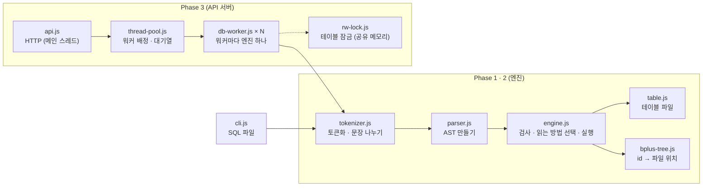
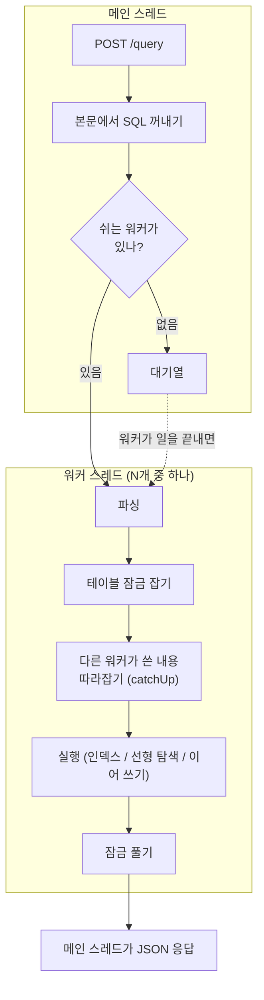

# Mini DBMS
SQL 처리기 → B+ 트리 인덱스 → 스레드 풀 API 서버, 세 단계로 만든 미니 DBMS.

## 0. 실행 방법
Node.js 20 이상이 필요하고, 설치할 패키지는 없다. (외부 라이브러리 0개)

Phase 1 · 2: SQL 파일을 명령줄로 실행
```bash
node cli.js sql/sample.sql
```
Phase 2: 100만 건을 넣고 인덱스 검색과 선형 탐색 비교
```bash
npm run bench
```
Phase 3: API 서버 실행 (포트 4000, 워커 스레드 4개)
```bash
npm start
```
```bash
curl -X POST http://127.0.0.1:4000/query -H "content-type: application/json" -d "{\"sql\":\"SELECT * FROM users WHERE id = 1\"}"
```
테스트 (86개)
```bash
npm test
```

테이블은 `data/schema.json`에 이미 정의돼 있다고 가정한다 (`CREATE TABLE` 없음).
```json
{ "users": { "id": "int", "name": "text", "age": "int", "city": "text" } }
```

## 1. 주요 기능 (5줄 요약)
- **SQL 처리기 (Phase 1)**: SQL 텍스트 파일을 CLI로 받아 토큰화 → 파싱 → 실행한다. `INSERT`는 테이블 파일 끝에 한 줄을 이어 쓰고, `SELECT`는 파일을 읽어 표로 출력한다
- **파일 기반 저장**: 테이블 하나가 파일 하나(`data/users.jsonl`). 레코드 하나가 한 줄이고, 한 줄은 값을 컬럼 순서대로 담은 JSON 배열이다
- **B+ 트리 인덱스 (Phase 2)**: `INSERT`할 때 id를 자동으로 붙이고 `id → 파일 안의 위치`를 메모리 B+ 트리에 등록한다. `WHERE id = ?`는 트리에서 위치를 찾아 그 한 줄만 읽는다
- **API 서버 + 스레드 풀 (Phase 3)**: 워커 스레드를 미리 만들어 두고, HTTP 요청마다 워커 하나를 배정해 SQL을 실행한다. 워커마다 Phase 1 + 2의 엔진을 하나씩 갖는다
- **동시성 제어**: 테이블마다 읽기-쓰기 잠금을 둔다. `SELECT`끼리는 동시에, `INSERT`는 혼자 실행된다. 잠금 상태는 스레드들이 함께 보는 메모리(`SharedArrayBuffer`)에 있다

## 2. 구조


| 파일 | Phase | 하는 일 |
|---|---|---|
| `src/tokenizer.js` | 1 | SQL 글자 → 토큰, `;` 기준으로 문장 나누기 |
| `src/parser.js` | 1 | 토큰 → AST (`INSERT`, `SELECT`) |
| `src/engine.js` | 1 · 2 | AST 실행: 값 검사, 읽는 방법(plan) 선택, 결과 만들기 |
| `src/table.js` | 1 · 2 | 테이블 파일에 이어 쓰기 / 한 줄 읽기 / 전체 훑기, 인덱스 구성 |
| `src/bplus-tree.js` | 2 | 메모리 기반 B+ 트리 (`insert` / `search` / `range`) |
| `src/thread-pool.js` | 3 | 워커 스레드 풀 (재사용, 대기열, 죽은 워커 교체) |
| `src/db-worker.js` | 3 | 워커 스레드가 실행하는 코드: 엔진으로 SQL 실행 |
| `src/rw-lock.js` | 3 | 스레드 간 읽기-쓰기 잠금 (`SharedArrayBuffer` + `Atomics`) |
| `src/api.js` | 3 | HTTP API 서버 |
| `cli.js` / `server.js` | 1 / 3 | 진입점 |

## 3. Phase 1 — SQL 처리기
`INSERT INTO users (name, age) VALUES ('김철수', 23);` 이 처리되는 순서 (입력 → 파싱 → 실행 → 저장)

1. **입력**: `cli.js`가 SQL 파일을 읽어 엔진에 넘긴다. 엔진은 `;` 기준으로 문장을 나눈다 (문자열·주석 안의 `;`는 무시)
2. **토큰화** `tokenize`: 글자를 의미 있는 조각으로 자른다 → `INSERT` `INTO` `users` `(` `name` `,` `age` `)` `VALUES` `(` `'김철수'` `,` `23` `)`
3. **파싱** `parse`: 토큰을 앞에서부터 읽으며 문법에 맞는지 확인하고 구조화한다
   ```json
   { "type": "insert", "table": "users", "columns": ["name", "age"], "rows": [["김철수", 23]] }
   ```
4. **실행** `engine.run`: 테이블과 컬럼이 있는지, 값의 개수와 타입이 맞는지 검사한다. 적지 않은 컬럼은 `NULL`로 채운다
5. **저장** `table.appendRows`: id를 붙여 파일 끝에 한 줄을 쓴다 → `[1,"김철수",23,null]`

지원하는 문법
```sql
INSERT INTO 테이블 [(컬럼, …)] VALUES (값, …) [, (값, …)] …;
SELECT * | 컬럼, … | COUNT(*) FROM 테이블
  [WHERE 조건 [AND 조건] …] [ORDER BY 컬럼 [ASC | DESC]] [LIMIT 개수];
-- 조건: 컬럼 = != <> < <= > >= 값,  컬럼 IS [NOT] NULL
```

**저장 포맷을 JSON 배열 한 줄로 정한 이유**: 문자열에 쉼표·따옴표·줄바꿈이 들어 있어도 `JSON.stringify`가 `\n`, `\"`로 바꿔 주므로 레코드가 반드시 한 줄에 들어간다. "한 줄 = 레코드 하나"가 지켜져야 파일 위치만으로 레코드를 읽을 수 있다. 숫자와 문자열, `null`의 구분도 그대로 남는다.

CLI 출력 예
```
+----+--------+-----+------+
| id | name   | age | city |
+----+--------+-----+------+
| 2  | 이영희 | 31  | 부산 |
+----+--------+-----+------+
(1건, 0.141ms, B+ 트리 인덱스 (id 한 건))
```
SQL이 틀리면 `오류 [bad.sql] 2번째 문장 (2번째 줄): FROM 이(가) 와야 하는데 'FORM' 이(가) 왔습니다`처럼 알리고 종료 코드 1로 끝난다.

## 4. Phase 2 — B+ 트리 인덱스
### B+ 트리의 모양
```
                 [ 3 | 5 ]                 ← 내부 노드: 길 안내만 한다 (값 없음)
               /     |     \
        [1 2] → [3 4] → [5 6 7]            ← 리프 노드: id 와 값(파일 위치)이 전부 여기에 있고, 옆 리프와 이어져 있다
```
- 노드 안의 키는 항상 정렬돼 있다
- 노드 하나에 키가 `order - 1`개(기본 63개)를 넘으면 **반으로 쪼개고** 가운데 키를 부모로 올린다. 쪼개기가 루트까지 올라가면 새 루트가 생겨 높이가 1 늘어난다 → 모든 리프의 깊이가 항상 같다
- 검색은 루트에서 리프까지 한 층씩 내려간다. 100만 건의 높이가 4였다. 즉 **노드 4개만 보면** 찾는다

### `WHERE id = ?`에서 인덱스를 쓰는 방법
인덱스에 넣는 값은 레코드 자체가 아니라 **그 줄이 파일의 몇 번째 바이트에서 시작하는지**다.

1. `INSERT`: 지금까지의 가장 큰 id + 1을 붙인다 → 파일 끝에 쓴다 → `tree.insert(id, 그 줄의 시작 위치)`
2. `SELECT … WHERE id = 3`: 엔진의 `choosePlan`이 WHERE 조건을 보고 읽는 방법을 고른다

| 조건 | 읽는 방법 | 하는 일 |
|---|---|---|
| `id = 3` | `INDEX_POINT` | 트리에서 위치를 찾아 그 한 줄만 읽는다 |
| `id >= 10 AND id < 20` | `INDEX_RANGE` | 시작 리프를 찾은 뒤 `next`를 따라 옆으로 이동하며 읽는다 |
| `name = '…'` 등 그 밖 | `FULL_SCAN` | 파일을 처음부터 끝까지 읽는다 (선형 탐색) |

인덱스로 찾은 뒤에도 나머지 조건(`AND city = '서울'`)은 그대로 확인한다. 인덱스는 파일에 저장하지 않고, 엔진을 열 때 파일을 한 번 훑어 다시 만든다 (100만 건에 약 0.15초).

### 100만 건 성능 비교
`npm run bench`로 실제 실행한 결과다. (Windows 11, Node.js 26, 2026-11-12 측정. 실행할 때마다 조금씩 달라진다)

대용량 데이터는 `bench/generate.js`가 **INSERT 문 SQL 파일**로 만들고, 그 파일을 `node cli.js`에 넘긴다. Phase 1의 SQL 처리기를 그대로 거친다.

레코드 1,000,000건 (테이블 파일 32.2 MB, B+ 트리 높이 4)

| 단계 | 걸린 시간 |
|---|---:|
| INSERT 문 SQL 파일 만들기 (28.5 MB) | 142 ms |
| `node cli.js insert.sql`로 1,000,000건 INSERT (파싱 + 파일 저장 + 인덱스 등록) | 1,054 ms |
| 엔진을 다시 열 때 파일에서 인덱스 재구성 | 149 ms |

| 조회 | 읽는 방법 | 평균 걸린 시간 |
|---|---|---:|
| `WHERE id = ?` (1,000번 평균) | B+ 트리 인덱스 | 0.0120 ms |
| `WHERE name = 'user?'` (5번 평균) | 선형 탐색 | 198.2 ms |
| `WHERE id >= ? AND id < ?` (100건) | B+ 트리 범위 검색 | 0.986 ms |
| `COUNT(*) WHERE age = 30` (16,667건) | 선형 탐색 | 231.6 ms |

같은 레코드 한 건을 찾을 때 인덱스 검색이 선형 탐색보다 **약 16,000배** 빨랐다. 선형 탐색은 조건에 맞는 레코드가 더 있는지 알 수 없어서, 찾는 레코드가 어디에 있든 파일을 끝까지 읽는다.

## 5. Phase 3 — API 서버와 스레드 풀
### 요청 하나가 처리되는 흐름


1. **메인 스레드**는 HTTP 요청을 받고 응답을 보내는 일만 한다. 데이터를 직접 건드리지 않는다
2. **스레드 풀** `pool.run`: 쉬는 워커가 있으면 바로 맡기고, 모두 일하는 중이면 대기열에 넣는다. 대기열이 꽉 차면 503으로 거절한다
3. **워커 스레드**가 자기 엔진으로 SQL을 실행한다. 엔진은 Phase 1 + 2의 코드 그대로다 (`createEngine`)
4. 결과를 메인 스레드에 돌려주면 메인 스레드가 응답한다. 워커는 대기열의 다음 일을 가져간다

스레드를 요청마다 새로 만들지 않고 풀로 두는 이유: 스레드를 만들 때마다 인덱스를 다시 구성해야 하고, 요청이 몰리면 스레드가 끝없이 늘어난다. 풀은 개수를 고정하고 재사용한다. 워커가 죽으면 맡고 있던 요청만 실패로 알리고 새 워커로 자리를 채운다.

### 내부 DB 엔진과 API 서버의 연결
Node.js의 워커 스레드는 **변수를 공유하지 않는다**. 그래서 B+ 트리 객체를 여러 스레드가 함께 쓸 수 없다. 이렇게 나눴다.

| 무엇 | 어디에 | 누가 쓰나 |
|---|---|---|
| 테이블 파일 | 디스크 | 모든 워커가 함께 (데이터의 기준) |
| 잠금 상태 | `SharedArrayBuffer` | 모든 워커가 함께 |
| B+ 트리 인덱스, 파서 | 워커마다 따로 | 그 워커만 |

다른 워커가 `INSERT`한 레코드는 내 인덱스에 없다. 그래서 워커는 문장을 실행하기 직전에 `catchUp`을 부른다. 파일에서 **내 인덱스가 아직 모르는 뒷부분만** 읽어 인덱스에 넣는다. 파일은 이어 쓰기만 하므로 "어디까지 읽었는지" 숫자 하나만 기억하면 된다.

### 멀티 스레드 동시성 이슈와 해결
잠금이 없으면 생기는 일
- 두 워커가 동시에 "가장 큰 id + 1"을 계산해 **같은 id**를 붙인다
- 한 워커가 줄을 쓰는 도중에 다른 워커가 읽어 **반쯤 쓰인 줄**을 본다

테이블마다 읽기-쓰기 잠금을 둔다 (`rw-lock.js`).

| 문장 | 잠금 | 규칙 |
|---|---|---|
| `SELECT` | 읽기 | 읽기끼리는 여러 워커가 동시에 들어간다 |
| `INSERT` | 쓰기 | 혼자만 들어간다. 그동안 읽기도 다른 쓰기도 기다린다 |

- 잠금 상태는 정수 하나다: `0` 아무도 없음, `n` 읽는 워커 n개, `-1` 쓰는 워커 1개
- "값을 읽고 → 비교하고 → 바꾸는" 사이에 다른 스레드가 끼어들면 둘이 동시에 잠금을 잡는다. `Atomics.compareExchange`는 이 세 단계를 끼어들 수 없는 한 동작으로 실행한다
- 잠금을 못 잡은 스레드는 `Atomics.wait`로 잠들고, 잠금이 풀리면 `Atomics.notify`로 깨어난다
- 쓰려고 기다리는 워커가 있으면 새 읽기는 양보한다 (읽기가 끊이지 않아 쓰기가 영영 못 들어가는 일을 막는다)
- 잠금을 10초 안에 못 잡으면 오류로 끝낸다 (요청이 영원히 멈추지 않게)
- 쓰기 잠금 안에서 `catchUp` → id 계산 → 파일 쓰기를 하므로 id가 겹치지 않는다

테스트로 확인한 것: 클라이언트 300개가 동시에 `INSERT` → id가 1~300 정확히 한 번씩, 파일도 300줄. 읽기와 쓰기를 섞어 동시에 보내도 두 건짜리 `INSERT`의 절반만 보이는 일이 없음.

### API
| 요청 | 하는 일 |
|---|---|
| `POST /query` ← `{ "sql": "…" }` 또는 SQL 글자 그대로 | SQL 실행 (문장 여러 개 가능). `200 { results, worker, elapsedMs }` / `400 { error }` |
| `GET /tables` | 테이블 목록, 컬럼, 레코드 수, B+ 트리 높이 |
| `GET /stats` | 스레드 풀 상태 (일하는 워커 수, 대기 중인 요청 수, 워커별 처리 건수) |
| `GET /health` | 서버 확인 |

`SELECT` 결과는 한 번에 최대 1,000건만 보내고, 잘렸으면 `truncated: true`로 알린다.

### 워커 스레드 수에 따른 처리 시간
`npm run bench:pool`로 실제 실행한 결과다. (CPU 코어 16개, 레코드 100만 건)

| 워커 스레드 | 서버 준비 (스레드마다 인덱스 구성) | 선형 탐색 16개 동시 요청 | 1개일 때 대비 |
|---:|---:|---:|---:|
| 1개 | 196 ms | 3,124 ms | 1.00배 |
| 2개 | 252 ms | 2,386 ms | 1.31배 빠름 |
| 4개 | 294 ms | 1,357 ms | 2.30배 빠름 |

선형 탐색은 CPU를 오래 쓰는 일이라 워커가 늘면 여러 코어에서 동시에 실행된다. 4배가 되지 않는 것은 워커들이 같은 파일을 읽고 메모리를 함께 쓰기 때문이다. 인덱스 조회 2,000개는 워커 수와 관계없이 300ms 안팎이었다. 조회 한 건이 0.01ms라서 HTTP 처리 시간이 대부분이다.

## 6. 테스트
`node:test`만 사용했다. 총 86개.

| 파일 (`src/__tests__/`) | 종류 | 검증하는 것 |
|---|---|---|
| `parser.test.js` | 단위 | 토큰화, 문장 나누기, `INSERT` / `SELECT` 파싱, 문법 오류 메시지 18종 |
| `bplus-tree.test.js` | 단위 | 삽입·검색, 리프 / 내부 노드 쪼개기, 범위 검색, 넣을 때마다 B+ 트리 규칙 검사, 10만 건 |
| `engine.test.js` | 기능 (Phase 1 · 2) | 파일에 저장되는 내용, 조회, 읽는 방법 선택, 인덱스 결과 = 선형 탐색 결과, 다시 열기 |
| `cli.test.js` | 기능 (Phase 1) | `node cli.js 파일`을 실제로 실행해 출력과 종료 코드 확인 |
| `thread-pool.test.js` | 단위 | 잠금 규칙, 스레드 4개의 공유 카운터, 풀의 병렬 실행·대기열·죽은 워커 교체 |
| `api.test.js` | 기능 (Phase 3) | 서버를 띄워 HTTP로 실행, 동시 `INSERT` 300개, 모든 워커가 같은 데이터를 보는지, 재시작 |

엣지 케이스로 확인한 것: 따옴표·쉼표·줄바꿈·역슬래시·이모지가 든 문자열, 빈 문자열, 음수·0·소수·큰 정수, `NULL` 비교, 없는 테이블 / 컬럼, 타입 불일치, 값 개수 불일치, id 직접 입력, 여러 묶음 중 하나만 틀린 `INSERT`(아무것도 저장하지 않음), 너무 큰 레코드, 빈 테이블, 빈 파일 / 주석뿐인 파일, 마지막 줄이 잘린 테이블 파일, 없는 id / 음수 id, SQL 주입처럼 보이는 문자열, 깨진 JSON 요청, 대기열 초과.

## 7. 한계와 실제 DBMS와의 차이
| 항목 | 이 구현 | 실제 DBMS |
|---|---|---|
| SQL | `INSERT`, `SELECT` (`AND`만, 조인 없음) | `UPDATE` / `DELETE` / `JOIN` / `OR` / 집계 등 |
| B+ 트리 | 메모리에 두고 시작할 때 다시 만든다. 삭제 없음 | 노드 하나가 디스크 블록 하나. 파일에 저장돼 있다 |
| 인덱스 대상 | id 하나 | 원하는 컬럼에 여러 개 |
| 인덱스 공유 | 워커마다 사본을 갖고 파일을 따라잡는다 (메모리를 워커 수만큼 쓴다) | 모든 스레드가 버퍼 풀의 같은 페이지를 본다 |
| 잠금 단위 | 테이블 전체 | 행 단위 잠금, MVCC |
| 트랜잭션 | 없음. 문장 하나는 전부 저장되거나 전부 안 되지만, 여러 문장을 묶을 수는 없다 | `BEGIN` / `COMMIT` / `ROLLBACK`, WAL |
| 디스크 반영 | 운영체제에 맡긴다 (`fsync` 하지 않음) | 커밋마다 로그를 `fsync` |
| 잠금을 잡은 워커가 죽으면 | 다른 워커는 10초 뒤 시간 초과 오류 | 죽은 세션의 잠금을 자동으로 회수 |
